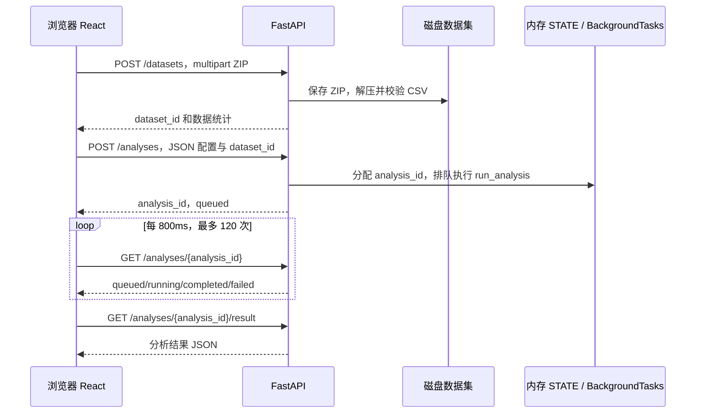

# 认证、请求流程与凭据处理

核查范围：当前主项目 `project/backend/app/`、`project/web/src/`、README、依赖文件及 Docker 配置；历史副本不是本说明的实现依据。

## 结论

这是研究演示原型，**当前没有应用用户认证和按用户授权**。后端未配置登录路由、密码数据库、JWT 校验、OAuth 提供商、会话认证或认证依赖。UUID 只是数据集/任务标识，不是访问令牌。

## 组件和源码依据

| 组件 | 代码位置 | 处理方式 |
|---|---|---|
| React 页面 | `web/src/main.tsx:7`、`:46–55` | `VITE_API_URL` 配置 API 地址，默认 `http://127.0.0.1:8000`；调用原生 fetch |
| FastAPI | `backend/app/main.py:24–25` | 注册应用和 CORS，没有身份验证中间件 |
| 数据上传 | `backend/app/main.py:33–56` | 校验 ZIP 和 CSV，生成 dataset_id，保存文件 |
| 后台分析 | `backend/app/main.py:59–78` | 校验数据集存在，生成 analysis_id，启动 BackgroundTasks |
| 状态和结果 | `backend/app/main.py:81–98` | 通过 analysis_id 查询 STATE；未检查资源所属用户 |
| 输入模型 | `backend/app/schemas.py` | 校验分析参数；不是身份校验 |
| 算法流水线 | `backend/app/pipeline.py:17` | 加载数据、执行模型和传播分析，不承担用户认证 |
| 部署 | `Dockerfile`、`docker-compose.yml`、`web/Dockerfile` | API 8000、Web 8080；静态前端由 Nginx 提供 |

上表路径相对 `project/`，行号对应本次源文件快照。

## 请求流程

这些请求均不要求登录或 Bearer token。前端 POST JSON 只显式设置 Content-Type；没有 Authorization 请求头，也没有显式启用跨源 Cookie。源码中没有凭据持久化到 localStorage/sessionStorage 的逻辑。

## 凭据、令牌和状态

- **密码和 token**：应用没有生成、存储、验证、刷新或撤销用户密码/token 的实现，因此没有密码哈希、refresh token 或 token 过期策略。
- **数据集 ID**：`uuid.uuid4().hex` 生成；文件保存在 `RIL_DATA_DIR/datasets/{dataset_id}`，默认根目录 `runtime-data`。上传 ZIP 也会保存。
- **任务 ID**：同样为 UUID；任务状态、错误和结果存在进程内全局 `STATE` 字典中。进程重启后这些状态丢失；这不是用户 session。
- **配置**：`RIL_DATA_DIR` 是路径，`VITE_API_URL` 是前端公开可见的服务地址，两者都不是秘密。
- **CORS**：只列出 `http://localhost:5173` 和 `http://localhost:8080`。这是浏览器跨源规则，不构成用户身份验证或 API 访问控制；`localhost` 与 `127.0.0.1` 的 Origin 不同。
- **GitHub 登录**：归档上传使用本机 GitHub CLI/Git 的账号授权，与应用无关。上传凭据不写入归档或项目配置。

## 当前行为的实际含义

能访问服务的人可以调用上传和创建分析接口；知道有效 analysis_id 的调用者可以查询对应任务及结果，后端没有用户归属检查。CORS 和随机 ID 都不能替代授权。

原 README 以本地开发为主要启动方式；Dockerfile 使用 `--host 0.0.0.0`，Compose 发布 8000/8080 端口。是否可从外部连接还取决于宿主机网络和防火墙。把 GitHub 仓库设为 Private 不会给这些运行中的接口增加认证。

若今后需要多用户部署，需另行实现身份提供商/登录、后端认证依赖，以及数据集和任务的 owner 校验；本次整理仅记录现状，没有改变应用行为。
