# 具有隐式动力学的层次化世界模型

## 译本说明

本译本对应 arXiv:2610.42146v1（2026-10-30）。作者：Gaoyue Zhou、Yvonne Wu、Zichen Jeff Cui、Nicolas Ballas、Mido Assran、Lerrel Pinto、Yann LeCun。按用户“只下载论文正文”的要求，完整翻译原文第 1–11 页，包括摘要、引言、相关工作、方法、实验、结论、局限性及致谢；参考文献第 12–16 页保留英文，附录第 17–26 页不翻译，也未另行下载 SI。图表与公式保留原图，图注和算法说明已译为中文。译文为 AI 辅助制作的非官方中文译本；保留作者署名及原文引文编号，具体技术含义以英文原文为准。

原文：https://arxiv.org/abs/2610.42146v1 。许可：CC BY 4.0（https://creativecommons.org/licenses/by/4.0/）。本版本对原文进行了中文翻译、段落重排和图表裁切；原作者未参与或认可本译本。

## 页码索引

[原文 p.1](#page-1) | [原文 p.2](#page-2) | [原文 p.3](#page-3) | [原文 p.4](#page-4) | [原文 p.5](#page-5) | [原文 p.6](#page-6) | [原文 p.7](#page-7) | [原文 p.8](#page-8) | [原文 p.9](#page-9) | [原文 p.10](#page-10) | [原文 p.11](#page-11)

## 术语表

| 英文 | 中文 |
| --- | --- |
| world model (WM) | 世界模型 |
| implicit dynamics | 隐式动力学 |
| hierarchical planning | 层次化规划 |
| reachability | 可达性 |
| subgoal | 子目标 |
| long-horizon | 长时域 |
| inverse dynamics solver | 逆动力学求解器 |
| latent space | 潜在空间 |
| Cross-Entropy Method (CEM) | 交叉熵方法 |
| Model Predictive Control (MPC) | 模型预测控制 |
| frameskip | 跳帧间隔 |
| DDPM | 去噪扩散概率模型 |
| DDIM | 去噪扩散隐式模型 |
| out-of-distribution (OOD) | 分布外 |
| coverage (Cov) | 覆盖率 |
| success rate (SR) | 成功率 |

## 原文第 1 页

**Source:** p.1 · P01B00

**Original:** Hierarchical World Models with Implicit Dynamics

**中文:** 具有隐式动力学的层次化世界模型

**Source:** p.1 · P01B01

**Original:** Gaoyue Zhou1,2 Yvonne Wu1 Zichen Jeff Cui1

**中文:** Gaoyue Zhou¹˒²、Yvonne Wu¹、Zichen Jeff Cui¹

**Source:** p.1 · P01B02

**Original:** Nicolas Ballas2 Mido Assran2 Lerrel Pinto1 Yann LeCun1,3

**中文:** Nicolas Ballas²、Mido Assran²、Lerrel Pinto¹、Yann LeCun¹˒³

**Source:** p.1 · P01B03

**Original:** 1Courant Institute, New York University 2Meta-FAIR 3AMI Labs Correspondence: gz2123@nyu.edu

**中文:** ¹纽约大学柯朗数学科学研究所；²Meta-FAIR；³AMI Labs。通信邮箱：gz2123@nyu.edu。

**Source:** p.1 · P01B04

**Original:** Abstract

**中文:** 摘要

**Source:** p.1 · P01B05

**Original:** Planning with world models enables test-time adaptation for embodied agents, offering superior generalization over direct policy learning. However, long-horizon tasks remain hindered by cumulative errors and search complexity. Existing hierarchical methods often use rigid macro-actions or latent skills, leading to brittle representations and limited fine-grained control. We introduce ID-WM (Implicit Dynamics World Models), a hierarchical world model that decouples state-space reachability from local control. Our framework utilizes a high-level model to sample feasible transitions across the state manifold and a low-level world model as an inverse dynamics solver to ground these transitions into precise actions. This allows the planner to identify reachable subgoals without being constrained by low-level execution details. By prioritizing local physical feasibility over global behavioral patterns, ID-WM synthesizes novel long-horizon plans from short segments, transcending the specific behavioral modes seen during training. We demonstrate its effectiveness across three navigation and manipulation suites, achieving a 38.5% improvement over state-of-the-art policy and diffusion-based planners. Crucially, by leveraging this hierarchical structure to mitigate compounding errors, our approach yields a 135% performance gain over single-level world model MPC, particularly in complex, unseen configurations for long-horizon tasks. Videos can be viewed at https://id-wm.github.io.

**中文:** 利用世界模型进行规划，能够使具身智能体在测试时适应新任务，其泛化能力优于直接学习策略。然而，长时域任务仍受累积误差与搜索复杂度的制约。现有层次化方法通常采用固定的宏动作或潜在技能，导致表征脆弱，且难以实现精细控制。我们提出隐式动力学世界模型（Implicit Dynamics World Models，ID-WM），这一层次化世界模型将状态空间可达性与局部控制解耦。该框架利用高层模型在状态流形上采样可行转移，并将低层世界模型用作逆动力学求解器，把这些转移落实为精确动作。因此，规划器能够识别可达子目标，而不受低层执行细节的束缚。ID-WM 优先关注局部物理可行性，而非全局行为模式，从而能够利用短片段合成新的长时域计划，超越训练期间出现的特定行为模式。我们在三个导航与操作环境系列中验证了其有效性；相较于当前先进的策略方法与扩散规划器，性能提升了 38.5%。更关键的是，通过利用层次结构缓解误差累积，相较于单层世界模型的模型预测控制（MPC），我们的方法取得了 135% 的性能提升，尤其适用于复杂、未见过配置下的长时域任务。演示视频见 https://id-wm.github.io/。

**Source:** p.1 · P01B06

**Original:** 1 Introduction

**中文:** 1 引言

**Source:** p.1 · P01B07

**Original:** World models (WM) [1, 2, 3] have emerged as a powerful paradigm for embodied decisionmaking [4, 5, 6, 7]. By learning predictive models of environment dynamics, they enable testtime reasoning and the synthesis of novel behaviors for unseen goals by searching in the action space [8, 9, 10, 11]. However, planning with WMs faces two fundamental challenges: 1) search complexity grows exponentially with planning horizon, and 2) prediction errors accumulate over long rollouts. Therefore, most WM-based planners are restricted to short-horizon tasks [8, 9], rely on simplified action abstractions [10], or operate in high-level spaces such as language, sacrificing fine-grained control [12].

**中文:** 世界模型（WM）[1, 2, 3] 已成为具身决策的一种强大范式 [4, 5, 6, 7]。通过学习环境动力学的预测模型，智能体可以在测试时进行推理，并通过在动作空间中搜索，为未见过的目标合成新的行为 [8, 9, 10, 11]。然而，使用世界模型进行规划面临两项根本挑战：一是搜索复杂度随规划时域呈指数增长，二是预测误差在长序列滚动预测中不断累积。因此，大多数基于世界模型的规划器只能处理短时域任务 [8, 9]，或者依赖简化的动作抽象 [10]，又或者在语言等高层空间中运行，从而牺牲精细控制能力 [12]。

**Source:** p.1 · P01B08

**Original:** Hierarchical learning offers a principled solution to this scalability challenge by decomposing longhorizon problems into manageable abstractions [13, 14, 15]. It has been extensively studied in Reinforcement Learning (RL) [16, 17, 18, 19], where hierarchy mitigates the credit assignment problem in long trajectories, and in imitation learning [20, 21], where it enables reusable behaviors. More recently, hierarchical structure has been introduced into diffusion-based planners to avoid directly modeling entire trajectories [22, 23, 24], improving scalability and generalization beyond fixed-horizon training data.

**中文:** 层次化学习通过将长时域问题分解为易于处理的抽象，为这一可扩展性难题提供了有原则的解决途径 [13, 14, 15]。这一方法已在强化学习（RL）[16, 17, 18, 19] 中得到广泛研究，层次结构能够缓解长轨迹中的信用分配问题；它也被用于模仿学习 [20, 21]，以支持可复用行为。近年来，研究者将层次结构引入基于扩散的规划器，避免直接建模完整轨迹 [22, 23, 24]，从而提升可扩展性，并实现对固定时域训练数据之外情形的泛化。

**Source:** p.1, 2 · P01B09

**Original:** How can we enable the same capabilities for task-agnostic world models, enabling long-horizon zeroshot planning for unseen goals? A direct approach would be to simply increase the prediction horizon or action abstraction (e.g., frame-skipping) [25]. However, previous attempts at hierarchical world models typically depend on task-specific priors to function effectively, relying on pre-trained skills and low-level policies [19, 26] or rewards and value functions to verify subgoal feasibility [27, 28]. This dependency arises because planning is fundamentally adversarial: without these anchoring constraints, a powerful optimizer will inevitably exploit deficiencies in a learned world model, discovering "wormholes" or unrealistic transitions [29, 30]. To make hierarchical world models suitable for planning, we must construct a latent space that both condenses trajectory information to minimize search complexity, and remains inherently well-behaved to prevent the planner from exploiting unrealistic transitions.

**中文:** 如何使与具体任务无关的世界模型也具备这样的能力，从而针对未见过的目标进行长时域零样本规划？一种直接做法是简单地增大预测时域，或提高动作抽象程度，例如采用跳帧 [25]。然而，以往层次化世界模型通常依赖任务特定先验才能有效运行：它们需要预训练技能与低层策略 [19, 26]，或依靠奖励和值函数验证子目标的可行性 [27, 28]。这种依赖源于规划过程本质上具有对抗性：如果缺乏这些约束，一个强大的优化器不可避免地会利用所学世界模型的缺陷，找到“虫洞”或不现实的转移 [29, 30]。要使层次化世界模型适用于规划，就必须构建一种潜在空间：既能压缩轨迹信息以降低搜索复杂度，又具有内在良好的性质，防止规划器利用不现实的转移。

## 原文第 2 页

**Source:** p.2 · P02B00

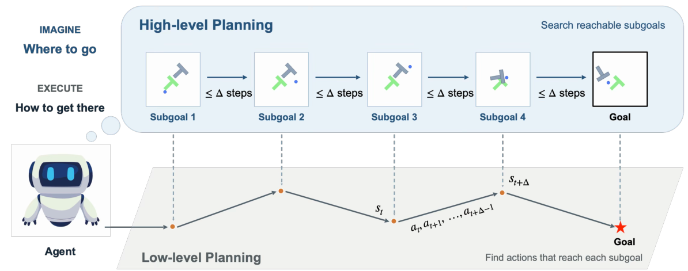

**Original:** Figure 1: Overview of ID-WM. Our hierarchical planning framework decouples state-space reachability from local control, eliminating the reliance on task-specific value functions or pre-trained policies. Planning proceeds in two interleaved stages: (1) high-level planning, which discovers a sequence of temporally abstract subgoals spaced ∆steps apart, and (2) low-level control, which leverages a world model as an inverse dynamics solver to extract executable actions between each subgoal.

**中文:** 图 1：ID-WM 概览。我们的层次化规划框架将状态空间可达性与局部控制解耦，消除了对任务特定值函数或预训练策略的依赖。规划过程交替进行两个阶段：（1）高层规划，寻找一系列在时间上抽象、彼此间隔 Δ 步的子目标；（2）低层控制，将世界模型用作逆动力学求解器，求得各子目标之间可执行的动作。

**Source:** p.2 · P02B02

**Original:** To this end, we introduce ID-WM, a hierarchical world model with implicit dynamics grounded in the insight that effective planning requires decoupling topological reachability from execution details (Figure 1). ID-WM consists of a high-level diffusion-based world model that only implicitly models the dynamics by outputting states that are within a fixed distance away from the current state, functioning as a neighboring state generator, and a deterministic low-level model conditioned on both current state and action, acting as an inverse dynamics solver. Conditioned on the current state and a Gaussian noise, the high-level model leverages the generative power of diffusion to map a tractable unit Gaussian latent space to the manifold of feasible neighboring states. This formulation allows us to treat the noise as an implicit high-level action, enabling the planner to search over a well-behaved distribution instead of complex, discontinuous skill spaces to reason purely about "where to go," while the low-level model recovers the precise executable actions for "how to get there."

**中文:** 为此，我们提出 ID-WM，一种具有隐式动力学的层次化世界模型，其核心认识是：有效规划需要将拓扑可达性与执行细节解耦（图 1）。ID-WM 包含一个基于扩散的高层世界模型，以及一个以当前状态和动作为条件的确定性低层模型。高层模型输出距离当前状态固定范围内的状态，仅以隐式方式建模动力学，发挥邻近状态生成器的作用；低层模型则作为逆动力学求解器。以当前状态和高斯噪声为条件，高层模型利用扩散模型的生成能力，将易于处理的标准高斯潜在空间映射至可行邻近状态的流形。这一表述允许我们把噪声视为隐式高层动作，使规划器能够在性质良好的分布中搜索，而不是在复杂、不连续的技能空间中搜索，从而专注于推理“去哪里”；低层模型则求得精确、可执行的动作，以解决“如何到达”。

**Source:** p.2 · P02B03

**Original:** We summarize our contributions as follows:

**中文:** 我们的贡献概括如下：

**Source:** p.2 · P02B04

**Original:** • We introduce ID-WM, a hierarchical world model that decouples reachability from control, eliminating the need for task-specific value functions or pre-trained policies. • We propose a corresponding hierarchical planning algorithm that bridges high-level abstraction with local dynamics, enabling robust, long-horizon decision-making. • Across three navigation and manipulation environment suites, ID-WM shows 38.5% improvement for reaching arbitrary goals against powerful hierarchical offline reinforcement learning, imitation learning, and diffusion planning methods, and crucially, a 135% improvement over single-level world model and planning regimes.

**中文:** • 提出 ID-WM，将可达性与控制解耦，无需任务特定值函数或预训练策略。
• 提出与之配套的层次化规划算法，将高层抽象与局部动力学连接起来，实现稳健的长时域决策。
• 在三个导航与操作环境系列中，针对到达任意目标的任务，相较于强大的层次化离线强化学习、模仿学习和扩散规划方法，ID-WM 的性能提升了 38.5%；相较于单层世界模型与规划方案，性能提升达 135%。

**Source:** p.2 · P02B05

**Original:** 2 Related Work

**中文:** 2 相关工作

**Source:** p.2 · P02B06

**Original:** 2.1 Hierarchical Learning

**中文:** 2.1 层次化学习

**Source:** p.2, 3 · P02B07

**Original:** Hierarchical learning has long been a foundational pursuit in artificial intelligence, decomposing long-horizon problems into manageable abstractions [13, 14, 15]. This paradigm spans policy architectures [31], reinforcement learning [16, 18, 27, 32], imitation learning [20], and planning [28, 33]. Existing work focuses on both behavioral (skills/options) [14, 19, 26, 34, 35, 36, 37] and subgoal-centric approaches [17, 28, 38]. However, these methods typically rely on coupled priors, such as rewards, learned value functions or pre-trained low-level policies [28, 32] to ensure feasibility, limiting generalization beyond the training distribution. In contrast, we eliminate this dependency, enabling robust hierarchical reasoning purely through implicit dynamics even when reliable value functions and policies are absent.

**中文:** 层次化学习长期以来一直是人工智能的基础研究方向，它将长时域问题分解为易于处理的抽象 [13, 14, 15]。这一范式涵盖策略架构 [31]、强化学习 [16, 18, 27, 32]、模仿学习 [20] 和规划 [28, 33]。现有工作既关注以行为为中心的方法，即技能或选项（options）[14, 19, 26, 34, 35, 36, 37]，也关注以子目标为中心的方法 [17, 28, 38]。然而，这些方法通常依赖奖励、学习得到的值函数或预训练低层策略等耦合先验来保证可行性 [28, 32]，限制了其向训练分布之外的泛化能力。我们消除了这种依赖，即使缺乏可靠的值函数和策略，也能仅凭隐式动力学进行稳健的层次化推理。

## 原文第 3 页

**Source:** p.3 · P03B01

**Original:** 2.2 World Models for Embodied Planning

**中文:** 2.2 用于具身规划的世界模型

**Source:** p.3 · P03B02

**Original:** World models [1, 2, 3] have emerged as a foundational paradigm for embodied decision-making, enabling agents to reason about the future consequences of their actions. Recently, the field has shifted towards developing general-purpose world models [5, 8, 10, 39, 40, 41] capable of capturing broad environmental dynamics, diverging from traditional model-based reinforcement learning (MBRL) where learning task-specific reward or value functions is paramount [42, 43, 44, 45, 46, 47, 48]. Once these dynamics are learned, inference-time planning algorithms like the Cross-Entropy Method (CEM) [49] or gradient descent—are employed to derive behaviors zero-shot [8, 9, 11, 50]. However, the effectiveness of these approaches is often constrained to short horizons due to the computational complexity of search and the accumulation of prediction errors over time. While various strategies have been proposed to mitigate these issues, ranging from robust gradient-based optimization [30, 51] and efficient sampling routines [52] to temporal approximations for longer action sequences [10], they remain fundamentally flat in their temporal reasoning. Consequently, they struggle with longhorizon task solving, remaining susceptible to local minima and limited in their scalability to complex behaviors. Concurrently, HWM [25] builds a hierarchical latent world model by increasing the high-level frameskip and learning macro-actions; in contrast, ID-WM searches over the diffusion noise space, which is smooth and well-conditioned by construction.

**中文:** 世界模型 [1, 2, 3] 已成为具身决策的基础范式，使智能体能够推理自身动作未来产生的后果。近年来，该领域开始转向开发能够捕捉广泛环境动力学的通用世界模型 [5, 8, 10, 39, 40, 41]；这不同于传统的基于模型的强化学习（MBRL），后者高度重视学习任务特定的奖励或值函数 [42, 43, 44, 45, 46, 47, 48]。一旦学到动力学，就可以在推理时使用交叉熵方法（CEM）[49] 或梯度下降等规划算法，以零样本方式求得行为 [8, 9, 11, 50]。但由于搜索的计算复杂度及预测误差随时间累积，这些方法通常仅在短时域内有效。已有多种策略尝试缓解这些问题，包括稳健的基于梯度的优化 [30, 51]、高效采样程序 [52]，以及针对较长动作序列的时间近似 [10]，但它们的时间推理在本质上仍是单层的。因此，它们难以解决长时域任务，仍容易陷入局部极小值，也难以扩展至复杂行为。同期工作 HWM [25] 通过增大高层跳帧间隔并学习宏动作来构建层次化潜在世界模型；ID-WM 则在扩散噪声空间中搜索，该空间在构造上平滑且条件良好。

**Source:** p.3 · P03B03

**Original:** 2.3 Diffusion Models and Planning

**中文:** 2.3 扩散模型与规划

**Source:** p.3 · P03B04

**Original:** Diffusion probabilistic models [53, 54, 55] excel at capturing complex, multimodal distributions via iterative denoising. Their efficacy is proven across high-dimensional modalities, including pixels [40, 41, 56, 57], language [58], and robot actions [59, 60]. Recently, diffusion models have been proposed as zero-shot planners for embodied tasks [61, 62, 63, 64]. These methods model entire trajectories directly, limiting generalization to out-of-distribution initial-goal pairs and constraining planning horizons to those seen during training. While hierarchical formulations mitigate these constraints, they rely on task-specific value functions [22, 23, 32], successful task trajectories [65], or assumed access to low-level primitives [24]. In contrast, we redefine diffusion as a local generator rather than a global planner. By delegating long-horizon reasoning to search, our method composes local jumps into novel trajectories without requiring task-specific priors.

**中文:** 扩散概率模型 [53, 54, 55] 擅长通过迭代去噪捕捉复杂的多模态分布，其有效性已在像素 [40, 41, 56, 57]、语言 [58] 和机器人动作 [59, 60] 等高维模态中得到证明。近期，扩散模型被用于具身任务的零样本规划 [61, 62, 63, 64]。这些方法直接建模完整轨迹，因而对分布外初始状态—目标状态组合的泛化能力有限，规划时域也受到训练数据时域的限制。虽然层次化表述能够缓解这些限制，但它们仍依赖任务特定值函数 [22, 23, 32]、成功完成任务的轨迹 [65]，或者假定能够使用低层动作原语 [24]。我们则将扩散重新定义为局部生成器，而非全局规划器。通过将长时域推理交由搜索完成，我们的方法可以把局部跳转组合为新轨迹，无需任务特定先验。

**Source:** p.3 · P03B05

**Original:** 3 Hierarchical World Models with Implicit Dynamics

**中文:** 3 具有隐式动力学的层次化世界模型

**Source:** p.3 · P03B06

**Original:** Overview and Problem Formulation. We consider a goal-conditioned planning problem within a Markov Decision Process (MDP) defined by the tuple M = (S, A, P), where S is the continuous state space, A is the action space, and P(st+1|s≤t, a≤t) represents the transition dynamics.

**中文:** 概述与问题定义。我们考虑马尔可夫决策过程（MDP）中的目标条件规划问题，其定义为三元组 M = (S, A, P)，其中 S 为连续状态空间，A 为动作空间，P(s[t+1] | s[≤t], a[≤t]) 表示转移动力学。

**Source:** p.3 · P03B07

**Original:** Following prior world modeling methods [8, 10, 11], we learn environment dynamics from a taskagnostic offline dataset without any reward labeling via a world model, and plan to reach arbitrary unseen goals at test time. More specifically, an agent is provided with an initial state o0 and a goal state og at test time. The objective is to execute a sequence of actions (a0, a1, . . . , aT −1) such that the distance between the agent’s final state oT and the goal og is minimized. Unlike prior work, we do not assume a fixed task horizon T [8], focusing instead on enabling the agent to perform autonomous long-horizon reasoning and planning.

**中文:** 沿用既有世界模型方法 [8, 10, 11]，我们通过世界模型，从与具体任务无关、没有任何奖励标注的离线数据集中学习环境动力学，并在测试时规划到达任意未见过的目标。具体而言，测试时向智能体提供初始状态 o₀ 和目标状态 o_g，目标是执行一系列动作 (a₀, a₁, …, a[T−1])，使最终状态 o_T 与目标 o_g 之间的距离最小。与已有工作不同，我们不假设固定的任务时域 T [8]，而是着重使智能体能够自主进行长时域推理与规划。

**Source:** p.3 · P03B08

**Original:** 3.1 Hierarchical World Models with Implicit Dynamics

**中文:** 3.1 具有隐式动力学的层次化世界模型

**Source:** p.3, 4 · P03B09

**Original:** The core component of ID-WM is a hierarchical world model comprising a high-level diffusion model and a low-level inverse dynamics model. As illustrated in Figure 2, the high-level model operates as a reachable state generator, predicting a distribution of feasible future states conditioned on the current state. The low-level model acts as an inverse dynamics solver, grounding these predicted transitions into executable actions.

**中文:** ID-WM 的核心是一个层次化世界模型，由高层扩散模型和低层逆动力学模型组成。如图 2 所示，高层模型作为可达状态生成器，以当前状态为条件，预测可行未来状态的分布；低层模型作为逆动力学求解器，将这些预测转移落实为可执行动作。

## 原文第 4 页

**Source:** p.4 · P04B00

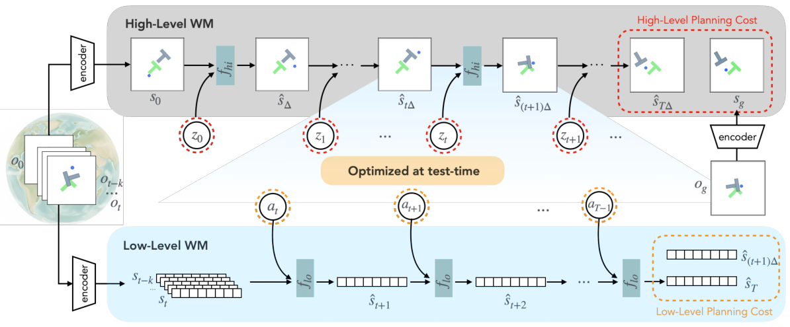

**Original:** Figure 2: Architecture of ID-WM. Given an initial observation o0 and a goal og, we optimize for both the sequence of subgoals s0, . . . , sT ∆and the executable actions at in an interleaved fashion. Here, fhi denotes the diffusion-based high-level world model and flo denotes the deterministic, transformer-based low-level world model, both of which predict in latent space.

**中文:** 图 2：ID-WM 的架构。给定初始观测 o₀ 和目标 o_g，我们交替优化子目标序列 s₀, …, s[TΔ] 以及可执行动作 a_t。其中，f_hi 表示基于扩散的高层世界模型，f_lo 表示基于 Transformer 的确定性低层世界模型，两者均在潜在空间中进行预测。

**Source:** p.4 · P04B02

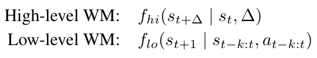

**Original:** High-level WM: fhi(st+∆| st, ∆) Low-level WM: flo(st+1 | st−k:t, at−k:t)

**中文:** 高层世界模型：f_hi(s[t+Δ] | s_t, Δ)。低层世界模型：f_lo(s[t+1] | s[t−k:t], a[t−k:t])。下图保留原文数学排版。

**Source:** p.4 · P04B03

**Original:** Specifically, the high-level world model conditions on the current state st and a temporal radius ∆, generating future states that fall within a ∆-step horizon. The low-level world model adopts the formulation from Zhou et al. [8], a transformer-based world model conditioning on a historical context of k past states and actions to infer immediate next steps.

**中文:** 具体而言，高层世界模型以当前状态 s_t 和时间半径 Δ 为条件，生成 Δ 步时域内的未来状态。低层世界模型采用 Zhou 等人 [8] 的表述：使用基于 Transformer 的世界模型，以过去 k 个状态与动作构成的历史上下文为条件，推断紧接着的下一步状态。

**Source:** p.4 · P04B05

**Original:** Both levels of the hierarchy share a unified structure, consisting of the following components:

**中文:** 层次结构中的两个层级采用统一结构，由以下部分组成：

**Source:** p.4 · P04B06

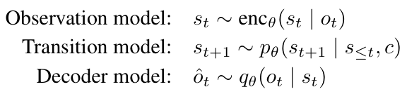

**Original:** Observation model: st ∼encθ(st | ot) Transition model: st+1 ∼pθ(st+1 | s≤t, c) Decoder model: ˆot ∼qθ(ot | st)

**中文:** 观测模型将观测 o_t 编码为潜在状态 s_t；转移模型在历史状态与上下文 c 的条件下预测下一潜在状态；解码模型由潜在状态重建观测。其原文数学定义如下。

**Source:** p.4 · P04B07

**Original:** where c is the context that the transition model takes in to make predictions. For fhi, c is the temporal distance ∆, instructing how far away the subgoals should be. For flo, c is the sequence of executable actions the agent has taken up to time t (i.e., a≤t).

**中文:** 其中，c 是转移模型进行预测时输入的上下文。对于 f_hi，c 是时间距离 Δ，用于指定子目标应距离当前状态多远；对于 f_lo，c 是智能体截至时刻 t 已执行的动作序列，即 a[≤t]。

**Source:** p.4 · P04B08

**Original:** 3.1.1 High-level Implicit Dynamics Model

**中文:** 3.1.1 高层隐式动力学模型

**Source:** p.4 · P04B09

**Original:** To model the manifold of reachable states without restricting the agent to a fixed set of discrete skills, we formulate the high-level world model as a conditional diffusion probabilistic model (DDPM) [54]. Let x0 represent the target future state st+∆(at a fixed temporal offset ∆). The forward diffusion process q(xj|xj−1) gradually adds Gaussian noise to the data according to a variance schedule β1, . . . , βK:

**中文:** 为了建模可达状态流形，同时避免把智能体限制在一组固定的离散技能上，我们将高层世界模型表述为条件去噪扩散概率模型（DDPM）[54]。令 x₀ 表示目标未来状态 s[t+Δ]，其时间偏移 Δ 固定。前向扩散过程 q(x_j | x[j−1]) 按照方差调度 β₁, …, β_K，逐渐向数据添加高斯噪声：

**Source:** p.4 · P04B10

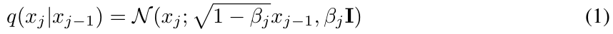

**Original:** q(x_j|x_{j-1}) = N(x_j; sqrt(1-beta_j) x_{j-1}, beta_j I) (1)

**中文:** 式（1）：前向扩散过程。均值为 √(1−β_j) x[j−1]，协方差为 β_j I。

**Source:** p.4 · P04B13

**Original:** This allows us to sample xj at any arbitrary diffusion step j in closed form. We learn a conditional denoising network ϵθ(xj, j, st) to reverse this process, where st is the current state to condition the generation. The training objective is to predict the noise ϵ added to the clean data x0:

**中文:** 这样，我们就可以在任意扩散步 j 以闭式形式采样 x_j。我们学习条件去噪网络 ε_θ(x_j, j, s_t) 来逆转这一过程，其中 s_t 是控制生成过程的当前状态。训练目标是预测添加到干净数据 x₀ 上的噪声 ε：

**Source:** p.4 · P04B14

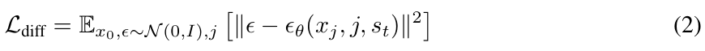

**Original:** L_diff = E_{x_0,epsilon~N(0,I),j}[||epsilon-epsilon_theta(x_j,j,s_t)||^2] (2)

**中文:** 式（2）：扩散模型的噪声预测训练目标，最小化真实噪声与网络预测噪声之间的平方误差期望。

**Source:** p.4, 5 · P04B18

**Original:** Sampling as Implicit Dynamics (DDIM). To represent the high-level decision at environment time t, we let zt ∈Rd denote the initial noise vector xK used for sampling the next subgoal. During inference, we employ Denoising Diffusion Implicit Models (DDIM) [55] to deterministically map this noise vector zt ∼N(0, I) to a generated subgoal ˆst+∆. The deterministic reverse step from diffusion step j to j −1 is given by:

**中文:** 将采样作为隐式动力学（DDIM）。为表示环境时刻 t 的高层决策，令 z_t ∈ R^d 表示用于采样下一子目标的初始噪声向量 x_K。在推理时，我们使用去噪扩散隐式模型（DDIM）[55]，将噪声向量 z_t ∼ N(0, I) 确定性地映射为生成子目标 ŝ[t+Δ]。从扩散步 j 到 j−1 的确定性反向更新如下：

## 原文第 5 页

**Source:** p.5 · P05B01

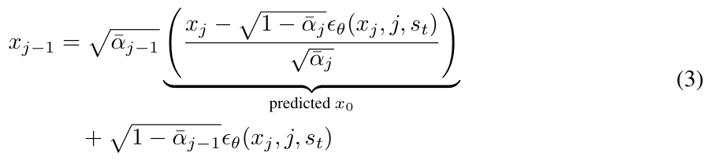

**Original:** x_{j-1} = sqrt(alpha_bar_{j-1}) [(x_j-sqrt(1-alpha_bar_j) epsilon_theta(x_j,j,s_t))/sqrt(alpha_bar_j)] + sqrt(1-alpha_bar_{j-1}) epsilon_theta(x_j,j,s_t) (3)

**中文:** 式（3）：DDIM 的确定性反向更新。其中带下括号的一项为预测的 x₀。

**Source:** p.5 · P05B10

**Original:** where α_j = 1 − β_j and ᾱ_j = ∏_{i=1}^j α_i. This formulation effectively parameterizes the high-level transition dynamics as a deterministic function G_θ(s_t, z_t).

**中文:** 其中，α_j = 1−β_j，ᾱ_j 为从 i=1 到 j 的 α_i 连乘积。这一表述实际上将高层转移动力学参数化为确定性函数 G_θ(s_t, z_t)。

**Source:** p.5 · P05B12

**Original:** Implicit High-Level Action Space. A key insight of our approach is to treat the initial noise vector zt as an implicit high-level action. Unlike discrete skill indices or learned latent codes which may suffer from mode collapse or topological discontinuities, illustrated in Section 6.13, the noise space Z = Rd is inherently smooth and well-behaved (isotropic Gaussian). By optimizing over zt, the planner searches over the standard Gaussian latent space, where any sample z maps to a physically valid reachable state on the data manifold via the deterministic DDIM mapping.

**中文:** 隐式高层动作空间。我们方法的一个关键认识是将初始噪声向量 z_t 视为隐式高层动作。离散技能索引或学习得到的潜在编码可能出现模式坍塌或拓扑不连续（见第 6.13 节）；与之不同，噪声空间 Z = R^d 天然平滑，且具有良好性质，即各向同性高斯分布。通过优化 z_t，规划器在标准高斯潜在空间中搜索；其中任一噪声样本 z 都经由确定性 DDIM 映射，得到数据流形上物理有效的可达状态。

**Source:** p.5 · P05B13

**Original:** 3.1.2 Low-level World Model

**中文:** 3.1.2 低层世界模型

**Source:** p.5 · P05B14

**Original:** The high-level World Model (WM) provides long-horizon guidance by identifying target states, yet it lacks the granular transition dynamics necessary to prescribe executable actions. To this end, we employ a transformer-based deterministic low-level WM following Zhou et al. [8], which functions as an inverse dynamics model through planning.

**中文:** 高层世界模型通过确定目标状态提供长时域引导，但缺乏指定可执行动作所需的细粒度转移动力学。为此，我们沿用 Zhou 等人 [8] 的方法，采用基于 Transformer 的确定性低层世界模型，并通过规划使其发挥逆动力学模型的作用。

**Source:** p.5 · P05B15

**Original:** Given a history of states st−k:t and actions at−k:t, the low-level WM predicts the next state ˆst+1 = flo(st−k:t, at−k:t). The model is trained via supervised learning to minimize the prediction error:

**中文:** 给定历史状态 s[t−k:t] 和动作 a[t−k:t]，低层世界模型预测下一状态 ŝ[t+1] = f_lo(s[t−k:t], a[t−k:t])。通过监督学习训练该模型，以最小化预测误差：

**Source:** p.5 · P05B16

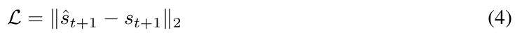

**Original:** L = ∥ˆst+1 −st+1∥2 (4)

**中文:** 式（4）：下一状态预测的平方误差损失。

**Source:** p.5 · P05B17

**Original:** Consistent with Zhou et al. [8], we utilize an MLP action encoder to process raw action sequences before they are input into the transformer backbone.

**中文:** 与 Zhou 等人 [8] 一致，我们使用多层感知机（MLP）动作编码器，在原始动作序列输入 Transformer 主干网络之前对其进行处理。

**Source:** p.5 · P05B18

**Original:** At inference, we leverage this model for inverse dynamics through planning. Given a target state s∗, we search for an optimal action sequence (a0, . . . , aHlo−1) over a low-level planning horizon Hlo such that the planning cost ∥ˆsHlo −s∗∥2 is minimized. We detail the full hierarchical planning procedure in Section 3.2.

**中文:** 推理时，我们通过规划将该模型用于逆动力学求解。给定目标状态 s*，在低层规划时域 H_lo 内搜索最优动作序列 (a₀, …, a[H_lo−1])，使规划代价 ‖ŝ[H_lo]−s*‖² 最小。完整的层次化规划过程见第 3.2 节。

**Source:** p.5 · P05B19

**Original:** 3.2 Hierarchical Planning with ID-WM

**中文:** 3.2 使用 ID-WM 进行层次化规划

**Source:** p.5 · P05B20

**Original:** At inference, given an initial state o0 and a goal state og, we employ hierarchical planning to determine a sequence of actions that reaches og. We formulate this as a Model Predictive Control (MPC) problem, where each iteration consists of two phases: subgoal generation and subgoal realization. The overall hierarchical planning procedure is detailed in Algorithm 1. We also include a full version in Algorithm 2. Throughout, ∆denotes the temporal radius of each subgoal (the maximum number of environment steps between consecutive subgoals), Hhi the number of subgoals per high-level plan, and Hlo the low-level planning horizon used to reach each subgoal.

**中文:** 推理时，给定初始状态 o₀ 与目标状态 o_g，我们通过层次化规划确定到达目标的动作序列。我们将其表述为模型预测控制（MPC）问题，每轮迭代包含子目标生成与子目标实现两个阶段。总体流程见算法 1，完整版本另见算法 2。全文中，Δ 表示每个子目标的时间半径，即连续子目标之间最多相隔的环境步数；H_hi 表示每个高层计划中的子目标数量；H_lo 表示到达各子目标所用的低层规划时域。

**Source:** p.5 · P05B21

**Original:** Subgoal Search via High-level WM. In the first phase, we identify a sequence of latent subgoals s*_0, …, s*_{Hhi} such that s*_0 = s_0 and s*_{Hhi} = s_g. To ensure that each subgoal remains within the reachable manifold of the low-level WM given its search budget, we constrain the distance between consecutive subgoals s*_i, s*_{i+1} to be no more than Δ environment steps. We optimize the latent noise variables z_0, …, z_{Hhi−1} using the Cross-Entropy Method (CEM) to minimize the following planning cost:

**中文:** 通过高层世界模型搜索子目标。在第一阶段，我们寻找潜在子目标序列 s*₀, …, s*[H_hi]，使 s*₀ = s₀，且 s*[H_hi] = s_g。为了保证在给定搜索预算下，每个子目标仍位于低层世界模型的可达流形内，我们约束相邻子目标 s*_i 与 s*[i+1] 之间的距离不超过 Δ 个环境步。使用交叉熵方法（CEM）优化潜在噪声变量 z₀, …, z[H_hi−1]，使下列规划代价最小：

**Source:** p.5 · P05B26

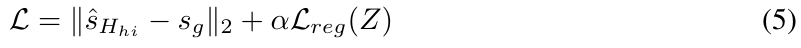

**Original:** L = ∥ˆsHhi −sg∥2 + αLreg(Z) (5)

**中文:** 式（5）：高层规划代价，由最终预测状态与目标状态的平方距离，以及加权噪声正则项构成。

**Source:** p.5 · P05B27

**Original:** where Lreg is a regularization term designed to keep the sampled noise within the support of the standard Gaussian distribution. This prevents the planner from exploiting adversarial regions of the latent space that would result in out-of-distribution transitions during DDIM sampling.

**中文:** 其中，L_reg 是一个正则项，旨在使采样噪声保持在标准高斯分布的支撑域内。这样可以防止规划器利用潜在空间中的对抗性区域，否则 DDIM 采样可能产生分布外转移。

**Source:** p.5, 6 · P05B28

**Original:** Subgoal Realization via Low-level WM. We similarly employ the CEM optimizer to identify the executable action sequences required to reach each intermediate subgoal. The agent plans and executes actions to reach the immediate subgoal, proceeding sequentially through the high-level trajectory. Upon completing the sequence for all subgoals generated by the high-level WM, the agent initiates a new MPC iteration to replan the high-level trajectory from its current state.

**中文:** 通过低层世界模型实现子目标。我们同样使用 CEM 优化器，寻找到达每个中间子目标所需的可执行动作序列。智能体先规划并执行动作，以到达最近的子目标，然后沿高层轨迹依次推进。当高层世界模型生成的所有子目标序列执行完毕后，智能体开启新一轮 MPC 迭代，从当前状态重新规划高层轨迹。

## 原文第 6 页

**Source:** p.6 · P06B01

**Original:** Latent Noise Regularization. While the latent space is theoretically structured as a unit Gaussian, unconstrained planning can favor adversarial latents that produce unrealistic state transitions. To mitigate this, we incorporate a regularization term in the high-level planning cost:

**中文:** 潜在噪声正则化。虽然潜在空间在理论上具有标准高斯结构，但无约束规划可能偏向会产生不现实状态转移的对抗性潜在变量。为缓解这一问题，我们在高层规划代价中引入正则项：

**Source:** p.6 · P06B02

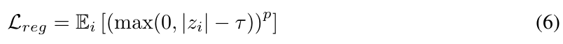

**Original:** Lreg = Ei [(max(0, |zi| −τ))p] (6)

**中文:** 式（6）：对潜在噪声中绝对值超过阈值 τ 的分量施加 p 次幂惩罚，并对分量 i 求平均。

**Source:** p.6 · P06B03

**Original:** This term penalizes latent vectors whose magnitude exceeds a threshold τ, ensuring the optimization stays within high-density regions of the prior. We examine the effect of noise regularization in Section 6.6.

**中文:** 该项惩罚幅值超过阈值 τ 的潜在向量，确保优化保持在先验分布的高密度区域内。噪声正则化的影响见第 6.6 节。

**Source:** p.6 · P06B04

**Original:** Algorithm 1 Hierarchical Planning with ID-WM

**中文:** 算法 1：使用 ID-WM 进行层次化规划

**Source:** p.6 · P06B05

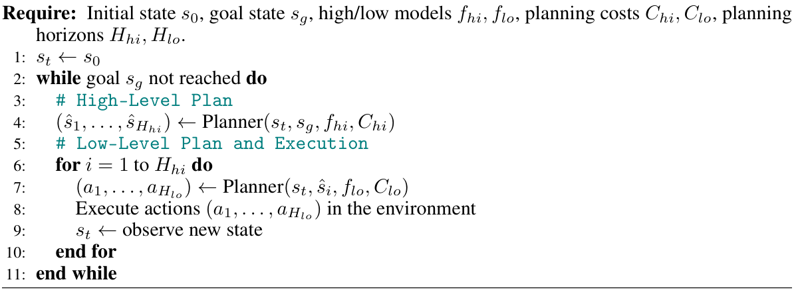

**Original:** Require: Initial state s0, goal state sg, high/low models fhi, flo, planning costs Chi, Clo, planning horizons Hhi, Hlo. 1: st ←s0 2: while goal sg not reached do 3: # High-Level Plan 4: (ˆs1, . . . , ˆsHhi) ←Planner(st, sg, fhi, Chi) 5: # Low-Level Plan and Execution 6: for i = 1 to Hhi do 7: (a1, . . . , aHlo) ←Planner(st, ˆsi, flo, Clo) 8: Execute actions (a1, . . . , aHlo) in the environment 9: st ←observe new state 10: end for 11: end while

**中文:** 输入：初始状态 s₀、目标状态 s_g、高层与低层模型 f_hi 和 f_lo、规划代价 C_hi 和 C_lo，以及规划时域 H_hi 和 H_lo。
1. 初始化 s_t ← s₀。
2. 当尚未到达目标 s_g 时，重复以下过程。
3. 高层规划：用 Planner(s_t, s_g, f_hi, C_hi) 求得子目标序列 (ŝ₁, …, ŝ[H_hi])。
4. 低层规划与执行：依次遍历 i = 1, …, H_hi。
5. 用 Planner(s_t, ŝ_i, f_lo, C_lo) 求得动作序列 (a₁, …, a[H_lo])。
6. 在环境中执行这一动作序列，并观测新状态，更新 s_t。
7. 完成子目标遍历后，返回高层规划，直至到达目标。

**Source:** p.6 · P06B07

**Original:** 4 Experiments

**中文:** 4 实验

**Source:** p.6 · P06B08

**Original:** Our experiments are designed to answer the following key questions:

**中文:** 我们的实验旨在回答以下关键问题：

**Source:** p.6 · P06B09

**Original:** • Subgoal Generation: Can ID-WM reliably generate diverse and feasible reachable states?

**中文:** • 子目标生成：ID-WM 能否可靠地生成多样且可行的可达状态？

**Source:** p.6 · P06B10

**Original:** • Generalization: Can ID-WM solve long-horizon planning tasks to reach arbitrary, zeroshot goals at test time?

**中文:** • 泛化能力：ID-WM 能否在测试时解决长时域规划任务，以零样本方式到达任意目标？

**Source:** p.6 · P06B11

**Original:** • Scaling: How does the performance of ID-WM scale across environments of increasing complexity?

**中文:** • 可扩展性：随着环境复杂度增加，ID-WM 的性能如何变化？

**Source:** p.6 · P06B12

**Original:** • Visual Planning: Is ID-WM effective for long-horizon planning directly from highdimensional visual observations?

**中文:** • 视觉规划：ID-WM 能否直接根据高维视觉观测进行有效的长时域规划？

**Source:** p.6 · P06B13

**Original:** 4.1 Environments

**中文:** 4.1 环境

**Source:** p.6 · P06B14

**Original:** We evaluate ID-WM on three navigation and manipulation environment suites as shown in Figure 3. The environments are Wall, PushT, and Maze, with task horizon ranging from hundreds to thousands of environment steps. A full description of the environments is detailed in Section 6.1.

**中文:** 如图 3 所示，我们在三个导航与操作环境系列中评估 ID-WM，分别是 Wall、PushT 和 Maze。任务时域从数百步到数千个环境步不等。环境的完整描述见第 6.1 节。

**Source:** p.6 · P06B15

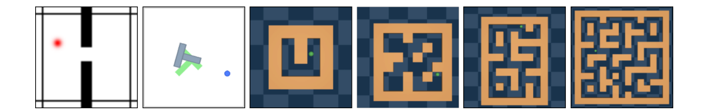

**Original:** Figure 3: We evaluate ID-WM on three environment suites (Wall, PushT, Maze); from left to right: Wall, PushT, and the four maze sizes (U-, Medium, Large, Giant).

**中文:** 图 3：我们在三个环境系列（Wall、PushT、Maze）中评估 ID-WM。从左到右依次为 Wall、PushT，以及四种大小的迷宫（U 型、中型、大型、巨型）。

## 原文第 7 页

**Source:** p.7 · P07B00

**Original:** 4.2 Baselines

**中文:** 4.2 基线方法

**Source:** p.7 · P07B01

**Original:** We compare ID-WM with five state-of-the-art offline learning methods including imitation learning (GCBC), offline RL (HIQL), diffusion planners (Diffuser, Hierarchical Diffuser), and planning with world models (Single-level WM with MPC). See Section 6.4 for full details.

**中文:** 我们将 ID-WM 与五种先进的离线学习方法比较，包括模仿学习（GCBC）、离线强化学习（HIQL）、扩散规划器（Diffuser、Hierarchical Diffuser），以及使用世界模型进行规划的方法，即结合 MPC 的单层世界模型。完整细节见第 6.4 节。

**Source:** p.7 · P07B02

**Original:** 4.3 Generating Neighboring States with ID-WM

**中文:** 4.3 使用 ID-WM 生成邻近状态

**Source:** p.7 · P07B03

**Original:** We first investigate the extent to which each level of ID-WM accurately captures the underlying data distribution and predicts future states across varying temporal granularities. Specifically, for the high-level WM, we evaluate whether sampling from the latent prior yields diverse and reachable future states.

**中文:** 我们首先考察 ID-WM 的各个层级在多大程度上能够准确捕捉底层数据分布，并在不同时间粒度下预测未来状态。对于高层世界模型，我们具体评估从潜在先验中采样是否能够得到多样且可达的未来状态。

**Source:** p.7 · P07B04

**Original:** In Figure 4, we sample 100 latent noise vectors z ∼N(0, I) and visualize the resulting generated states ˆs∆= fhi(s0, z, ∆) reachable within a ∆-step horizon. For each ∆, we overlay all 100 generated samples to visualize the predicted state distribution, explicitly marking the agent’s position with a black dot for clarity.

**中文:** 在图 4 中，我们采样 100 个潜在噪声向量 z ∼ N(0, I)，并可视化由此生成、在 Δ 步时域内可达的状态 ŝ_Δ = f_hi(s₀, z, Δ)。对于每个 Δ，我们叠加全部 100 个生成样本，以展示预测状态分布；为便于辨认，用黑点明确标示智能体的位置。

**Source:** p.7 · P07B05

**Original:** As illustrated in Figure 4, the high-level WM generates diverse and physically reachable states for both the Wall and PushT environments. In the Wall environment, the dispersion of agent positions increases with ∆, reflecting a larger reachable radius as the temporal budget grows. Similarly, in the PushT environment, we observe an increasingly diffused distribution of both the agent and the T-block. The smooth coverage of object configurations demonstrates that the model successfully captures the complex, multi-modal interactions between the agent and the object. This high-fidelity distribution modeling serves as a necessary prerequisite for planning, enabling the system to generate diverse trajectories and generalize effectively to unseen goals in downstream tasks.

**中文:** 如图 4 所示，高层世界模型在 Wall 和 PushT 环境中都生成了多样且物理可达的状态。在 Wall 环境中，智能体位置的离散程度随 Δ 增大而增加，反映了时间预算增加时可达半径相应扩大。同样，在 PushT 环境中，智能体与 T 形块的位置分布都变得更加分散。物体配置的平滑覆盖表明，模型成功捕捉了智能体与物体之间复杂、多模态的交互。这种高保真的分布建模是规划的必要前提，使系统能够生成多样轨迹，并在下游任务中有效泛化至未见目标。

**Source:** p.7 · P07B06

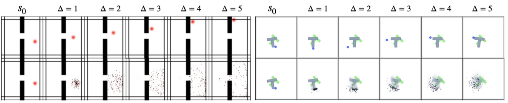

**Original:** Figure 4: Diverse neighboring states generated with the high-level WM of ID-WM.

**中文:** 图 4：ID-WM 高层世界模型生成的多样邻近状态。

**Source:** p.7 · P07B07

**Original:** 4.4 Hierarchical Planning with ID-WM

**中文:** 4.4 使用 ID-WM 进行层次化规划

**Source:** p.7 · P07B08

**Original:** Can ID-WM solve long-horizon planning tasks to reach arbitrary, zero-shot goals at test time? To this end, we conduct hierarchical planning on three environment suites.

**中文:** ID-WM 能否在测试时解决长时域规划任务，以零样本方式到达任意目标？为此，我们在三个环境系列中进行层次化规划。

**Source:** p.7 · P07B09

**Original:** For all environments and baselines, we randomly sample 50 pairs of initial and goal states, with sampling method detailed in Section 6.2, and report the average performance across these instances. For the PushT task, we report two metrics: the success rate and the final coverage of the T-block relative to the target configuration. A trial is considered successful only if both the agent and the T-block reach their respective goal positions. In contrast, the final coverage metric provides a more granular measure of performance by focusing specifically on the object’s alignment. To further evaluate generalization capabilities, we test PushT under two settings: a standard regime and a data-augmented regime featuring random spatial transformations and rotations. All experiments are conducted with a maximum horizon of 2000 environment steps. For all experiments, ID-WM uses ∆= 5 (25 environment steps with frameskip) and Hhi = 5 subgoals per high-level plan, without per-task tuning; the planner replans after each executed plan (up to 15 replans), so no prior knowledge of the goal distance is required. We ablate ∆and the number of subgoals in Section 6.7.

**中文:** 对于所有环境与基线，我们随机采样 50 对初始状态和目标状态，采样方法详见第 6.2 节，并报告这些实例上的平均性能。对于 PushT 任务，报告成功率，以及 T 形块相对于目标配置的最终覆盖率两项指标。只有当智能体与 T 形块均到达各自目标位置时，才判定试验成功；最终覆盖率则专门关注物体的对齐程度，提供更细致的性能度量。为进一步评估泛化能力，我们在标准设置和经过随机空间变换与旋转的数据增强设置下测试 PushT。所有实验的最大时域均为 2000 个环境步。所有实验中，ID-WM 统一使用 Δ = 5（考虑跳帧后相当于 25 个环境步），每个高层计划含 H_hi = 5 个子目标，不针对任务单独调参；规划器在每个计划执行后重新规划，最多重规划 15 次，因此无需预先知道到目标的距离。我们在第 6.7 节对 Δ 和子目标数量进行了消融研究。

**Source:** p.7, 8 · P07B11

**Original:** In Table 1, ID-WM outperforms all baselines, achieving a 38.5% overall improvement and 135% gain over single-level WM with MPC (SL-WM). The gap is most evident in PushT with random goals, where ID-WM is the only approach exceeding a 30% success rate without augmentation. While SL-WM performs well on shorter horizons (Maze, Wall), it fails on PushT’s long-horizon requirements (often > 100 steps) due to exponential search complexity and compounding prediction errors. Unlike the 25-step benchmark in Zhou et al. [8], our results show that standard WM planning cannot solve these extended tasks, a limitation our hierarchical approach effectively addresses. We visualize the resulting high-level plans in Figure 5 and examine subgoal quality and diversity in Sections 4.3 and 6.12.

**中文:** 表 1 中，ID-WM 优于所有基线，总体提升 38.5%，相较于结合 MPC 的单层世界模型（SL-WM）提升 135%。在随机目标 PushT 中差距最为明显：未经数据增强时，只有 ID-WM 的成功率超过 30%。虽然 SL-WM 在较短时域环境（Maze、Wall）中表现良好，但由于搜索复杂度呈指数增长及预测误差累积，它无法满足 PushT 的长时域要求，后者往往超过 100 步。不同于 Zhou 等人 [8] 中的 25 步基准，我们的结果表明，标准世界模型规划无法解决这些扩展任务，而层次化方法有效解决了这一局限。图 5 展示了得到的高层计划，第 4.3 节和第 6.12 节进一步分析子目标的质量与多样性。

## 原文第 8 页

**Source:** p.8 · P08B00

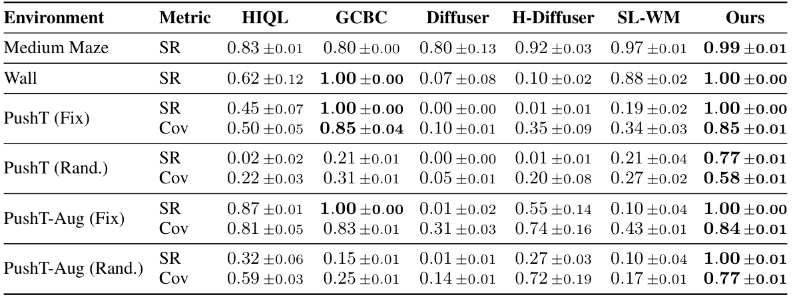

**Original:** Table 1: Performance comparison across environments. We report success rate (SR) and, for PushT, final coverage (Cov), as mean ± std over three seeds. PushT is evaluated with a fixed goal (Fix) and random goals (Rand.). Best results per row are in bold. Environment Metric HIQL GCBC Diffuser H-Diffuser SL-WM Ours Medium Maze SR 0.83 ±0.01 0.80 ±0.00 0.80 ±0.13 0.92 ±0.03 0.97 ±0.01 0.99 ±0.01 Wall SR 0.62 ±0.12 1.00 ±0.00 0.07 ±0.08 0.10 ±0.02 0.88 ±0.02 1.00 ±0.00 PushT (Fix) SR 0.45 ±0.07 1.00 ±0.00 0.00 ±0.00 0.01 ±0.01 0.19 ±0.02 1.00 ±0.00 Cov 0.50 ±0.05 0.85 ±0.04 0.10 ±0.01 0.35 ±0.09 0.34 ±0.03 0.85 ±0.01 PushT (Rand.) SR 0.02 ±0.02 0.21 ±0.01 0.00 ±0.00 0.01 ±0.01 0.21 ±0.04 0.77 ±0.01 Cov 0.22 ±0.03 0.31 ±0.01 0.05 ±0.01 0.20 ±0.08 0.27 ±0.02 0.58 ±0.01 PushT-Aug (Fix) SR 0.87 ±0.01 1.00 ±0.00 0.01 ±0.02 0.55 ±0.14 0.10 ±0.04 1.00 ±0.00 Cov 0.81 ±0.05 0.83 ±0.01 0.31 ±0.03 0.74 ±0.16 0.43 ±0.01 0.84 ±0.01 PushT-Aug (Rand.) SR 0.32 ±0.06 0.15 ±0.01 0.01 ±0.01 0.27 ±0.03 0.10 ±0.04 1.00 ±0.01 Cov 0.59 ±0.03 0.25 ±0.01 0.14 ±0.01 0.72 ±0.19 0.17 ±0.01 0.77 ±0.01

**中文:** 表 1：跨环境性能比较。报告成功率（SR），以及 PushT 的最终覆盖率（Cov）；结果为三个随机种子上的均值 ± 标准差。PushT 分别采用固定目标（Fix）和随机目标（Rand.）进行评估。每行最佳结果以粗体标示。

**Source:** p.8 · P08B08

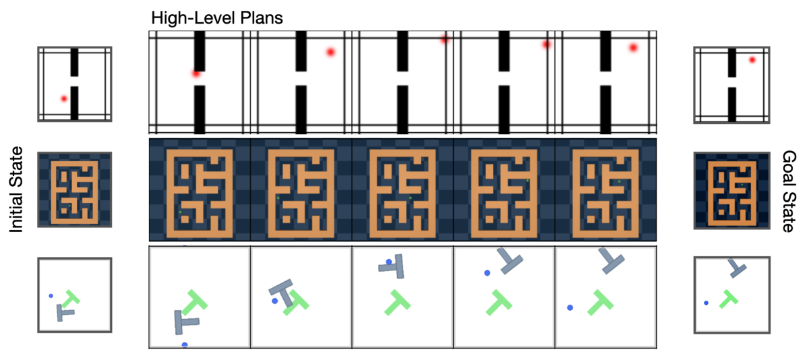

**Original:** Figure 5: High-level subgoals planned by ID-WM. The planned sequence successfully guides the agent to the target goal while ensuring that consecutive subgoals satisfy local reachability constraints.

**中文:** 图 5：ID-WM 规划的高层子目标。规划得到的序列成功引导智能体到达目标，同时保证连续子目标满足局部可达性约束。

**Source:** p.8 · P08B10

**Original:** Furthermore, the remaining baselines exhibit distinct failure modes. GCBC performs well on indistribution goals (e.g., fixed-goal PushT) and in environments with dense data coverage (Medium Maze, Wall) but degrades significantly on out-of-distribution (OOD) goals. HIQL shows potential for OOD generalization but demands dense data coverage to accurately learn value functions, reflected in its performance gap between PushT and PushT-Aug. Diffuser-based methods struggle with dataset noise; despite adding replanning (Section 6.11.8), performance remains poor. While H-Diffuser offers marginal improvements, it still relies heavily on dense data. Even with data augmentation (Section 6.3), H-Diffuser’s success rate remains low, primarily because it struggles to jointly attend to both the object and the agent’s final position.

**中文:** 其他基线呈现出不同的失效模式。GCBC 在分布内目标（如固定目标 PushT）和数据覆盖密集的环境（Medium Maze、Wall）中表现良好，但在分布外（OOD）目标上的性能显著下降。HIQL 具有分布外泛化潜力，但需要密集的数据覆盖才能准确学习值函数，其在 PushT 与 PushT-Aug 之间的性能差距体现了这一点。基于 Diffuser 的方法难以应对数据集噪声；即使加入重新规划（第 6.11.8 节），表现仍然不佳。H-Diffuser 虽带来小幅改进，但仍高度依赖密集数据。即便经过数据增强（第 6.3 节），H-Diffuser 的成功率仍然很低，主要原因是它难以同时兼顾物体与智能体的最终位置。

**Source:** p.8 · P08B11

**Original:** Comparison with hierarchical latent world models. We additionally compare with HWM [25], a hierarchical world model that increases the frameskip of its high-level model and compresses action sequences into macro-actions with a transformer-based action encoder. We compare with the DINO-WM variant of HWM. As shown in Table 2, on PushT, which requires long-horizon object manipulation, ID-WM outperforms HWM by a large margin on all variants. This highlights the benefit of disentangling state reachability from fine-grained control using diffusion noise as an implicit latent action.

**中文:** 与层次化潜在世界模型比较。我们还与 HWM [25] 比较。HWM 通过增大高层模型的跳帧间隔，并用基于 Transformer 的动作编码器将动作序列压缩成宏动作，构建层次化世界模型。我们采用 HWM 的 DINO-WM 变体进行比较。如表 2 所示，在需要长时域物体操作的 PushT 上，ID-WM 在所有变体中均大幅优于 HWM。这说明，将扩散噪声用作隐式潜在动作、从而将状态可达性与精细控制解耦具有优势。

## 原文第 9 页

**Source:** p.9 · P09B00

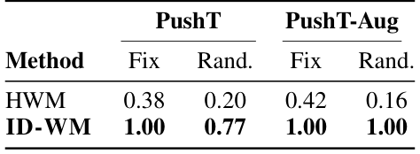

**Original:** Table 2: Success rate of ID-WM and HWM on PushT environments with fixed (Fix) and random (Rand.) goals. PushT PushT-Aug Method Fix Rand. Fix Rand. HWM 0.38 0.20 0.42 0.16 ID-WM 1.00 0.77 1.00 1.00

**中文:** 表 2：固定目标（Fix）与随机目标（Rand.）PushT 环境中，ID-WM 与 HWM 的成功率。

**Source:** p.9 · P09B06

**Original:** Unlike approaches that explicitly model dataset behavior, ID-WM is not constrained by the underlying training distribution. By leveraging full planning over the environment dynamics, our method is inherently capable of finding diverse solutions for a given goal. Figure 6 demonstrates this by showing two different subgoal sequences generated by ID-WM. For instance, Plan 1 (top row) rotates the T-block counterclockwise, while Plan 2 (bottom row) rotates it clockwise. Ultimately, both planned trajectories successfully achieve the final objective via our hierarchical framework.

**中文:** 与显式建模数据集行为的方法不同，ID-WM 不受底层训练分布的束缚。通过围绕环境动力学进行完整规划，我们的方法本身能够为给定目标找到多样解。图 6 展示了 ID-WM 生成的两条不同子目标序列：计划 1（上行）逆时针旋转 T 形块，计划 2（下行）顺时针旋转 T 形块。两条规划轨迹最终都通过层次化框架成功实现目标。

**Source:** p.9 · P09B04

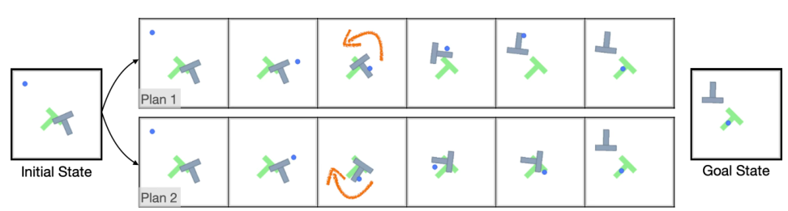

**Original:** Figure 6: Diverse plans generated by ID-WM. The top and bottom rows illustrate distinct strategies: counterclockwise and clockwise rotations of the T-block, both resulting in successful task completion.

**中文:** 图 6：ID-WM 生成的多样计划。上、下两行分别展示逆时针与顺时针旋转 T 形块的不同策略，两者都成功完成任务。

**Source:** p.9 · P09B07

**Original:** 4.5 How does ID-WM scale with task complexity?

**中文:** 4.5 ID-WM 如何随任务复杂度扩展？

**Source:** p.9 · P09B08

**Original:** We investigate whether ID-WM scales to tasks of increasing complexity across two dimensions: environment size and goal horizon.

**中文:** 我们从环境大小与目标时域两个维度，研究 ID-WM 能否扩展到复杂度不断增加的任务。

**Source:** p.9 · P09B09

**Original:** Scaling with Maze Size. We evaluate ID-WM across four mazes of increasing difficulty: U-Maze (3 × 3), Medium Maze (6 × 6), Large Maze (7 × 10), and Giant Maze (13 × 13) (Figure 7a). Each dataset contains 2,000 random 100-step trajectories. Given a fixed dataset size, data coverage naturally becomes sparser as maze size increases.

**中文:** 随迷宫大小扩展。我们在四种难度递增的迷宫中评估 ID-WM：U-Maze（3 × 3）、Medium Maze（6 × 6）、Large Maze（7 × 10）和 Giant Maze（13 × 13），见图 7a。每个数据集含 2000 条随机的 100 步轨迹。在数据集大小固定时，迷宫越大，数据覆盖自然越稀疏。

**Source:** p.9, 10 · P09B10

**Original:** While all methods achieve near-perfect success on the U-Maze, baselines degrade significantly in larger environments (Figure 7a). In contrast, ID-WM maintains the highest performance on the Large Maze. We hypothesize this is because ID-WM combines local dynamics modeling with high-level planning, effectively "stitching" together regions of sparse data. Unlike GCBC or Diffuser (which model entire trajectories simultaneously) or HIQL (which requires dense data for global value functions), ID-WM does not rely on global trajectory coverage. Furthermore, while H-Diffuser uses abstraction, it lacks an explicit dynamics model, resulting in brittle plans requiring expensive, high-frequency replanning. By grounding its hierarchy in explicit local dynamics, ID-WM generates robust, scalable plans.

**中文:** 虽然所有方法在 U-Maze 中的成功率都接近完美，但基线在更大环境中的性能显著下降（图 7a）。相较之下，ID-WM 在 Large Maze 中保持最高性能。我们推测，这是因为 ID-WM 将局部动力学建模与高层规划结合起来，有效“拼接”数据稀疏区域。不同于同时建模完整轨迹的 GCBC 或 Diffuser，以及需要密集数据来学习全局值函数的 HIQL，ID-WM 不依赖全局轨迹覆盖。此外，H-Diffuser 虽然使用抽象，但缺乏显式动力学模型，因此生成的计划较脆弱，需要代价高昂的高频重规划。通过将层次结构建立在显式局部动力学之上，ID-WM 能够生成稳健、可扩展的计划。

## 原文第 10 页

**Source:** p.10 · P10B01

**Original:** Scaling with Goal Horizon. Building on the PushT planning benchmark introduced by Zhou et al. [8] (which evaluates goals 25 steps away), we increase complexity by sampling goals from the validation set that are d ∈{25, 50, . . . , 150} steps away.

**中文:** 随目标时域扩展。基于 Zhou 等人 [8] 提出的 PushT 规划基准，该基准评估距离当前状态 25 步的目标，我们从验证集中采样距离为 d ∈ {25, 50, …, 150} 步的目标，以提高任务复杂度。

**Source:** p.10 · P10B02

**Original:** We compare ID-WM against a single-level world model baseline that performs full-horizon CEM search and replanning at every step. While the total number of executed actions is identical, ID-WM achieves a near-perfect success rate across all horizons as shown in Figure 7b). This confirms our main PushT results (Table 1), demonstrating that ID-WM maintains precise goal-reaching capabilities even when goals are over 150 steps away.

**中文:** 我们将 ID-WM 与单层世界模型基线比较，后者在完整时域内进行 CEM 搜索，并在每一步重新规划。尽管执行动作总数相同，ID-WM 在所有时域下的成功率都接近完美，如图 7b 所示。这印证了 PushT 的主要结果（表 1），说明即便目标距离超过 150 步，ID-WM 仍能保持精确的目标到达能力。

**Source:** p.9 · P09B05

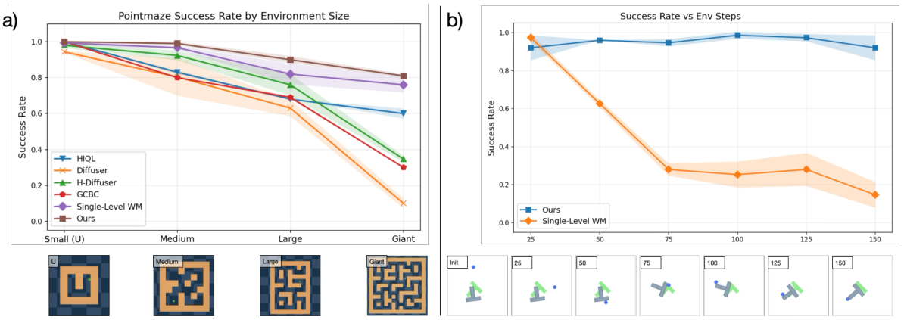

**Original:** Figure 7: Planning performance with increasing task complexity. In a), we test ID-WM’s ability on Maze with increasing sizes. In b), we test ID-WM on increasingly longer horizon PushT tasks.

**中文:** 图 7：任务复杂度增加时的规划性能。a）在大小逐渐增加的 Maze 环境中测试 ID-WM；b）在时域逐渐延长的 PushT 任务中测试 ID-WM。

**Source:** p.10 · P10B03

**Original:** 4.6 Vision-based Planning with ID-WM

**中文:** 4.6 基于视觉的 ID-WM 规划

**Source:** p.10 · P10B04

**Original:** To evaluate ID-WM in high-dimensional observation spaces, we test it on a vision-based PushT task. We use the state-based PushT dataset augmented with four 90◦rotations for spatial robustness. Observations (3 × 64 × 64 images) are encoded into 4 × 8 × 8 latents using a pretrained Stable Diffusion VAE [66]. We compare against AVDC [64], a language-conditioned video planner that generates all subgoals simultaneously (details in Section 6.4).

**中文:** 为评估 ID-WM 在高维观测空间中的表现，我们在基于视觉的 PushT 任务中进行测试。我们对基于状态的 PushT 数据集进行四种以 90° 为间隔的旋转增强，以提高空间鲁棒性。利用预训练的 Stable Diffusion 变分自编码器（VAE）[66]，将 3 × 64 × 64 的观测图像编码为 4 × 8 × 8 的潜在表示。我们与 AVDC [64] 比较；它是一种以语言为条件、同时生成全部子目标的视频规划器，细节见第 6.4 节。

**Source:** p.10 · P10B05

**Original:** As shown in Figure 8, ID-WM generates reliable, sequential subgoals that ensure steady progress. In contrast, AVDC fails to produce meaningful plans, likely because the initial-goal pairs are out-ofdistribution. This highlights the generalization advantage of iterative subgoal search over simultaneous generation—which relies heavily on trajectory-level dataset coverage—even within compressed visual spaces.

**中文:** 如图 8 所示，ID-WM 生成可靠的顺序子目标，保证持续推进。相较之下，AVDC 未能生成有意义的计划，可能是因为初始状态—目标状态组合处于分布之外。这说明，即便在压缩后的视觉空间中，迭代子目标搜索也比高度依赖轨迹层面数据覆盖的同时生成方法具有更强的泛化优势。

**Source:** p.10 · P10B06

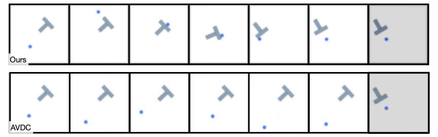

**Original:** Figure 8: Subgoals generated by ID-WM on a visual PushT task. The first column denotes the starting state, and the last shaded column denotes the desired goal state. ID-WM generates reliable, sequential subgoals that drive steady progress toward the goal state without any degenerate states.

**中文:** 图 8：ID-WM 在视觉 PushT 任务中生成的子目标。第一列表示初始状态，最后带阴影的一列表示期望目标状态。ID-WM 生成可靠的顺序子目标，使状态持续向目标推进，且未出现退化状态。

**Source:** p.10 · P10B07

**Original:** Quantitative evaluation. To complement the qualitative comparison, we report success rates on vision-based PushT in Table 3. We compare against two additional baselines: DINO-WM [8], a flat single-level world model planner, and HWM [25], a concurrent hierarchical latent world model that uses a larger frameskip for its high-level model. In this setting, ID-WM uses DINO-WM as its low-level world model, so the comparison between DINO-WM and ID-WM isolates the gain provided by the hierarchy. We evaluate four settings: for d ∈{25, 50, 75}, the goal is sampled from a held-out validation set and is known to be d steps away; for Random Goal, both the initial and goal states are sampled randomly from the environment. ID-WM achieves the best performance on the most challenging long-horizon settings (d = 50, d = 75, and Random Goal), demonstrating its effectiveness for long-horizon vision-based planning.

**中文:** 定量评估。为补充定性比较，我们在表 3 中报告视觉 PushT 的成功率，并增加两项基线：单层世界模型规划器 DINO-WM [8]，以及同期提出、在高层模型中使用更大跳帧间隔的层次化潜在世界模型 HWM [25]。在这一设置中，ID-WM 使用 DINO-WM 作为低层世界模型，因此二者的比较能够单独考察层次结构带来的收益。我们评估四种设置：对于 d ∈ {25, 50, 75}，从留出的验证集中采样目标，并已知目标距离当前状态 d 步；对于随机目标（Random Goal），初始状态和目标状态均从环境中随机采样。ID-WM 在最具挑战性的长时域设置（d = 50、d = 75，以及随机目标）中表现最佳，体现了其在长时域视觉规划中的有效性。

**Source:** p.10 · P10B08

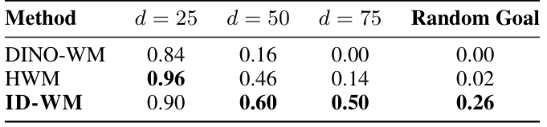

**Original:** Table 3: Success rate on vision-based PushT. For d ∈{25, 50, 75} the goal is d steps away; Random Goal samples both the initial and goal states randomly. Method d = 25 d = 50 d = 75 Random Goal DINO-WM 0.84 0.16 0.00 0.00 HWM 0.96 0.46 0.14 0.02 ID-WM 0.90 0.60 0.50 0.26

**中文:** 表 3：视觉 PushT 任务的成功率。对于 d ∈ {25, 50, 75}，目标距离为 d 步；随机目标设置对初始状态和目标状态均进行随机采样。

## 原文第 11 页

**Source:** p.11 · P11B00

**Original:** 5 Conclusion

**中文:** 5 结论

**Source:** p.11 · P11B01

**Original:** We present ID-WM, a hierarchical world modeling and planning framework that decouples temporally extended subgoal generation from local reachability. By treating diffusion noise as implicit actions, we constrain the planning search space to a unit Gaussian, ensuring reliable subgoal generation. ID-WM significantly outperforms state-of-the-art baselines and demonstrates high-quality vision-based subgoal generation. Ultimately, grounding hierarchical abstraction in explicit local dynamics represents a promising step toward robust, long-horizon decision-making.

**中文:** 我们提出 ID-WM，一种层次化世界建模与规划框架，将跨较长时间跨度的子目标生成与局部可达性解耦。通过把扩散噪声视为隐式动作，我们将规划搜索空间约束在标准高斯分布中，保证子目标生成的可靠性。ID-WM 显著优于先进基线，并展示了高质量的视觉子目标生成能力。将层次化抽象建立在显式局部动力学之上，是迈向稳健长时域决策的一条有前景的路径。

**Source:** p.11 · P11B02

**Original:** Limitations. First, ID-WM’s reliance on search-based optimization within a diffusion latent space incurs higher inference times than reactive policies or deterministic world models. Future work will explore amortized or gradient-based planning to mitigate this bottleneck. Second, while our hierarchy prevents planning complexity from scaling with trajectory length, it still scales with state-space dimensionality. Integrating compact, structured representation learning could further streamline this planning process for highly complex environments.

**中文:** 局限性。首先，ID-WM 依赖扩散潜在空间中的搜索优化，因此其推理耗时高于反应式策略或确定性世界模型。未来将探索摊销式或基于梯度的规划，以缓解这一瓶颈。其次，虽然层次结构避免规划复杂度随轨迹长度增长，但复杂度仍会随状态空间维数增大。结合紧凑、结构化的表示学习，有望进一步简化高度复杂环境中的规划过程。

**Source:** p.11 · P11B03

**Original:** Acknowledgments and Disclosure of Funding

**中文:** 致谢与资助披露

**Source:** p.11 · P11B04

**Original:** We would like to thank Amir Bar, Alfredo Canziani, Yilun Kuang, Hengkai Pan, Mike Rabbat, Ying Wang, and Wancong Zhang for their valuable discussion and feedback. This work was supported by AFOSR under grant FA95502310139, the Institute of Information & Communications Technology Planning & Evaluation (IITP) with a grant funded by the Ministry of Science and ICT (MSIT) of the Republic of Korea in connection with the Global AI Frontier Lab International Collaborative Research Agreement (No. RS-2024-00469482 & RS-2024-00509279).

**中文:** 感谢 Amir Bar、Alfredo Canziani、Yilun Kuang、Hengkai Pan、Mike Rabbat、Ying Wang 和 Wancong Zhang 提供的宝贵讨论与反馈。本工作获得美国空军科学研究办公室（AFOSR）资助，项目号 FA95502310139；同时获得韩国科学技术信息通信部（MSIT）出资、由信息通信技术规划评估院（IITP）提供的资助，属于全球人工智能前沿实验室国际合作研究协议的一部分，项目号为 RS-2024-00469482 和 RS-2024-00509279。

## 参考文献（保留英文书目信息）

### 原文第 12 页

References

 [1] Derrick Nguyen and Bernard Widrow. The truck backer-upper: an example of self-learning in neural
     networks. IJCNN, 1989. 1, 3

 [2] David Ha and Jürgen Schmidhuber. World models. CoRR, abs/1803.10122, 2018. URL http://arxiv.
    org/abs/1803.10122. 1, 3

 [3] Yann LeCun. A path towards autonomous machine intelligence. OpenReview, 2022. Version 0.9.2,
    https://openreview.net/forum?id=BZ5a1r-kVsf. 1, 3

 [4] Anthony Hu, Lloyd Russell, Hudson Yeo, Zak Murez, George Fedoseev, Alex Kendall, Jamie Shotton, and
     Gianluca Corrado. Gaia-1: A generative world model for autonomous driving. ArXiv, abs/2309.17080,
     2023. URL https://api.semanticscholar.org/CorpusID:263310665. 1

 [5] Danijar Hafner, Wilson Yan, and Timothy Lillicrap. Training agents inside of scalable world models. arXiv
     preprint arXiv:2509.24527, 2025. 1, 3

 [6] Nicklas Hansen, Hao Su, and Xiaolong Wang. Learning massively multitask world models for contin-
     uous control. ArXiv, abs/2511.19584, 2025. URL https://api.semanticscholar.org/CorpusID:
    283251537. 1

 [7] Lin Li, Qihang Zhang, Yiming Luo, Shuai Yang, Ruilin Wang, Fei Han, Mingrui Yu, Zelin Gao, Nan Xue,
    Xing Zhu, et al. Causal world modeling for robot control. arXiv preprint arXiv:2601.21998, 2026. 1

 [8] Gaoyue Zhou, Hengkai Pan, Yann LeCun, and Lerrel Pinto. DINO-WM: world models on pre-trained
      visual features enable zero-shot planning. In Aarti Singh, Maryam Fazel, Daniel Hsu, Simon Lacoste-Julien,
     Felix Berkenkamp, Tegan Maharaj, Kiri Wagstaff, and Jerry Zhu, editors, Forty-second International
     Conference on Machine Learning, ICML 2025, Vancouver, BC, Canada, July 13-19, 2025, volume
    267 of Proceedings of Machine Learning Research. PMLR / OpenReview.net, 2025. URL https:
    //proceedings.mlr.press/v267/zhou25t.html. 1, 3, 4, 5, 7, 10, 17, 18, 22

 [9] Mido Assran, Adrien Bardes, David Fan, Quentin Garrido, Russell Howes, Matthew Muckley, Ammar
      Rizvi, Claire Roberts, Koustuv Sinha, Artem Zholus, et al. V-jepa 2: Self-supervised video models enable
     understanding, prediction and planning. arXiv preprint arXiv:2506.09985, 2025. 1, 3

[10] Amir Bar, Gaoyue Zhou, Danny Tran, Trevor Darrell, and Yann LeCun.  Navigation world models.
     In IEEE/CVF Conference on Computer Vision and Pattern Recognition, CVPR 2025, Nashville, TN,
    USA, June 11-15, 2025, pages 15791–15801. Computer Vision Foundation / IEEE, 2025. doi: 10.1109/
     CVPR52734.2025.01472. URL https://openaccess.thecvf.com/content/CVPR2025/html/Bar_
    Navigation_World_Models_CVPR_2025_paper.html. 1, 3, 21

[11] Raktim Gautam Goswami, Amir Bar, David Fan, Tsung-Yen Yang, Gaoyue Zhou, Prashanth Krishnamurthy,
     Michael Rabbat, Farshad Khorrami, and Yann LeCun. World models can leverage human videos for
     dexterous manipulation. CoRR, abs/2512.13644, 2025. doi: 10.48550/ARXIV.2512.13644. URL https:
    //doi.org/10.48550/arXiv.2512.13644. 1, 3

[12] Delong Chen, Theo Moutakanni, Willy Chung, Yejin Bang, Ziwei Ji, Allen Bolourchi, and Pascale Fung.
     Planning with reasoning using vision language world model. arXiv preprint arXiv:2509.02722, 2025. 1

[13] Jürgen Schmidhuber. Learning to generate sub-goals for action sequences. In Artificial neural networks,
     pages 967–972, 1991. 1, 2

[14] Richard S. Sutton, Doina Precup, and Satinder Singh. Between mdps and semi-mdps: A framework
      for temporal abstraction in reinforcement learning.  Artif. Intell., 112:181–211, 1999. URL https:
    //api.semanticscholar.org/CorpusID:76564. 1, 2, 3

[15] Andrew G. Barto and Sridhar Mahadevan. Recent advances in hierarchical reinforcement learning. Discrete
     Event Dynamic Systems, 13:41–77, 2003. URL https://api.semanticscholar.org/CorpusID:
     386824. 1, 2

[16] Alexander Sasha Vezhnevets, Simon Osindero, Tom Schaul, Nicolas Heess, Max Jaderberg, David Silver,
     and Koray Kavukcuoglu. Feudal networks for hierarchical reinforcement learning. In Doina Precup and
    Yee Whye Teh, editors, Proceedings of the 34th International Conference on Machine Learning, ICML
     2017, Sydney, NSW, Australia, 6-11 August 2017, volume 70 of Proceedings of Machine Learning Research,
     pages 3540–3549. PMLR, 2017. URL http://proceedings.mlr.press/v70/vezhnevets17a.html.
      1, 3

### 原文第 13 页

[17] Ofir Nachum, Shixiang Shane Gu, Honglak Lee, and Sergey Levine. Data-efficient hierarchical reinforce-
     ment learning. In Neural Information Processing Systems, 2018. URL https://api.semanticscholar.
    org/CorpusID:43920938. 1, 3

[18] Seohong Park, Dibya Ghosh, Benjamin Eysenbach, and Sergey Levine. HIQL: offline goal-conditioned
   RL with latent states as actions. In Alice Oh, Tristan Naumann, Amir Globerson, Kate Saenko, Moritz
     Hardt, and Sergey Levine, editors, Advances in Neural Information Processing Systems 36: Annual
     Conference on Neural Information Processing Systems 2023, NeurIPS 2023, New Orleans, LA, USA,
    December 10 - 16, 2023, 2023. URL http://papers.nips.cc/paper_files/paper/2023/hash/
    6d7c4a0727e089ed6cdd3151cbe8d8ba-Abstract-Conference.html. 1, 3, 18, 23

[19] Karl Pertsch, Youngwoon Lee, and Joseph J. Lim. Accelerating reinforcement learning with learned
      skill priors. In Conference on Robot Learning, 2020. URL https://api.semanticscholar.org/
    CorpusID:225039804. 1, 2, 3

[20] Abhishek Gupta, Vikash Kumar, Corey Lynch, Sergey Levine, and Karol Hausman. Relay policy learning:
     Solving long-horizon tasks via imitation and reinforcement learning. ArXiv, abs/1910.11956, 2019. URL
    https://api.semanticscholar.org/CorpusID:204955905. 1, 3

[21] Michael Ahn, Anthony Brohan, Noah Brown, Yevgen Chebotar, Omar Cortes, Byron David, Chelsea
     Finn, Keerthana Gopalakrishnan, Karol Hausman, Alexander Herzog, Daniel Ho, Jasmine Hsu, Julian
      Ibarz, Brian Ichter, Alex Irpan, Eric Jang, Rosario M Jauregui Ruano, Kyle Jeffrey, Sally Jesmonth,
     Nikhil Jayant Joshi, Ryan C. Julian, Dmitry Kalashnikov, Yuheng Kuang, Kuang-Huei Lee, Sergey
     Levine, Yao Lu, Linda Luu, Carolina Parada, Peter Pastor, Jornell Quiambao, Kanishka Rao, Jarek
     Rettinghouse, Diego M Reyes, Pierre Sermanet, Nicolas Sievers, Clayton Tan, Alexander Toshev, Vincent
     Vanhoucke, F. Xia, Ted Xiao, Peng Xu, Sichun Xu, and Mengyuan Yan. Do as i can, not as i say:
     Grounding language in robotic affordances.  In Conference on Robot Learning, 2022. URL https:
    //api.semanticscholar.org/CorpusID:247939706. 1

[22] Wenhao Li, Xiangfeng Wang, Bo Jin, and Hongyuan Zha. Hierarchical diffusion for offline decision making.
     In International Conference on Machine Learning, 2023. URL https://api.semanticscholar.org/
    CorpusID:260859191. 1, 3

[23] Chang Chen, Fei Deng, Kenji Kawaguchi, Caglar Gulcehre, and Sungjin Ahn.  Simple hierarchical
     planning with diffusion. In The Twelfth International Conference on Learning Representations, ICLR 2024,
     Vienna, Austria, May 7-11, 2024. OpenReview.net, 2024. URL https://openreview.net/forum?id=
    kXHEBK9uAY. 1, 3, 18, 24

[24] Ce Hao, Anxing Xiao, Zhiwei Xue, and Harold Soh. Chd: Coupled hierarchical diffusion for long-
     horizon tasks. ArXiv, abs/2505.07261, 2025. URL https://api.semanticscholar.org/CorpusID:
    278502357. 1, 3

[25] Wancong Zhang, Basile Terver, Artem Zholus, Soham Chitnis, Harsh Sutaria, Mido Assran, Randall
      Balestriero, Amir Bar, Adrien Bardes, Yann LeCun, et al. Hierarchical planning with latent world models.
     arXiv preprint arXiv:2604.03208, 2026. 2, 3, 8, 10, 18

[26] Kevin Xie, Homanga Bharadhwaj, Danijar Hafner, Animesh Garg, and Florian Shkurti.  Latent skill
     planning for exploration and transfer. In International Conference on Learning Representations, 2020.
   URL https://api.semanticscholar.org/CorpusID:233714270. 2, 3

[27] Christian Gumbsch, Noor Sajid, Georg Martius, and Martin Volker Butz. Learning hierarchical world
     models with adaptive temporal abstractions from discrete latent dynamics. In International Conference on
     Learning Representations, 2024. URL https://api.semanticscholar.org/CorpusID:268859646.
      2, 3

[28] Soroush Nasiriany, Vitchyr H. Pong, Steven Lin, and Sergey Levine. Planning with goal-conditioned
      policies. In Neural Information Processing Systems, 2019. URL https://api.semanticscholar.org/
    CorpusID:202779996. 2, 3

[29] Kurtland Chua, Roberto Calandra, Rowan Thomas McAllister, and Sergey Levine. Deep reinforcement
     learning in a handful of trials using probabilistic dynamics models. In Neural Information Processing
     Systems, 2018. URL https://api.semanticscholar.org/CorpusID:44177328. 2

[30] Michael Psenka, Michael Rabbat, Aditi Krishnapriyan, Yann LeCun, and Amir Bar. Parallel stochastic
     gradient-based planning for world models, 2026. URL https://arxiv.org/abs/2602.00475. 2, 3

[31] Junyoung Chung, Sungjin Ahn, and Yoshua Bengio. Hierarchical multiscale recurrent neural networks.
     ArXiv, abs/1609.01704, 2016. URL https://api.semanticscholar.org/CorpusID:1463401. 3

### 原文第 14 页

[32] Dan Haramati, Carl Qi, Tal Daniel, Amy Zhang, Aviv Tamar, and George D Konidaris. Hierarchical
      entity-centric reinforcement learning with factored subgoal diffusion. In International Conference on
     Learning Representations, volume 2026, pages 137484–137510, 2026. 3

[33] Suraj Nair and Chelsea Finn. Hierarchical foresight: Self-supervised learning of long-horizon tasks via
      visual subgoal generation. ArXiv, abs/1909.05829, 2019. URL https://api.semanticscholar.org/
    CorpusID:202565422. 3

[34] Lucy Xiaoyang Shi, Joseph J. Lim, and Youngwoon Lee. Skill-based model-based reinforcement learning.
     In Karen Liu, Dana Kulic, and Jeffrey Ichnowski, editors, Conference on Robot Learning, CoRL 2022,
     14-18 December 2022, Auckland, New Zealand, volume 205 of Proceedings of Machine Learning Research,
     pages 2262–2272. PMLR, 2022. URL https://proceedings.mlr.press/v205/shi23a.html. 3

[35] Murtaza Dalal, Deepak Pathak, and Ruslan Salakhutdinov. Accelerating robotic reinforcement learning
     via parameterized action primitives.  In Neural Information Processing Systems, 2021. URL https:
    //api.semanticscholar.org/CorpusID:240070909. 3

[36] Jingwei Zhang, Jost Tobias Springenberg, Arunkumar Byravan, Leonard Hasenclever, Abbas Abdolmaleki,
     Dushyant Rao, Nicolas Manfred Otto Heess, and Martin A. Riedmiller. Leveraging jumpy models for
     planning and fast learning in robotic domains.  ArXiv, abs/2302.12617, 2023. URL https://api.
    semanticscholar.org/CorpusID:257206001. 3

[37] Nicklas Hansen, Jyothir S. V, Vlad Sobal, Yann LeCun, Xiaolong Wang, and Hao Su.  Hierarchical
     world models as visual whole-body humanoid controllers. In The Thirteenth International Conference
    on Learning Representations, ICLR 2025, Singapore, April 24-28, 2025. OpenReview.net, 2025. URL
    https://openreview.net/forum?id=7wuJMvK639. 3

[38] Jinning Li, Chen Tang, Masayoshi Tomizuka, and Wei Zhan.  Hierarchical planning through goal-
     conditioned offline reinforcement learning. IEEE Robotics Autom. Lett., 7(4):10216–10223, 2022. doi:
     10.1109/LRA.2022.3190100. URL https://doi.org/10.1109/LRA.2022.3190100. 3

[39] Jake Bruce, Michael D. Dennis, Ashley Edwards, Jack Parker-Holder, Yuge Shi, Edward Hughes, Matthew
      Lai, Aditi Mavalankar, Richie Steigerwald, Chris Apps, Yusuf Aytar, Sarah Bechtle, Feryal M. P. Behbahani,
     Stephanie C. Y. Chan, Nicolas Heess, Lucy Gonzalez, Simon Osindero, Sherjil Ozair, Scott E. Reed,
     Jingwei Zhang, Konrad Zolna, Jeff Clune, Nando de Freitas, Satinder Singh, and Tim Rocktäschel. Genie:
     Generative interactive environments. In ICML, 2024. 3

[40] Xiangyu Peng, Zangwei Zheng, Chenhui Shen, Tom Young, Xinying Guo, Binluo Wang, Hang Xu,
    Hongxin Liu, Mingyan Jiang, Wenjun Li, et al.  Open-sora 2.0: Training a commercial-level video
     generation model in $200k. arXiv preprint arXiv:2503.09642, 2025. 3

[41] Thaddäus Wiedemer, Yuxuan Li, Paul Vicol, Shixiang Shane Gu, Nick Matarese, Kevin Swersky, Been
    Kim, Priyank Jaini, and Robert Geirhos. Video models are zero-shot learners and reasoners. arXiv preprint
     arXiv:2509.20328, 2025. 3

[42] Danijar Hafner, Timothy P. Lillicrap, Jimmy Ba, and Mohammad Norouzi. Dream to control: Learning
     behaviors by latent imagination. In ICLR, 2020. 3

[43] Danijar Hafner, Timothy P. Lillicrap, Mohammad Norouzi, and Jimmy Ba. Mastering atari with discrete
     world models. In ICLR, 2021. 3

[44] Danijar Hafner, Jurgis Pasukonis, Jimmy Ba, and Timothy Lillicrap. Mastering diverse domains through
     world models. arXiv preprint arXiv:2301.04104, 2023. 3

[45] Nicklas Hansen, Xiaolong Wang, and Hao Su. Temporal difference learning for model predictive control,
     2022. URL https://arxiv.org/abs/2203.04955. 3

[46] Nicklas Hansen, Hao Su, and Xiaolong Wang. TD-MPC2: scalable, robust world models for continuous
      control. In ICLR, 2024. 3

[47] Jan Robine, Marc Höftmann, Tobias Uelwer, and Stefan Harmeling. Transformer-based world models are
     happy with 100k interactions. In ICLR, 2023. 3

[48] Vincent Micheli, Eloi Alonso, and François Fleuret. Transformers are sample-efficient world models. In
     ICLR, 2023. 3

[49] Reuven Y Rubinstein. Optimization of computer simulation models with rare events. European Journal of
     Operational Research, 99(1):89–112, 1997. 3

### 原文第 15 页

[50] Uladzislau Sobal, Wancong Zhang, Kyunghyun Cho, Randall Balestriero, Tim GJ Rudner, and Yann LeCun.
     Learning from reward-free offline data: A case for planning with latent dynamics models. Advances in
     Neural Information Processing Systems, 38:43905–43941, 2026. 3

[51] Arjun Parthasarathy, Nimit Kalra, Rohun Agrawal, Yann LeCun, Oumayma Bounou, Pavel Izmailov,
     and Micah Goldblum. Closing the train-test gap in world models for gradient-based planning. CoRR,
     abs/2512.09929, 2025. doi: 10.48550/ARXIV.2512.09929. URL https://doi.org/10.48550/arXiv.
    2512.09929. 3

[52] Homanga Bharadhwaj, Kevin Xie, and Florian Shkurti. Model-predictive control via cross-entropy and
     gradient-based optimization. ArXiv, abs/2004.08763, 2020. URL https://api.semanticscholar.
    org/CorpusID:215827996. 3

[53] Jascha Sohl-Dickstein, Eric A. Weiss, Niru Maheswaranathan, and Surya Ganguli. Deep unsupervised
      learning using nonequilibrium thermodynamics. In Francis R. Bach and David M. Blei, editors, Proceedings
      of the 32nd International Conference on Machine Learning, ICML 2015, Lille, France, 6-11 July 2015,
    volume 37 of JMLR Workshop and Conference Proceedings, pages 2256–2265. JMLR.org, 2015. URL
    http://proceedings.mlr.press/v37/sohl-dickstein15.html. 3

[54] Jonathan Ho, Ajay Jain, and P. Abbeel. Denoising diffusion probabilistic models. ArXiv, abs/2006.11239,
     2020. URL https://api.semanticscholar.org/CorpusID:219955663. 3, 4

[55] Jiaming Song, Chenlin Meng, and Stefano Ermon. Denoising diffusion implicit models. In 9th Inter-
     national Conference on Learning Representations, ICLR 2021, Virtual Event, Austria, May 3-7, 2021.
     OpenReview.net, 2021. URL https://openreview.net/forum?id=St1giarCHLP. 3, 4

[56] James Betker, Gabriel Goh, Li Jing, Tim Brooks, Jianfeng Wang, Linjie Li, Long Ouyang, Juntang
     Zhuang, Joyce Lee, Yufei Guo, et al. Improving image generation with better captions. Computer Science.
      https://cdn. openai. com/papers/dall-e-3. pdf, 2(3):8, 2023. 3

[57] Chitwan Saharia, William Chan, Saurabh Saxena, Lala Li, Jay Whang, Emily L. Denton, Seyed
    Kamyar Seyed Ghasemipour, Burcu Karagol Ayan, Seyedeh Sara Mahdavi, Raphael Gontijo Lopes,
    Tim Salimans, Jonathan Ho, David J. Fleet, and Mohammad Norouzi.  Photorealistic text-to-image
     diffusion models with deep language understanding.  ArXiv, abs/2205.11487, 2022. URL https:
    //api.semanticscholar.org/CorpusID:248986576. 3

[58] Xiang Lisa Li, John Thickstun, Ishaan Gulrajani, Percy Liang, and Tatsunori Hashimoto.  Diffusion-
    lm improves controllable text generation.   ArXiv, abs/2205.14217, 2022.  URL https://api.
    semanticscholar.org/CorpusID:249192356. 3

[59] Cheng Chi, Siyuan Feng, Yilun Du, Zhenjia Xu, Eric Cousineau, Benjamin Burchfiel, and Shuran Song.
     Diffusion policy: Visuomotor policy learning via action diffusion. In Kostas E. Bekris, Kris Hauser,
     Sylvia L. Herbert, and Jingjin Yu, editors, Robotics: Science and Systems XIX, Daegu, Republic of Korea,
     July 10-14, 2023, 2023. doi: 10.15607/RSS.2023.XIX.026. URL https://doi.org/10.15607/RSS.
    2023.XIX.026. 3, 17, 18, 23

[60] Sudeep Dasari, Oier Mees, Sebastian Zhao, Mohan Kumar Srirama, and Sergey Levine. The ingredients
      for robotic diffusion transformers. In IEEE International Conference on Robotics and Automation, ICRA
     2025, Atlanta, GA, USA, May 19-23, 2025, pages 15617–15625. IEEE, 2025. doi: 10.1109/ICRA55743.
     2025.11127493. URL https://doi.org/10.1109/ICRA55743.2025.11127493. 3

[61] Michael Janner, Yilun Du, Joshua B. Tenenbaum, and Sergey Levine. Planning with diffusion for flexible
     behavior synthesis. In Kamalika Chaudhuri, Stefanie Jegelka, Le Song, Csaba Szepesvári, Gang Niu,
     and Sivan Sabato, editors, International Conference on Machine Learning, ICML 2022, 17-23 July 2022,
     Baltimore, Maryland, USA, volume 162 of Proceedings of Machine Learning Research, pages 9902–9915.
    PMLR, 2022. URL https://proceedings.mlr.press/v162/janner22a.html. 3, 18, 24

[62] Anurag Ajay, Yilun Du, Abhi Gupta, Joshua B. Tenenbaum, T. Jaakkola, and Pulkit Agrawal. Is conditional
     generative modeling all you need for decision-making?  ArXiv, abs/2211.15657, 2022. URL https:
    //api.semanticscholar.org/CorpusID:254044710. 3

[63] Haofei Lu, Dongqi Han, Yifei Shen, and Dongsheng Li. What makes a good diffusion planner for deci-
     sion making? ArXiv, abs/2503.00535, 2025. URL https://api.semanticscholar.org/CorpusID:
    276741986. 3

[64] Po-Chen Ko, Jiayuan Mao, Yilun Du, Shao-Hua Sun, and Joshua B. Tenenbaum.  Learning to act
    from actionless videos through dense correspondences.  In The Twelfth International Conference on
     Learning Representations, ICLR 2024, Vienna, Austria, May 7-11, 2024. OpenReview.net, 2024. URL
    https://openreview.net/forum?id=Mhb5fpA1T0. 3, 10, 18

### 原文第 16 页

[65] Amelie Minji Kim, Anqi Wu, and Ye Zhao. Hierarchical diffusion motion planning with task-conditioned
     uncertainty-aware priors, 2025. URL https://arxiv.org/abs/2509.25685. 3

[66] Robin Rombach, Andreas Blattmann, Dominik Lorenz, Patrick Esser, and Björn Ommer. High-resolution
     image synthesis with latent diffusion models. In IEEE/CVF Conference on Computer Vision and Pattern
     Recognition, CVPR 2022, New Orleans, LA, USA, June 18-24, 2022, pages 10674–10685. IEEE, 2022. doi:
    10.1109/CVPR52688.2022.01042. URL https://doi.org/10.1109/CVPR52688.2022.01042. 10

[67] Justin Fu, Aviral Kumar, Ofir Nachum, George Tucker, and Sergey Levine. D4RL: datasets for deep
     data-driven reinforcement learning. CoRR, abs/2004.07219, 2020. URL https://arxiv.org/abs/
    2004.07219. 17

[68] Seohong Park, Kevin Frans, Benjamin Eysenbach, and Sergey Levine. Ogbench: Benchmarking offline
     goal-conditioned rl, 2025. URL https://arxiv.org/abs/2410.20092. 23

## 阅读提示

阅读提示（译者说明，非原文）：低层模型本身进行前向状态预测，规划器通过搜索动作序列把它用于逆动力学求解。原文有关“任何噪声样本均映射为有效状态”等说法属于作者的模型论述，并非额外给出的严格物理保证。38.5% 与 135% 均按原文表述保留，为相对性能提升，不应改写为百分点。视觉实验中 ID-WM 在 d=25 时为 0.90，低于 HWM 的 0.96；原文的视觉优势结论针对较难的长时域设置。正文对第 6.x 节的引用指向英文 PDF 中的附录，已原样保留。
