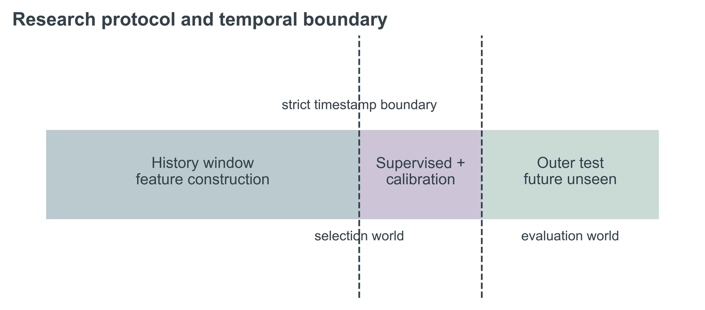
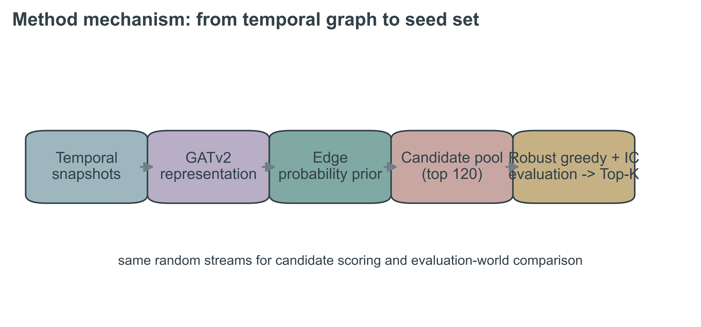
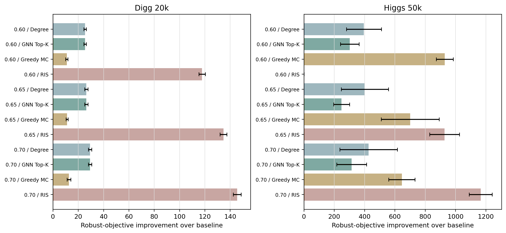
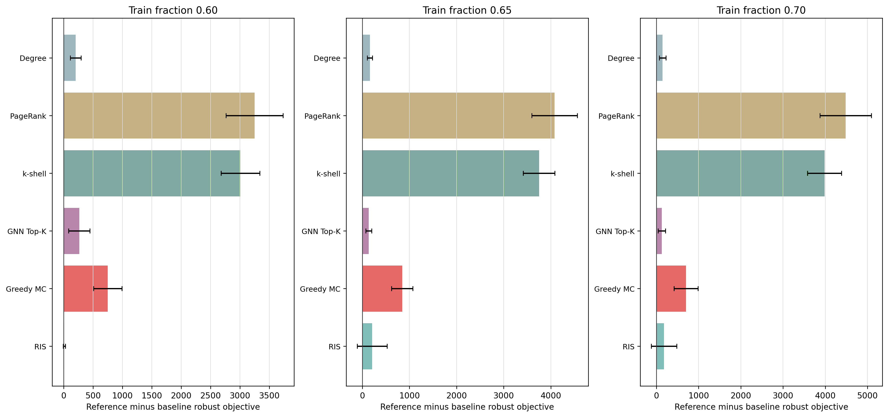
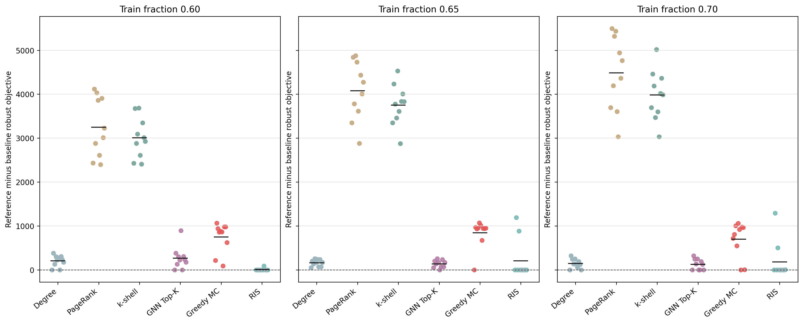
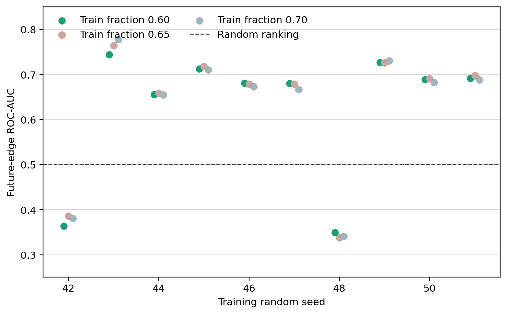
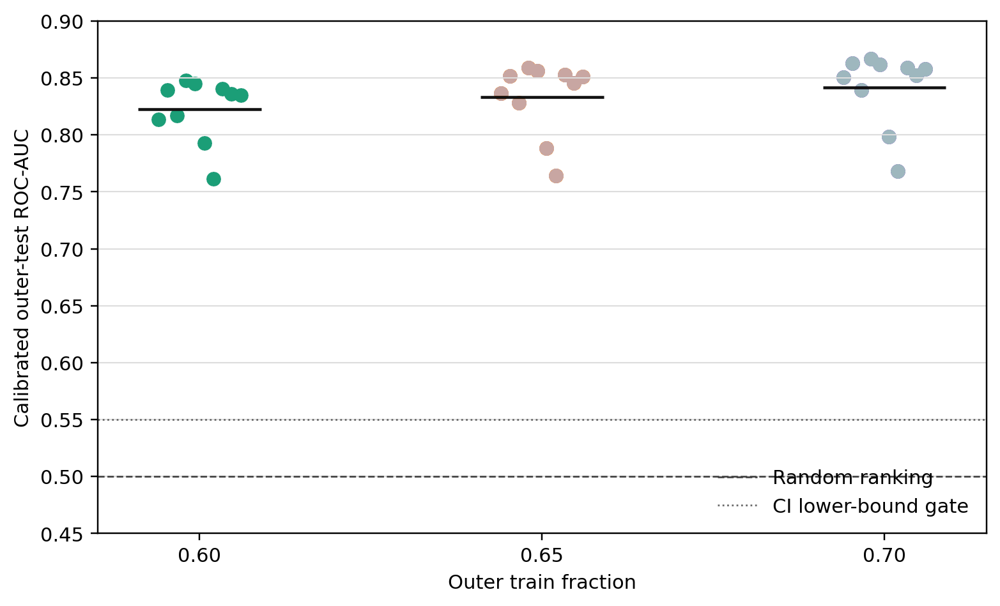
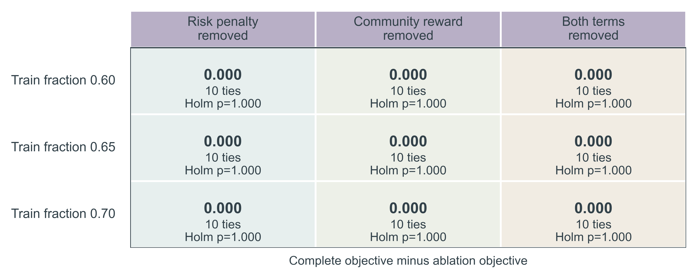
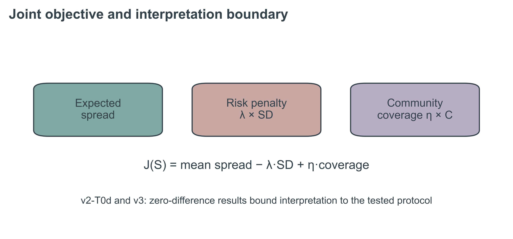
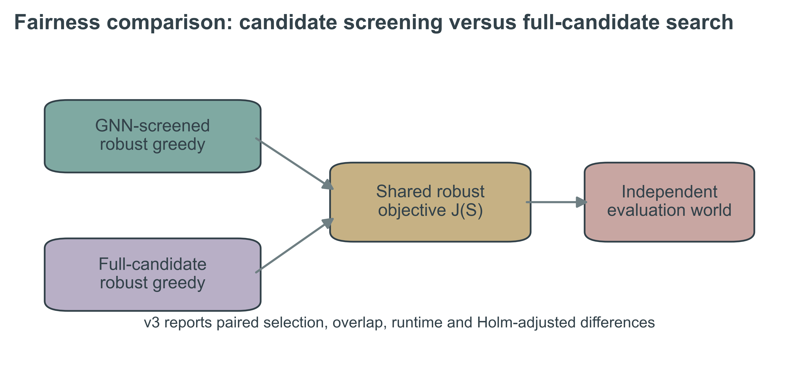

# 面向时间不确定性与跨社区约束的关键用户识别

## 摘要

关键用户识别通常在静态网络上优化传播规模，却较少同时处理边的时间变化、传播不确定性与跨社区覆盖约束。本文研究时间序列社交网络中的 Top-K 种子选择问题，采用“期望传播规模减风险惩罚加社区覆盖奖励”的鲁棒目标，并使用图神经网络先验限制贪心搜索的候选集合。为避免将训练边重构误作未来传播能力，本文将概率学习与影响力优化分离审计：冻结的两数据集比较用于评价优化目标，Higgs 上的时间前向外部测试用于验证一个独立的时序边预测候选。十次配对重复实验表明，在既定 Digg 与 Higgs 协议的三个时间切分中，所提方法相对 Degree 与 Greedy MC 均取得更高的鲁棒目标；在 Higgs 上相对 RIS 在 0.60 切分持平、在 0.65 与 0.70 切分更高。GNN Top-K 是主算法受保护下界的审计项，不作为独立效能比较。进一步地，严格时间戳分组的 Higgs v2-T0b 验证中，18 项主方法减比较点的均值均为正，其中 11 项在独立的 18 项 Holm 校正后显著；全部 RIS 对比均不显著，GNN Top-K 的结果仅作下界审计。时序候选 T0 在 Higgs 的三项外部切分上满足预注册的排序、校准、反向评分和稳定性门槛。本文不将 Digg 的父链接解释为观测到的转发因果关系，也不宣称对所有网络或所有基线具有普遍优势。

新增的 Higgs v3 确认性公平性分析中，筛选鲁棒贪心与完整候选鲁棒贪心、候选池敏感性及权重敏感性均未产生经 Holm 校正支持的效用差异；该负结果仅限于预注册协议。

关键词：关键用户识别；影响力最大化；图神经网络；时间网络；不确定性；社区覆盖

## 1 引言

在在线社会网络中，有限干预预算下的关键用户选择直接影响信息扩散、公共传播与风险响应。经典影响力最大化主要关注期望传播规模 [1]，但真实互动网络同时具有时间演化、边可靠性不确定和社区结构异质性。仅按度、中心性或静态扩散概率选择节点，可能集中于同一局部社群，也可能在高方差环境下产生不稳定决策。

本文关注的核心问题是：在历史时间窗可见、未来时间窗不可见的条件下，如何选择少量种子节点，使传播规模、传播风险与跨社区覆盖得到平衡？为此，本文将时间快照图上的边概率、节点先验和鲁棒贪心优化连接起来，并将概率预测质量与优化结果分开报告。

本文的工作重点不是提出一个脱离协议的“全能”排序器，而是建立一条可审计的时间隔离、候选筛选与鲁棒评估流程。方法层面，本文把传播均值、传播波动和跨社区覆盖写入同一评价目标，并在共同随机扩散流下进行逐步选择；证据层面，冻结的 Digg 20k 与 Higgs 50k 比较、严格时间戳分组的 Higgs v2-T0b 验证和独立的时序边概率审计分别回答优化、时间泛化与概率校准问题；复现层面，研究包保存输入、源代码和运行工件的哈希清单，并报告完整的成对差异、效应量和 Holm 校正结果。后文将 GNN Top-K 明确限定为受保护下界审计，将 v2-T0d 和 v3 的零差异结果作为解释边界，而不把风险惩罚、社区奖励或候选筛选表述为已获独立效能支持的来源。

## 2 相关工作

经典影响力最大化及其近线性 RIS 近似以期望传播规模为核心 [1,3,8]。风险规避和鲁棒影响力最大化进一步引入不确定性处理 [11,12]，社区结构研究则关注覆盖或多样性约束 [10,16,17]。本文沿用这些问题维度，但把传播均值、总体标准差和社区覆盖固定在同一评价函数中，并通过共同随机流进行配对比较；因此，相关工作只用于界定问题空间，不构成跨论文数值优劣的依据。

时间网络研究强调决策时只能使用历史演化信息，并区分单次播种与多次播种范式 [19,25,26]；不确定性研究则区分随机性与认知性来源 [20]。本文采用决策前固定一次 Top-K 播种，将历史、监督、校准和未来测试窗口严格分离，并把未来边概率验证与影响力优化分开审计。序贯反馈式干预 [18]、时间 k-shell 启发式 [34] 及有效链路方法 [29] 代表了不同的信息边界或扩散设定，本文不作跨论文数值比较。

GNN 研究为节点表示和候选筛选提供了学习型路径。GATv2 [2]、图嵌入影响力最大化 [6]、DeepSN [21] 以及自适应 GCN/ATGCN [22,28] 分别代表注意力编码、搜索空间缩减和反馈驱动播种。TGAT 与 TGN 则从连续时间表示和事件记忆角度处理动态图预测 [23,24]。本文借鉴 GATv2 生成时间窗口内的节点与边先验，但不把训练边重构等同于未来边能力，也不把自适应播种、连续时间编码或动态图记忆与本文的固定候选池、固定预算和非自适应鲁棒贪心混为一谈。

表 1 将已完成全文核验的相邻工作按决策信息、表示学习和优化目标进行对照。表中仅比较问题设定与方法边界，不进行跨论文数值比较；“未报告”仅表示本文未据已审计全文确认相同要素，并不推断原工作缺少该要素。

| 工作 | 决策信息与播种方式 | 已核验的表示或优化要点 | 与本文的边界 |
| --- | --- | --- | --- |
| Shan 等 [16] | 迭代推广模型中根据用户反馈分批选择传播热点 | 重叠社区搜索 | 非固定 Top-K；未等同于本文的时间隔离或风险-覆盖目标 |
| Yadav 等 [18] | 在不确定网络中依据干预反馈更新后续推荐 | 序贯、反馈驱动的干预选择 | 非自适应的预设时间窗选择与其 POMDP 式决策不同 |
| Tang 等 [22] | 依据已观测扩散结果进行多轮自适应播种 | ATGCN 将自适应播种表述为回归，并以自注意力加权节点表示 | 不共享本文的固定候选池、固定预算或方差惩罚目标 |
| Hevapathige 等 [21] | 子图种子推断缩小搜索空间 | 剪切神经扩散学习影响模式 | 未据全文确认匹配的严格时间戳分组或风险-覆盖目标 |
| Lin 等 [7] | 多层社交关系下的影响力最大化 | 差异化图嵌入、层内/层间扩散与局部自适应聚合 | 多层关系建模不同于本文单层时间窗口协议 |
| 本文 | 决策前固定时间窗口、候选池与 $k=2$ 预算 | GATv2 先验约束候选枚举；共同随机流下的鲁棒贪心 | 期望传播规模减方差惩罚加跨社区覆盖奖励；未来边概率另行隔离审计 |

表 1：全文核验的相邻方法设定对照；仅比较决策信息、表示学习与优化边界，不作跨论文性能比较。

国内外研究还从多层关系、社区多样性、主题特征和时间活跃度等角度扩展影响力最大化 [7,17,27,33]。这些工作说明社区与时间是重要的建模维度，但其数据、扩散模型和决策信息边界与本文不同。综合来看，现有研究较少在严格时间戳隔离下同时检验 GNN 候选筛选、风险—覆盖目标和共同随机流；本文的定位正是对这一协议组合进行可复核验证，而非声称覆盖所有相关方法。

## 3 问题定义

给定按时间排序的有向交互网络，在决策时刻 $t$ 之前构造图 $G_t=(V,E_t)$。目标是在候选节点集合中选择大小为 $k$ 的种子集 $S$，最大化

$$J(S)=\mathbb{E}[\sigma(S)]-\lambda\operatorname{Std}[\sigma(S)]+\eta C(S),$$

其中 $\sigma(S)$ 是独立级联模型下的传播规模，$\lambda$ 是风险系数，$C(S)$ 为被选择节点覆盖的社区数，$\eta$ 为社区奖励。每次运行以 20 条共同随机扩散流估计均值和总体标准差；所有方法在同一次配对比较中使用该同一组随机流，以保证目标差异来自种子选择而非蒙特卡洛噪声。

## 4 方法

### 4.1 时间快照与社区结构

对历史边按时间衰减聚合，构建加权有向快照图；节点特征包含加权入度、加权出度、截止时刻前的级联活动和 PageRank。社区由加权无向投影上的贪心模块度划分得到。所有特征严格由相应历史窗口构造。



图 1：研究流程与时间隔离边界。该机制图定义了本文所有时间前向实验的可用信息边界，不承载性能数值。

### 4.2 概率先验与候选集

图注意力编码器（实现采用 GATv2 [2]）输出节点表示，边解码器给出边分数。节点先验为其出边概率均值与加权出度对数的乘积，并归一化到 $[0,1]$。候选池取先验排名前 120 个节点；这一限制只缩小每一步贪心枚举范围，最终选择仍由鲁棒目标在共同随机流上评估。

### 4.3 鲁棒跨社区贪心

从空集开始逐步加入使 $J(S)$ 最大的候选节点。为防止方差惩罚导致的非单调性，算法同时评估纯 GNN Top-K 候选，并返回两者中目标更高者。因而 GNN Top-K 是主算法的受保护下界：其配对差异用于核查回退逻辑，不作为独立方法间效能检验的证据。候选节点按先验降序排列，分数相同时按节点标识符稳定排序；每轮使用同一组由运行种子生成的扩散随机流，精确并列时保留稳定候选顺序中的第一个节点。伪代码如下，明确给出候选池、共同随机流和回退规则。

```text
ROBUST-GREEDY(G, p, q, c, k, H, lambda, eta, M, seed, L)
  A <- nodes sorted by decreasing q, then node identifier
  A <- first min(max(k, L), |A|) nodes of A
  R <- M random streams drawn once from seed
  S <- empty set
  repeat min(k, |A|) times:
      score each v in A \ S by EVALUATE(S union {v}, R)
      add the highest-scoring v to S (stable tie-break)
  G_result <- EVALUATE(S, R)
  Q_result <- EVALUATE(first min(k, |A|) nodes of A, R)
  return the result with larger J; ties return Q_result

EVALUATE(S, R):
  x_i <- independent-cascade spread from S on stream r_i
  return (mean(x_i), population_SD(x_i), mean(x_i)-lambda*SD+eta*coverage(S))
```

Degree、PageRank、k-shell、Greedy MC 与 RIS 在相同图、概率和扩散流上评价；这些比较点在完整决策图上选择种子，只有主算法的逐步贪心枚举受前 120 名先验候选池限制。Degree、PageRank 与 k-shell 是结构排序比较点，Greedy MC 与 RIS 面向期望传播近似；它们均在共同的鲁棒 $J$ 指标下评分，但不等同于针对该完整风险-覆盖目标的竞争求解器。



图 2：方法机制图。颜色仅表示处理阶段，不编码实验效果。

### 4.4 与 RIS 比较点的关系

RIS 基线采用反向可达集合近似的思想 [3]。为与冻结协议中的候选池、扩散模型和共同随机评估保持一致，本文将其作为受固定计算预算约束的比较点；因此，本文关于 RIS 的结论只适用于该实现与协议，不将其表述为对原始算法全部工程优化的逐项复现。

### 4.5 时间前向概率验证

概率模型不以训练边重构作为有效性依据。对每个外层时间切分，最早窗口仅供编码器构图，后续窗口依次用于未来边监督和等距回归校准，最终窗口保持隔离。固定 T0 使用一层 GATv2 编码器、32 维隐层、10 个训练轮次、学习率 0.01 和拼接式 MLP 边解码器；它是通过隔离外部测试门槛的候选，而非穷尽结构搜索所得的全局最优架构。主指标为 ROC-AUC；同时报告平均精度、Brier 分数、10-bin ECE、反向分数 AUC 和跨随机种子稳定性。严格时间戳分组的 v2-T0b 实现将同一时间戳的所有记录置于同一窗口；其完成的 Higgs 影响力验证及统计边界见第 6.2 节。

## 5 实验设置

### 5.1 数据与语义

Higgs 50k 取自 SNAP 发布的 Higgs Twitter 活动数据；该发布记录了匿名用户的 RT、MT、RE 行为及时间戳，并明确将边方向解释留给研究者 [4]。本文按协议转换这些观测活动，且不把处理后的小时分组当作完整级联真值。Digg 20k 取自 Network Data Repository 的 Digg 关系与投票发布 [5]；其父链接被视为由时序共投票和关系图推断的暴露代理，而非观测到的再传播因果边。因未获得同时满足许可证、用户 ID、时间戳和观测父子级联关系的第三主数据集，本文明确将结论限定在两数据集协议内。

### 5.2 协议与统计

使用 0.60、0.65 和 0.70 三个训练比例，随机种子为 42--51；每次选择 $k=2$ 个种子节点，独立级联传播时域为 4，风险系数 $\lambda=0.35$、社区奖励 $\eta=0.25$。主算法只在先验排名前 120 个节点中枚举贪心候选；其余方法均从完整决策图选取种子，随后所有方法以 20 条共同随机扩散流评分。每个方法在相同切分和随机种子下构成配对观测，十次重复因此表示随机协议重复而非独立社会网络样本。冻结 v1 的鲁棒目标差异使用精确双侧符号翻转检验，并在其 24 个预设对比上进行 Holm 校正；报告均值、总体标准差、95% 配对 t 区间、胜/平/负计数和配对效应量 $d_z$。严格时间戳分组的 v2-T0b 是独立 Higgs 协议，使用相同的配对定义但仅在其 18 个预注册对比上校正，不能与冻结 v1 的数值或校正家族合并。所有研究记录输入、协议、代码和运行工件哈希，复核时按哈希回溯原始 JSON 和聚合统计。

## 6 结果

### 6.1 冻结的优化比较

本节检验：在冻结的时间协议和共同随机扩散流下，联合风险-社区目标的候选选择是否相对预设基线取得更高的配对鲁棒目标。

在 Digg 20k 的三个时间切分中，主方法相对 Degree、Greedy MC 与 RIS 的配对鲁棒目标差异均为正，且在 24 项 Holm 校正后比较中保持显著。在 Higgs 50k 中，主方法相对 Degree 与 Greedy MC 在所有切分均为正；相对 RIS 在训练比例 0.60 为 10/10 的精确平局，在 0.65 与 0.70 为正差异。该平局源自两方法在 0.60 的十次运行中选择了相同种子集，因而不是统计处理错误。表中保留 GNN Top-K 的数值，以审计主算法的受保护下界；该列不构成独立效能比较。

表 2 汇总了主方法减去基线方法的配对鲁棒目标均值。除 Higgs/RIS 在 0.60 的精确平局外，所有非零差异均通过双侧精确符号翻转检验，并在 24 项预设对比的 Holm 校正后保持显著（调整后 $p\leq0.046875$）。这些统计单位是同一数据集和时间切分下的随机协议重复，不代表独立社会网络样本。

| 数据集 | 训练比例 | Degree | GNN Top-K | Greedy MC | RIS |
| --- | ---: | ---: | ---: | ---: | ---: |
| Digg 20k | 0.60 | +25.360 | +25.360 | +10.934 | +117.766 |
| Digg 20k | 0.65 | +26.331 | +26.331 | +11.156 | +134.621 |
| Digg 20k | 0.70 | +29.265 | +29.265 | +12.583 | +145.493 |
| Higgs 50k | 0.60 | +395.109 | +301.294 | +928.659 | 0.000（10/10 平局） |
| Higgs 50k | 0.65 | +401.491 | +247.809 | +700.822 | +927.432 |
| Higgs 50k | 0.70 | +426.037 | +314.344 | +645.459 | +1165.466 |

表 2：主方法减去对应比较点的十次配对鲁棒目标差异均值；正值表示主方法更高。GNN Top-K 列是受保护下界审计，不作为独立效能结论。完整统计定义为配对差异的总体标准差、95% 配对 t 区间、胜/平/负计数、精确双侧符号翻转检验、Holm 调整后的 $p$ 值和 $d_z=\bar d/s_d$；原始差异和检验输入保存在可复核分析包中。



图 3：冻结 Digg 与 Higgs 协议下的主比较。图中保留全部训练比例以及 Higgs/RIS 的非优势结果，因此只能支持两套协议内的条件性比较结论。

### 6.2 严格时间戳分组的 Higgs 验证

本节检验：在同一时间戳记录不得跨窗口的严格切分下，冻结的 T0b 配置是否仍能相对六个预注册基线提高鲁棒目标。该研究包含三个训练比例、种子 42--51 的 30 个运行工件和 210 条方法指标记录；同一对比共享时间戳切分、随机种子与共同随机扩散流。

18 项主方法减比较点的配对均值均为正，但多重比较后的结论必须按预注册的 18 项 Holm 家族解读。其中，主方法相对 PageRank、k-shell 与 Greedy MC 在 0.60、0.65 和 0.70 均通过 Holm 校正；相对 Degree 仅在 0.65 通过 Holm 校正。GNN Top-K 在 0.65 的数值也通过 Holm 校正，但因其是主算法的受保护下界，只作为回退逻辑审计，不能作为独立效能证据。其余 7 项对比不显著，包含全部 3 项 RIS 对比。因此，该严格 Higgs 结果不支持“显著优于 RIS”或“所有切分、所有基线均显著优于”的表述。



图 4：严格时间戳分组的 v2-T0b 主比较。该图支持在已列明的 Holm 显著对比中作 Higgs 协议内的条件性改进结论；正均值、胜数或区间不跨零均不能替代该 18 项家族内的校正结论。



图 5：种子级差异展示了协议重复的离散性，特别是 RIS 对比存在大量平局并且 95% t 区间跨零。每个点是随机协议重复，不是独立社会网络样本。

### 6.3 时间预测审计

本节检验：训练边重构分数能否代表未来边排序能力，以及固定 T0 候选是否满足隔离时间外部测试的预注册门槛。

冻结 v1 模型的训练边重构 AUC 约为 0.95，但未来边 AUC 在不同种子间不稳定，部分种子低于随机水平。T0 候选在 Higgs 隔离外部测试上的 AUC 均值分别为 0.8228、0.8333 和 0.8417；相应 Brier 均值为 0.1623、0.1564 和 0.1516，ECE 均值不高于 0.0173。T0 通过全部预注册数值门槛，但尚未完成全部候选网格，因此本文只将其表述为通过验证的固定候选。



图 6：v1 的时间前向审计不能由平均 AUC 取代。种子层面的反向排序说明，训练边重构不构成未来边概率有效性的证据。



图 7：固定 T0 候选在三个 Higgs 外部切分上的 AUC 均超过随机水平，并通过预注册的排序和种子稳定性门槛；该图不表示完整架构搜索，严格时间戳分组的影响力结果另见第 6.2 节。

### 6.4 共同世界目标消融

为单独检验目标项是否改变选种结果，v2-T0d 在每个严格 Higgs 比例—种子组合中只拟合一次 T0 概率图，再以确定性的边—时间共同世界分别运行完整目标、去风险项、去社区奖励项和仅传播规模四个选择臂。该版本与 v2-T0b 独立编号，不能与其数值或校正家族合并。30 个哈希化工件和 120 条指标记录均通过完整性核验。

在三个训练比例的每个 10 次配对中，四个臂均选择相同的 Top-K 集合，并在统一完整目标下取得完全相同的得分。因此，9 项预注册的“完整目标减去消融臂”对比均为 0，胜/平/负均为 0/10/0，精确双侧符号翻转检验和 Holm 校正后的 $p$ 值均为 1.0。该受控消融不支持将方差惩罚或社区奖励描述为本协议中选集得分差异的独立经验来源；它也不能证明这些项在其他候选池、预算、网络或目标下无关。图 8 以 3×3 数值矩阵明确显示每项对比的 0.000、10 次平局和 Holm $p=1.000$，完整统计定义与原始配对差异已在本节给出并保存在可复核分析包中。

这里的“零差异”需要区分选择阶段目标与报告阶段目标。每个消融臂确实使用其对应的目标进行选点，但所有臂随后都在同一组确定性共同世界上用完整目标重新评分；统计量定义为“完整目标选集得分减去消融目标选集得分”。由于 30 次配对运行中四个臂均选出相同的两个节点，统一完整目标的重评分也必然相同，故差值严格为零，而不是将风险项或社区奖励的参数错误地固定为零。以训练比例 0.60、随机种子 42 为例，完整目标、去风险项、去社区奖励项和仅传播规模臂的选择阶段目标分别为 2360.408、2481.100、2359.908 和 2480.600，但四者均选择节点集合 {88, 677}，在完整目标下重评分均为 2360.408。该机制说明本消融检验的是目标项是否改变最终选点，而不是比较不同目标定义下未经统一标尺的数值；因此结果应表述为“本协议下未观察到选点变化”，不能表述为目标项普遍无效。



图 8：共同世界目标消融的紧凑参数表。所有九项对比均显示 0.000、10 次平局和 Holm $p=1.000$；浅色背景仅用于区分消融列，不表示数值大小。



图 9：联合目标结构图。该图用于区分目标定义与经验效应，不替代消融统计。

### 6.5 v3 公平性与敏感性确认性分析

为检验 GNN 候选筛选是否改变鲁棒贪心结果，v3 在独立的选择世界与评估世界上完成了 30 个非烟雾运行工件，比较 120 节点筛选鲁棒贪心与完整决策图鲁棒贪心，并预注册了 60/120/240/480 候选池和 3×3 风险—社区权重网格。十次重复是配对随机协议重复，不是独立社会网络样本；GNN Top-K 仍仅作受保护下界审计。

三项主公平性对比均为严格零差异（10 次平局，精确双侧符号翻转检验与 Holm 校正后的 $p=1.000$），三项非基准候选池对比在三个切分上也均为零差异。24 项权重敏感性对比中 23 项为零差异；其余三个（训练比例 0.70、风险系数 0.70）均值差异为 10.751，胜/平/负为 1/9/0，95% t 区间为 [-13.570, 35.072]，Holm $p=1.000$。因此，在本 Higgs 协议中没有检测到 GNN 筛选、候选池扩大或权重变化带来的鲁棒目标改进；这些是协议条件下的稳健负结果，不证明普遍等价或目标项在其他设定中无关。



图 10：候选筛选公平性机制图。v3 的零差异结果说明，在本协议内 GNN 筛选没有改变鲁棒贪心的选择或得分。

## 7 讨论与局限

首先，冻结的优化结果不应被解读为概率预测质量的证明；这正是本文将两类证据分离的原因。其次，Digg 的暴露代理语义限制了因果扩散解释。第三，只有两套冻结主数据协议，且 T0 尚未完成完整结构网格选择。第四，严格时间戳分组的 v2-T0b 仅在 Higgs 上验证：18 项 Holm 校正后仅 11 项显著，全部 RIS 对比不显著，故不能外推为普遍或 RIS 优势。最后，重复运行代表随机协议重复，不代表独立社会网络样本。

此外，v2-T0d 的共同世界消融在 30 次协议重复中没有产生任何臂间选集或得分差异；v3 也没有检测到候选筛选或权重敏感性带来的鲁棒目标差异。这些零结果共同限制了本文对联合目标的解释：本文只能报告其作为冻结决策规则和候选筛选协议的一部分，不能把主比较中的条件性改进归因于风险惩罚、社区奖励或 GNN 筛选的独立效应。

## 8 结论

本文给出一个可复现的时间不确定性与跨社区约束关键用户识别流程，并通过配对统计澄清其在两个冻结时间协议和一个严格时间戳分组 Higgs 协议上的适用范围。结果支持条件性的优化改进，而不支持普遍优越、显著优于 RIS 或因果概率解释。时间前向的 T0 审计表明，概率学习必须以隔离未来测试和校准指标约束；在严格 Higgs 验证中，T0b 配置只对部分预注册基线显示经 Holm 校正支持的改进。

独立的 v2-T0d 共同世界消融和完成的 v3 公平性—敏感性分析进一步表明，在所检验的候选池、预算和 Higgs 时间协议下，移除风险项、社区奖励项、改变候选池或改用完整决策图均未产生经 Holm 校正支持的效用差异；因此本文不将联合目标中的任一项或 GNN 筛选表述为已获独立效能支持的改进来源。

## 9 数据与代码可用性

研究包中的冻结研究清单与严格 v2-T0b 清单记录了输入、运行工件、聚合统计和核心源文件哈希；对冻结研究的 8 个核心源文件及 Higgs、Digg 各 30 个运行工件，以及严格 v2-T0b 的 30 个运行工件和 210 条指标记录，均已完成只读一致性复核。运行环境为 Windows 11、Python 3.13、NumPy 2.3、pandas 2.3、scikit-learn 1.7、NetworkX 3.5、PyTorch 2.11 与 CUDA 12.8；协议固定 Python、NumPy、PyTorch CPU/CUDA 随机流并关闭 cuDNN benchmark，开启确定性算法。原始 Higgs 与 Digg 数据应分别依据其发布方的使用条款获取和引用，研究包不将原始下载文件作为公开再分发对象。正式发布前应归档与清单一致的源代码快照、环境依赖和分析工件；在此之前，本文不声称已建立公开代码仓库。

独立 v2-T0d 清单另记录三份输入、预注册协议、四个源码文件、v2-T0b 参考清单和 30 个运行工件的哈希；其 120 条指标记录与工件回溯得分已在单独分析包中复核。该材料仍待与作者授权的数据和代码归档方案一并决定公开方式。

## 参考文献

[1] Kempe D, Kleinberg J, Tardos E. Maximizing the spread of influence through a social network. Proceedings of the Ninth ACM SIGKDD International Conference on Knowledge Discovery and Data Mining, 2003: 137--146. DOI: 10.1145/956750.956769.

[2] Brody S, Alon U, Yahav E. How attentive are graph attention networks? The Tenth International Conference on Learning Representations (ICLR), 2022. https://openreview.net/forum?id=F72ximsx7C1.

[3] Tang Y, Shi Y, Xiao X. Influence maximization in near-linear time: A martingale approach. Proceedings of the 2015 ACM SIGMOD International Conference on Management of Data, 2015: 1539--1554. DOI: 10.1145/2723372.2723734.

[4] De Domenico M, Lima A, Mougel P, Musolesi M. The anatomy of a scientific rumor. Scientific Reports, 2013, 3: 2980. DOI: 10.1038/srep02980.

[5] Rossi R A, Ahmed N. The network data repository with interactive graph analytics and visualization. Proceedings of the AAAI Conference on Artificial Intelligence, 2015, 29(1). DOI: 10.1609/aaai.v29i1.9277.

[6] Kumar S, Mallik A, Khetarpal A, Panda B S. Influence maximization in social networks using graph embedding and graph neural network. Information Sciences, 2022, 607: 1617--1636. DOI: 10.1016/j.ins.2022.06.075.

[7] 林荣华, 姚润彬, 王怡嘉, 林俊杰, 吴正洋, 汤庸. 差异化图嵌入的多层社交网络影响力最大化方法. 软件学报, 在线优先出版, 2026-06-24: 1--19. DOI: 10.13328/j.cnki.jos.007672.

[8] Li Y, Fan J, Wang Y, Tan K-L. Influence maximization on social graphs: A survey. IEEE Transactions on Knowledge and Data Engineering, 2018, 30(10): 1852--1872. DOI: 10.1109/TKDE.2018.2807843.

[9] Lee W, Kim J, Yu H. CT-IC: Continuously activated and time-restricted independent cascade model for viral marketing. 2012 IEEE 12th International Conference on Data Mining, 2012: 960--965. DOI: 10.1109/ICDM.2012.40.

[10] Zhang X, Zhu J, Wang Q, Zhao H. Identifying influential nodes in complex networks with community structure. Knowledge-Based Systems, 2013, 42: 74--84. DOI: 10.1016/j.knosys.2013.01.017.

[11] NasehiMoghaddam S, Fathian M, Amiri B. Risk-averse influence maximization: A computational investigation by genetic algorithm framework. The Journal of Supercomputing, 2022, 79(3): 2519--2569. DOI: 10.1007/s11227-022-04731-w.

[12] He X, Kempe D. Robust influence maximization. Proceedings of the 22nd ACM SIGKDD International Conference on Knowledge Discovery and Data Mining, 2016: 885--894. DOI: 10.1145/2939672.2939760.

[13] Zhuang H, Sun Y, Tang J, Zhang J, Sun X. Influence maximization in dynamic social networks. 2013 IEEE 13th International Conference on Data Mining, 2013: 1313--1318. DOI: 10.1109/ICDM.2013.145.

[14] Murata T, Koga H. Extended methods for influence maximization in dynamic networks. Computational Social Networks, 2018, 5(1): 8. DOI: 10.1186/s40649-018-0056-8.

[15] 韩忠明, 陈炎, 刘雯, 原碧鸿, 李梦琪, 段大高. 社会网络节点影响力分析研究. 软件学报, 2017, 28(1):84--104. DOI: 10.13328/j.cnki.jos.005115.

[16] 单菁, 申德荣, 寇月, 聂铁铮, 于戈. 基于重叠社区搜索的传播热点选择方法. 软件学报, 2017, 28(2):326--340. DOI: 10.13328/j.cnki.jos.005117.

[17] Li J, Cai T, Deng K, Wang X, Sellis T, Xia F. Community-diversified influence maximization in social networks. Information Systems, 2020, 92:101522. DOI: 10.1016/j.is.2020.101522.

[18] Yadav A, Chan H, Jiang A X, Xu H, Rice E, Tambe M. Using social networks to aid homeless shelters: Dynamic influence maximization under uncertainty. Proceedings of the 2016 International Conference on Autonomous Agents and Multiagent Systems, 2016: 740--748.
[19] Yanchenko E, Murata T, Holme P. Link prediction for ex ante influence maximization on temporal networks. Applied Network Science, 2023, 8(1).
[20] Biswas T K, Abbasi A, Chakrabortty R K. Robust influence maximization under both aleatory and epistemic uncertainty. ACM Transactions on Knowledge Discovery from Data, 2023, 17(7): 1--27.

[21] Hevapathige A, Wang Q, Zehmakan A N. DeepSN: A sheaf neural framework for influence maximization. Proceedings of the AAAI Conference on Artificial Intelligence, 2025, 39(16): 17177--17185. DOI: 10.1609/aaai.v39i16.33888.

[22] Tang J, Song S, Du Q, Yao Y, Qu J. Graph convolutional networks with the self-attention mechanism for adaptive influence maximization in social networks. Complex & Intelligent Systems, 2024, 10(6): 8383--8401. DOI: 10.1007/s40747-024-01604-y.

[23] Xu D, Ruan C, Korpeoglu E, Kumar S, Achan K. Inductive representation learning on temporal graphs. International Conference on Learning Representations, 2020. arXiv:2002.07962. DOI: 10.48550/arXiv.2002.07962.

[24] Rossi E, Chamberlain B, Frasca F, Eynard D, Monti F, Bronstein M. Temporal graph networks for deep learning on dynamic graphs. arXiv preprint arXiv:2006.10637, 2020. DOI: 10.48550/arXiv.2006.10637.

[25] Yanchenko E, Murata T, Holme P. Influence maximization on temporal networks: A review. Applied Network Science, 2024, 9(1): 16. DOI: 10.1007/s41109-024-00625-3.

[26] Erkol S, Mazzilli D, Radicchi F. Influence maximization on temporal networks. Physical Review E, 2020, 102(4): 042307. DOI: 10.1103/PhysRevE.102.042307.

[27] Qin X, Zhong C, Yang Q. An influence maximization algorithm based on community-topic features for dynamic social networks. IEEE Transactions on Network Science and Engineering, 2022, 9(2): 608--621. DOI: 10.1109/TNSE.2021.3127921.

[28] Liu W, Wang S, Ding J. Influence maximization based on adaptive graph convolution neural network in social networks. Electronics, 2024, 13(16): 3110. DOI: 10.3390/electronics13163110.

[29] Fu B, Zhang J, Bai H, Yang Y, He Y. An influence maximization algorithm for dynamic social networks based on effective links. Entropy, 2022, 24(7): 904. DOI: 10.3390/e24070904.

[30] Han M, Yan M, Cai Z, Li Y, Cai X, Yu J. Influence maximization by probing partial communities in dynamic online social networks. Transactions on Emerging Telecommunications Technologies, 2017, 28(4): e3054. DOI: 10.1002/ett.3054.

[31] Li Y, Gao H, Gao Y, Guo J, Wu W. A survey on influence maximization: From an ML-based combinatorial optimization. ACM Transactions on Knowledge Discovery from Data, 2023, 17(9): 1--50. DOI: 10.1145/3604559.

[32] Meena S K, Singh S S, Singh K. Achieving fair influence maximization: Integrating privacy, diversity, and temporal fairness. IEEE Transactions on Network Science and Engineering, 2026, 13: 1676--1688. DOI: 10.1109/tnse.2025.3598819.

[33] Jia W, Ma R, Niu W, Yan L, Ma Z. Topic relevance and temporal activity-aware influence maximization in social network. Applied Intelligence, 2022, 52(14): 16149--16167. DOI: 10.1007/s10489-022-03430-6.

[34] Yang S, Zhu W, Zhang K, Diao Y, Bai Y. Influence maximization in temporal social networks with the mixed K-shell method. Electronics, 2024, 13(13): 2533. DOI: 10.3390/electronics13132533.

其余相关工作与基础方法引文将在 Semantic Scholar、CrossRef 或 arXiv 双源核验后补入；未核验的条目不进入本稿。
