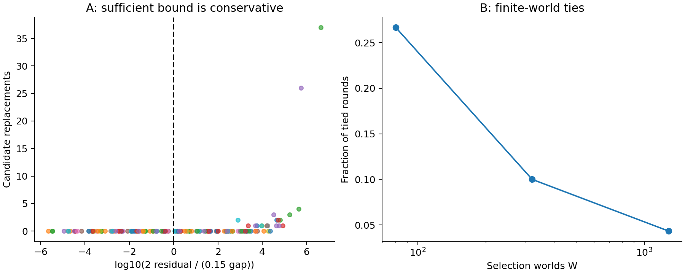
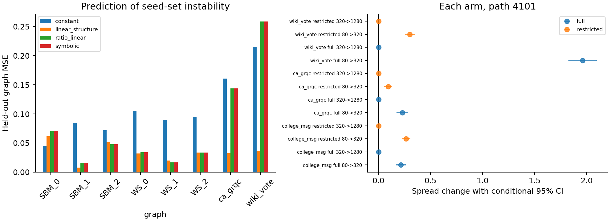

# 社交网络计算精度与符号回归 / Round 1 / 研究投入决策 / 2026-11-01

## 1. 决策摘要

**建议：适合缩小。保留精度诊断和简单结构回归这条小规模研究线，停止继续扩大当前符号回归搜索、GNN训练或预算策略开发的投入。** 本轮敏感性确实存在，但没有达到预先声明的SR增量门槛。这是对当前数据、特征、目标和受限搜索的负面证据，不是所有SR方法不可能有效的证明。

本轮实际完成15图、150个PR条件、219个选种子条件和1095个贪心阶段；主实验549.49秒（约9分9秒），预检13.74秒，模型分析约3.52秒。环境配置、阅读、编写报告不计入主实验CPU成本；Numba首次安装和编译另列日志。未触发预算缩减/提前停止，无缺失条件。资源采样峰值约630MB（采样时Windows进程PeakWorkingSet），不等于经过全程专门监控的精确总资源峰值。全部交付在独立目录，原输入结束时哈希复核未变。

## 2. 研究身份、既有事实与边界

已有研究卡和旧分析指出ca-GrQc默认PR候选与严格控制不同，W也可改变全候选/受限候选的选择。本轮用全新命名空间和路径产生新的计算重复，但三张真实图曾被探索，仍是探索证据。合成图有机制明确的整族留出，不构成真实社交总体样本。

读取了研究卡、冻结protocol/config/data_selection/source_manifest、原engine/legacy_engine和精度预算分析；未发现适用AGENTS.md。继承引擎逐字节复制，仅本轮代码/缓存/依赖/输出写入新实验目录。原论文、协议、代码快照和结果保持只读。

## 3. 实验设置、协议与评价

真实图：CollegeMsg按前65%完整时间戳组取历史有向关系，1438节点/13397弧；ca-GrQc删除自环及重复、互惠化，5241节点/28968弧；wiki-Vote有向去重去自环，7115节点/103689弧。raw与graph hashes都与冻结manifest一致。不能照抄原始下载摘要的节点数。

合成图为ER、BA、两块SBM、WS四族，每族n=160/240/320，种子6100/6101/6102；具体参数在protocol.md。每张图内节点按字符串字典序。传播固定有向IC p=.01、h=3、k=5、step-indexed hash；候选资格不改变传播图。相同整数总传播分以字典序解同分。该有限步共同世界模拟器不自动拥有固定live-edge模型全部次模优化保证。

A扫描tol=1e-4..1e-12共五档，m=20与ceil(.05n)。参考1e-14再收紧到1e-15。B固定经检查的参考PR20池，W=80/320/1280、4101..4104四条前缀路径；三真实图full另用4101/4102两条。独立reference路径4999/W1280，只作有限计算参考；先导4099/160世界；独立评价4001/10000世界。ID不交叠有代码断言，原始值已保留。

主要预测目标只选**最终种子集合相对独立有限参考的1-Jaccard**，不是传播损失。训练5图（CollegeMsg+ER/BA前两张），验证2图（ER/BA第三张），留出8图（ca-GrQc/wiki-Vote+全部SBM/WS）。SR只用训练拟合、验证选式，留出评价一次；测试后未改变公式、矩阵、指标或网络。验证分数附加.002×节点数复杂度惩罚。

## 4. PageRank：有变化，但已有充分判据应先用

默认tol=1e-6的读数：

| graph | m | replacements | iterations | residual | gap |
| --- | --- | --- | --- | --- | --- |
| college_msg | 20 | 0 | 9 | 0.0004981 | 6.636e-05 |
| college_msg | 72 | 0 | 9 | 0.0004981 | 3.92e-06 |
| ca_grqc | 20 | 2 | 12 | 0.003867 | 8.083e-07 |
| ca_grqc | 263 | 3 | 12 | 0.003867 | 3.067e-07 |
| wiki_vote | 20 | 1 | 5 | 0.001687 | 4.631e-06 |
| wiki_vote | 356 | 1 | 5 | 0.001687 | 3.958e-07 |

150条件中19条件有替换；68个满足gap>2epsilon的条件均稳定，epsilon=实际L1残差/.15。剩余82个未认证条件中63个也稳定、19个改变。因而该界可保守诊断稳定，但不能预测全部变化或替换数量。不能把“未通过保证”计为“判为不稳定”的准确分类。

15张图的两个池在参考1e-14与1e-15间全部成员一致；真实图残差14约1.06e-11/4.40e-11/2.27e-11，15约1.09e-12/3.83e-12/2.78e-12。所有图最大分数差约1.07e-11。这里提供数值参考稳定证据，未做任意精度或舍入误差证明。原实现tol按n缩放，tol绝不是每节点真实误差。

代表性路径4101/W320，严格PR减默认PR的独立平均传播差：

| 图 | 候选20替换 | 最终种子Jaccard | 传播差 | 条件95%区间 |
| --- | --- | --- | --- | --- |
| CollegeMsg | 0 | 1 | 0 | 相同集合，逐世界精确相同 |
| ca-GrQc | 2 | 0.6667 | +0.3055 | [0.2736,0.3374] |
| wiki-Vote | 1 | 0.6667 | -0.4823 | [-0.5435,-0.4211] |

更准确的PR没有必然更高的传播收益：PR是候选排名，不是传播目标本身。这是本轮固定路径证据，不是跨网络普遍法则。此分支不再追加SR任务，避免同一轮同时扩展多个目标。

## 5. Monte Carlo：选择分辨率改善不等于收益单调改善

受限方法同分阶段比例从26.67%降到10.00%、4.33%；相对独立reference的平均1-Jaccard为0.6341/0.5295/0.4750。均值跨15个固定图描述，不用路径冒充独立网络。最高W对另一独立同W参考仍不稳定，参考本身有限是标签噪声来源。

受限120个相邻W转移中100个改变集合、115个改变顺序；54个效用差在条件逐比较区间可区分，46个集合变化的转移**尚无法区分**收益。全候选12转移中7个集合变化、11个顺序变化、6个收益差可区分。顺序改变但最终集合相同，当前传播评价逐世界完全一致。

例如wiki-Vote/4101从W80到320，full自身平均传播+1.9627，区间[1.8260,2.0994]；受限自身+0.3020，区间[0.2523,0.3517]。不能把相对差的变化全部归因于受限方法。ca-GrQc/full/4102从320到1280是-0.0266，区间[-0.0657,0.0125]，应称尚无法区分，不能说增加W有害或等效。

## 6. 简单基线与符号回归

主要留出图等权结果（越小越好）：

| model | mse | mae |
| --- | --- | --- |
| constant | 0.108252 | 0.297462 |
| linear_structure | 0.034275 | 0.145109 |
| ratio_linear | 0.077699 | 0.221907 |
| symbolic | 0.077699 | 0.221907 |

固定的受限表达式搜索评估1200式，最多7个表达式AST节点、3个变量、四种算子；每次搜索不足1秒，原上限60秒。没有PySR/遗传编程的全面搜索。选择的式子退化为：

`不稳定程度预测 = clip(0.287274 + 0.340075*x, 0, 1)`

其中 `x=log1p(sigma_D/(sqrt(W)*max(abs(mean_D),1/160)))`；D来自160个独立先导世界中先导选出的前两候选的同世界单种子传播差。该gap有先导赢家偏差，不是真实差距；它与评价和选择数据独立。它是已知方差/差距机制的经验校准，没有新增理论。

结构线性模型为：

`clip(0.722636 + 0.196604*x - 0.368613*o - 0.747089*c, 0, 1)`

`o`是上述两候选出邻居的Jaccard；`c=CV/(1+CV)`，CV是全图出度变异系数。出邻居重叠是便宜代理，不能等同实际多步传播覆盖重叠。系数是关联，不能作结构机制的因果结论。

SR留出MSE比验证选定结构线性基线高126.7%，只3/8图更好；训练图bootstrap三次（7101..7103）结构为x、c-protected_div(x,x)、x，仅1次总体优于原简单基线。按照“至少10% MSE改善、6/8图改善、至少2/3重采样改善且结构一致”的协议，明确未通过。

结构线性相对ratio基线整体MSE下降55.9%，但留出合成6图的改善仅6.1%，且只3/6图更好。真实图差异贡献很大；目前仅支持继续小规模检验结构特征，不能称其已稳定跨图族泛化。对单个验证结果反复换式、扩大语法或改目标均未执行。

## 7. 统计验证与图解

CI采用10000独立评价世界的成对差，SE=sd(D)/sqrt(10000)，非两臂独立方差。只表示固定集合、固定图下的模拟误差，不是现实网络总体区间。所有阶段margin/SE是被选赢家的描述，不充当无偏真差距。未做网络总体p检验；逐比较CI未多重修正，不据此宣称总体优越。

SR减简单模型的反向效果可用“简单MSE减SR MSE”=-0.04342描述。整图重采样条件区间约[-0.10020,-0.00121]只衡量这8图组成敏感性，不是网络总体区间，图族聚类未解决。完整假设/不确定性在stats-appendix.md。

左图说明充分界保守，右图说明W上升时同分减少；二者都不能推出效用单调改善。

左图SR与单变量高度相同，真实图上明显弱于简单结构回归；右图把路径4101的两臂效用变化分开，全路径均在budget_transitions.csv。

## 8. 成本、负面结果与证据不足

真实图先导160世界耗时CollegeMsg约0.602秒、ca-GrQc0.024秒、wiki-Vote0.084秒；受限选择的跨W/路径中位数约0.021/0.022/0.043秒。CollegeMsg首次先导包含未完全消除的JIT/首次签名开销，不能视为稳态测量。这些值提示先导开销对很便宜的受限选择不可忽略；虽然比full扫描便宜，不能据此说策略已省计算。

计时中的selection只含贪心核心，世界构造、每轮竞争记录、PR、评价另有成本；timings.csv和主实验总时间避免将核心时间当端到端时间。没有实测自适应策略，没有将特征/先导/校准成本抵扣后的节省。稳态成本和部署价值证据不足。

仅5训练、2验证图，SBM/WS每族仅3张；合成图远小于真实图；每图共享一条有限参考标签；只用空集前两候选描述5轮复杂流程；没有真实传播覆盖重叠；真实图曾探索。这些都限制公式可靠性。本轮负面SR结果也不能证明换成更多数据和更强SR必然无效，但不足以据此扩大投入。

## 9. 方法来源与新颖性范围

NetworkX官方文档明确n*tol停止规则。Gleich 2015作者全文Remark2.3提供残差L1/(1-alpha)界。Lu/Tao/Zhang UAI2021原始全文已有方差与收益差距的采样关系。Chen/Xing/Crawford UAI2025官方摘要研究带噪次模优化并明确列出影响力最大化应用。Cranmer等NeurIPS2020官方摘要属于GNN提取物理关系先例，不是本任务有效性的证据。

原始链接与读取范围见[sources.md](sources.md)。Wills/Ipsen作者PDF本次超时，未以未读全文支撑细节。没有系统检索，不作“首次提出”或论文新颖性成立的判断。

## 10. 下一步投入决策与复现索引

**立即停止当前SR搜索扩张，不投入大规模训练或自动预算算法。** 若仍保留这条研究线，只补一轮最小证据：选少量从未参与现有探索的独立真实网络，锁定简单结构模型及当前特征；为每图至少两条独立高W参考估计标签噪声，并拆分先导用于选竞争者与估差距；逐图检查结构增量及实际传播覆盖重叠是否一致。没有这些数据，不宜再通过换语法/换指标寻找更好SR式。

先不测试预算策略。只有简单结构模型在新真实图及多参考标签下稳定有效，才另冻协议比较预算选择策略，完整计入PR、世界构造、先导、搜索/校准和运行成本。若这一最低门槛仍失败，终止通用符号规律主线，把本轮保留为原研究的精度与不确定性诊断补充。

复现入口[README.md](README.md)，全部代码pilot.py/run.py/analyze.py/validate.py及环境environment.json、协议protocol.md、config.json、哈希清单、日志、原始逐世界NPZ齐全。QA全部通过；图已目视检查。无Obsidian写回，所有结果仅在用户指定独立目录。
