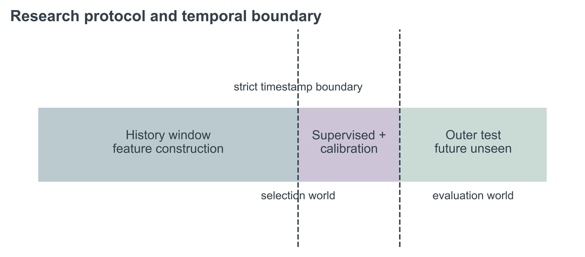
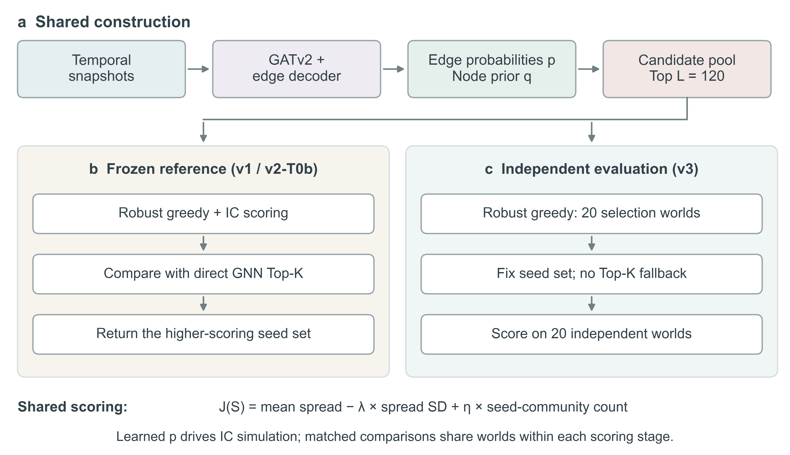
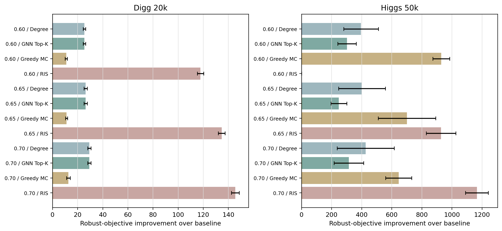
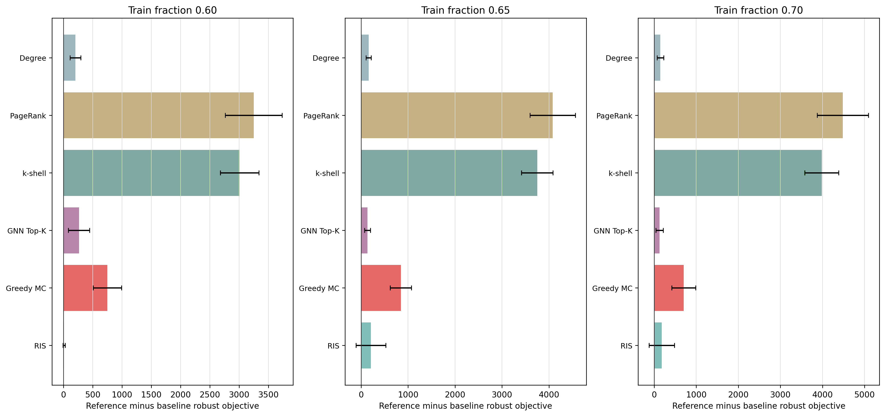
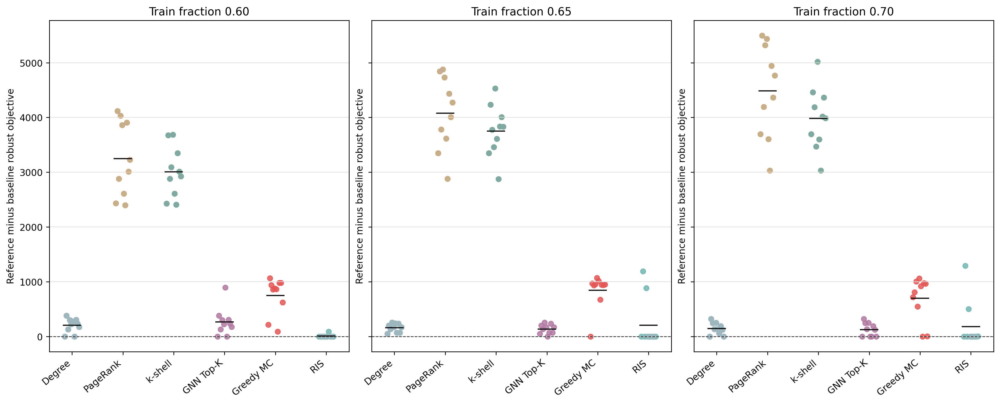
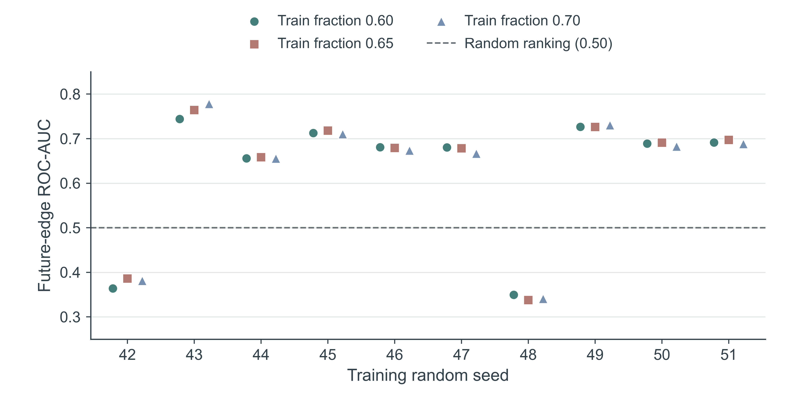
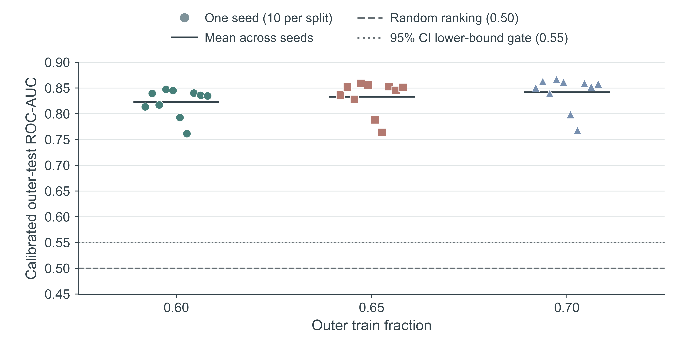
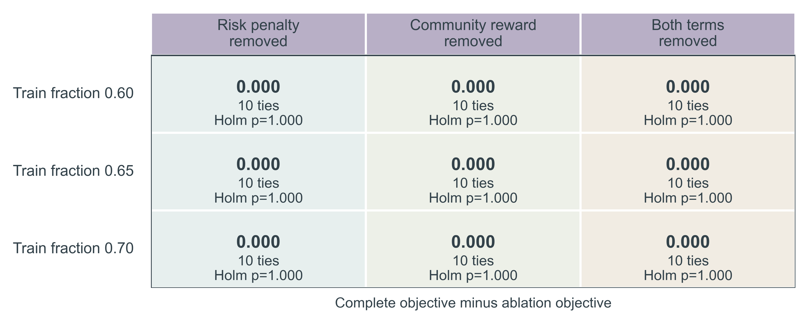
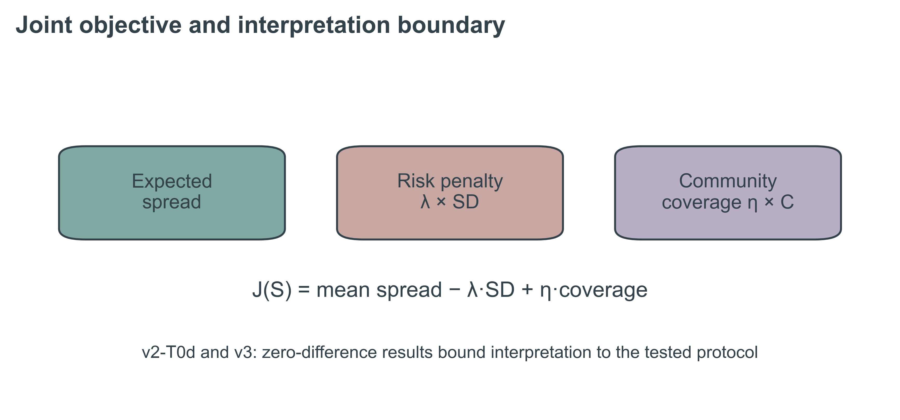
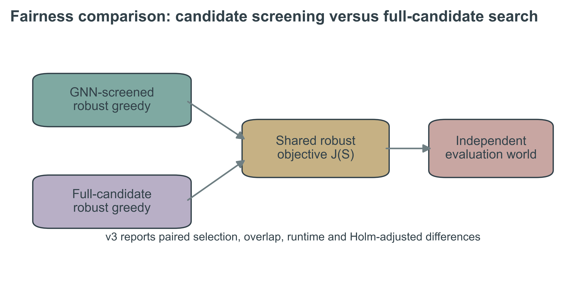

# 时序社交网络中的关键用户识别：传播概率建模与候选缩减的实证评估

## 摘要

本文研究时序社交网络关键用户识别中的传播概率建模与候选缩减，将未来边预测、种子集合效用和搜索开销分别验证。参考流程以学习边概率驱动独立级联模拟，在候选池内优化传播均值、标准差惩罚与种子社区奖励构成的目标。冻结比较覆盖 Digg 20k 与 Higgs 50k，严格时间戳分组的比较限定于 Higgs，每个切分含十次配对协议重复，选择预算为两个节点。参考流程相对部分基线的差异通过 Holm 校正，但全部严格 RIS 对比不显著；共同世界目标消融、v3 筛选与候选池检验以及权重敏感性均未支持组件的独立效用增益。v3 三十次运行中，120 节点候选池与完整搜索得到相同选集和评估得分，记录的搜索与末次评分耗时更低。一例另行编号的事后诊断中，GNN 与加权出度筛选也得到相同选点和评估结果，尚不能证明学习筛选的独特价值。固定 T0 预测器通过所记录采样协议下的 Higgs 外部测试门槛，但该概率流水线的校准负样本资格利用全期边集合，不能解释为严格在线无未来信息。本文提供了预测、选择与计算成本的分层证据；学习概率的独立选种收益及端到端加速仍待检验。

关键词：关键用户识别；影响力最大化；时序社交网络；传播概率建模；候选筛选；计算成本

## 1 引言

在社交网络中，关键用户识别需要在有限预算下选择能够影响后续传播的种子节点。经典影响力最大化以期望传播规模为目标 [1,8]；在时序网络中，选择还受到决策时可见信息的限制：未来互动尚未发生，历史连接和节点活跃度只能作为预测与决策的依据 [19,25,26]。因此，一个流程在历史图上的评分优势，需要与其未来边预测能力、选择机制和评价条件分别检验。

学习型选种流程常包含表示学习、候选筛选与组合搜索等不同环节 [6,21,31]。当最终效用提高时，仅与度排序或传播规模基线比较，不能确定收益来自学习先验、搜索目标还是候选空间的差异。风险规避和社区多样性进一步引入了不同于期望传播规模的决策偏好 [11,12,17,20]。将这些偏好写入目标函数，只能说明算法考虑了相应项；它们是否改变选中的节点、是否提高统一标尺下的效用，仍需通过控制其他条件的比较来回答。

本文围绕三个问题展开。第一，在所记录的时间与采样协议下，学习边分数的预测验证能支持什么结论，能否据此推断种子选择收益？第二，在共享概率图、评价目标和随机扩散条件时，缩减候选池是否保留完整搜索的选点，学习筛选是否提供超过简单结构筛选的附加价值？第三，基线比较、目标项检验与阶段计时各自界定了哪些效用和成本边界？这里的社区项仅奖励种子所属社区的数量，不度量传播最终触达的社区，也不构成人群公平性的保证。

为回答这些问题，本文采用 GATv2 生成边概率估计与节点先验，考察候选筛选后的鲁棒贪心流程，并以完整候选鲁棒贪心作为组件检验的对照。研究保留 Digg 20k 与 Higgs 50k 的冻结比较，同时将严格时间戳分组的 Higgs 比较、共同世界目标消融和选择—评估世界分离的检验分别编号、分别统计。另行编号的单次诊断加入同预算加权出度、PageRank 和随机候选池。未来边预测在外部时间窗口评价；由于现有校准负采样使用全期出现关系及固定节点全集，本文将其视为带有这些条件的回溯评估，不将窗口分离表述为整个流程无未来信息。该设计区分模型预测、种子选择与扩散模拟，避免用一个层次的结果替代另一个层次的证据。

本文的贡献包括以下三个方面：

1. 建立传播概率建模与种子集合选择的分层证据链：将未来边预测验证、统一目标基线比较和同目标组件检验分别回溯到运行工件，明确预测门槛通过不等于学习概率带来独立的选种收益。
2. 给出候选缩减的效果—成本实证：v3 三十次配对运行中，120 节点池保留了完整候选搜索的有序选点和评估得分，搜索与末次评分的记录耗时更低。这是所测协议的阶段成本观察，尚不构成端到端加速或学习筛选优于简单规则的证据。
3. 界定组件归因的可识别边界：严格 Higgs 比较只对部分基线支持改进，目标消融和 v3 检验未支持独立组件收益；新增单次诊断记录了 GNN 与加权出度同选点及逐轮评分，提供可复核的机制实例，不作总体显著性推断。

上述贡献定位于流程的分层验证与条件性的实证发现，不主张新型 GNN 架构、新的最优性保证或模块组合的首次提出。结论针对两个节点预算及所记录的时间和采样协议；学习概率的独立贡献与同预算非学习筛选的完整成本仍属于待检验问题。

## 2 相关工作

### 2.1 传播目标、风险与社区结构

经典影响力最大化及 RIS 近似方法以期望传播规模为核心 [1,3,8]。风险规避和鲁棒影响力最大化关注不确定条件下的决策 [11,12,20]，社区相关研究则讨论社区结构、传播热点或多样化选择 [10,16,17]。本文采用传播均值、标准差惩罚与种子社区奖励构成的固定标量目标。“鲁棒”在本文中特指该均值—标准差评分规则，不表示获得最坏情形、分布鲁棒或概率校准误差下的理论保证；种子社区计数也不等同于传播触达群体的公平性指标。

### 2.2 时序信息与预测边界

时间网络研究强调决策时只能使用历史演化信息，并区分单次播种与多次播种范式 [19,25,26]；不确定性研究则区分随机性与认知性来源 [20]。本文采用决策前固定一次 Top-K 播种，在相应版本中分离历史、监督、校准和未来测试窗口，并把未来边概率验证与影响力优化分开审计。现有概率流水线仍以全期边集合判断校准负样本资格，因此本文不主张整个流程满足严格在线信息约束。序贯反馈式干预 [18]、时间 k-shell 启发式 [34] 及有效链路方法 [29] 代表了不同的信息边界或扩散设定，本文不作跨论文数值比较。

### 2.3 学习型候选筛选与组合搜索

图嵌入与 GNN 已用于影响力最大化 [6,31]。DeepSN 通过剪切神经扩散学习影响模式并进行子图种子推断 [21]；自适应 GCN 工作预测节点传播能力并选择 Top-K [28]，ATGCN 则处理依据扩散反馈进行的自适应播种 [22]，两者的决策方式不同。GATv2 [2]、TGAT [23] 与 TGN [24] 为图表示及时间信息建模提供技术背景，但不直接证明本文选种流程的有效性。本文使用 GATv2 构造先验，随后由贪心搜索选择节点；因此，先验排序与搜索后的效用需要分开比较。

表 1 将已完成全文核验的相邻工作按决策信息、表示学习和优化目标进行对照。表中仅比较问题设定与方法边界，不进行跨论文数值比较；“未报告”仅表示本文未据已审计全文确认相同要素，并不推断原工作缺少该要素。

| 工作 | 决策信息与播种方式 | 已核验的表示或优化要点 | 与本文的边界 |
| --- | --- | --- | --- |
| Shan 等 [16] | 迭代推广模型中根据用户反馈分批选择传播热点 | 重叠社区搜索 | 非固定 Top-K；未等同于本文的时间隔离或风险-覆盖目标 |
| Yadav 等 [18] | 在不确定网络中依据干预反馈更新后续推荐 | 序贯、反馈驱动的干预选择 | 非自适应的预设时间窗选择与其 POMDP 式决策不同 |
| Tang 等 [22] | 依据已观测扩散结果进行多轮自适应播种 | ATGCN 将自适应播种表述为回归，并以自注意力加权节点表示 | 不共享本文的固定候选池、固定预算或标准差惩罚目标 |
| Hevapathige 等 [21] | 子图种子推断缩小搜索空间 | 剪切神经扩散学习影响模式 | 未据全文确认匹配的严格时间戳分组或风险-覆盖目标 |
| Lin 等 [7] | 多层社交关系下的影响力最大化 | 差异化图嵌入、层内/层间扩散与局部自适应聚合 | 多层关系建模不同于本文单层时间窗口协议 |
| 本文 | 决策前固定时间窗口、候选池与 $k=2$ 预算 | GATv2 先验约束候选枚举；共同随机流下的鲁棒贪心 | 期望传播规模减标准差惩罚加种子社区覆盖奖励；未来边概率另行隔离审计 |

表 1：全文核验的相邻方法设定对照；仅比较决策信息、表示学习与优化边界，不作跨论文性能比较。

多层关系、社区多样性、主题特征和时间活跃度也构成相关研究的不同切入点 [7,17,27,33]。本文沿这些维度界定自己的实验对象，并以同目标的完整候选对照及组件消融检验解释来源。表 1 中的问题差异不能作为本文数值优势的依据；未在本协议中实现的文献方法仍属于相关工作，不计入实验基线。本文也不据当前文献范围主张该协议组合具有“首次提出”的优先性。

## 3 问题定义

给定按时间排序的有向交互网络，在决策时刻 $t$ 之前构造图 $G_t=(V,E_t)$。目标是在候选节点集合中选择大小为 $k$ 的种子集 $S$，最大化

$$J(S)=\mathbb{E}[\sigma(S)]-\lambda\operatorname{Std}[\sigma(S)]+\eta C(S),$$

其中 $\sigma(S)$ 是给定图、边概率和传播时域下，独立级联模型产生的随机传播规模；$\lambda$ 与 $\eta$ 分别控制传播标准差惩罚和种子社区奖励。设 $c(v)$ 为节点所属的社区，则 $C(S)=|\{c(v):v\in S\}|$。该项是软奖励，并不要求每个社区获得种子，也不计数传播结束时触达的社区。

每次评价使用 $M=20$ 个扩散世界，令其传播规模为 $x_1,\ldots,x_M$，则 $\widehat\mu=M^{-1}\sum_i x_i$，$\widehat s=\sqrt{M^{-1}\sum_i(x_i-\widehat\mu)^2}$，报告 $\widehat J=\widehat\mu-\lambda\widehat s+\eta C(S)$。这里的标准差使用分母 $M$，与后文跨十次协议重复的配对差标准差不同。方法间共享随机条件旨在减少蒙特卡洛比较噪声，并不能消除有限模拟误差。冻结比较、共同世界消融和 v3 的随机世界使用方式分别保留；尤其 v3 以独立的选择世界和评估世界区分搜索与报告，不能把该性质追溯赋予所有旧版本。

## 4 方法

### 4.1 时间快照与社区结构

对历史边按时间衰减聚合，构建加权有向快照图；节点特征包含加权入度、加权出度、截止时刻前的级联活动和 PageRank。社区由加权无向投影上的贪心模块度划分得到。所有特征严格由相应历史窗口构造。



图 1：研究流程与时间窗口边界。图示的外部测试隔离指窗口内记录未直接用于特征学习或校准拟合；校准负样本资格仍由包含未来出现关系的全期边集合判断，故图中的时间隔离不代表整个流水线无未来信息。独立选择和评估世界对应 v3，不能据此认定冻结 v1 或 v2-T0b 具有相同的随机世界隔离。该图不承载性能数值。

### 4.2 概率先验与候选集

图注意力编码器（实现采用 GATv2 [2]）输出节点表示，边解码器给出边分数。节点先验为其出边概率均值与加权出度对数的乘积，并归一化到 $[0,1]$。候选池取先验排名前 120 个节点；这一限制只缩小每一步贪心枚举范围，最终选择仍由鲁棒目标在共同随机流上评估。

学习边概率在流程中有两个用途：一是为独立级联模拟提供参数，二是与结构量共同构成候选先验。本文分别讨论这两种用途。取消先验筛选并未取消模拟中的学习概率；现有未来边预测门槛也不能证明这些数值是真实传播概率。GNN 候选排序作为所评估的一种实现选择，不预设其优于同预算结构筛选。

### 4.3 鲁棒跨社区贪心

从空集开始逐步加入使估计目标 $\widehat J(S)$ 最大的候选节点。由于标准差惩罚可能破坏目标的单调性，冻结 v1 与 v2-T0b 的参考流程额外评估纯 GNN Top-K 选集，并返回两者中评分更高者。这一规则在所用评分条件下把 GNN Top-K 设为受保护下界，其对比只用于核查回退逻辑。候选节点按先验降序排列，先验相同时按节点标识符稳定排序；每轮共享随机扩散条件，目标精确并列时保留候选顺序中的第一个节点。下面的伪代码描述带回退的参考流程，不代表 v3 的组件对照实现。

```text
ROBUST-GREEDY(G, p, q, c, k, H, lambda, eta, M, seed, L)
  A <- nodes sorted by decreasing q, then node identifier
  A <- first min(max(k, L), |A|) nodes of A
  R <- M random streams drawn once from seed
  S <- empty set
  repeat min(k, |A|) times:
      score each v in A \ S by EVALUATE(S union {v}, R)
      add the highest-scoring v to S (stable tie-break)
  G_result <- EVALUATE(S, R)
  Q_result <- EVALUATE(first min(k, |A|) nodes of A, R)
  return the result with larger J; ties return Q_result

EVALUATE(S, R):
  x_i <- independent-cascade spread from S on stream r_i
  return (mean(x_i), population_SD(x_i), mean(x_i)-lambda*SD+eta*coverage(S))
```

Degree、PageRank、k-shell、Greedy MC 与 RIS 在相同图、概率和扩散流上评价；这些比较点在完整决策图上选择种子，只有参考流程的逐步贪心枚举受前 120 名先验候选池限制。Degree、PageRank 与 k-shell 是结构排序比较点，Greedy MC 与 RIS 面向期望传播近似；它们均在共同的鲁棒 $J$ 指标下评分，但不等同于针对该完整风险—社区目标的竞争求解器。

v3 为检验筛选本身的作用，分别从前 120 名候选和完整决策图执行同一鲁棒贪心，两者均不与 GNN Top-K 作返回前择优。选择只使用 20 个选择世界，固定选集后再用 20 个独立评估世界计算统一目标。完整候选按节点标识符排序，筛选候选按先验及节点标识符排序，并各自保留确定性并列规则。两条路径共享学习得到的边概率图，因此该对照检验的是节点先验筛选步骤，不能解释为去除整个 GNN 概率模型的消融。v3 文件沿用的 GNN Top-K 审计名称不赋予其在独立评估世界上的受保护下界保证。



图 2：方法机制图。（a）由时间快照学习边概率 p，构造节点先验 q 并筛选前 120 个候选；学习得到的 p 同时用于 IC 模拟。（b）冻结 v1 与 v2-T0b 在同一组评分随机流上比较鲁棒贪心与直接 GNN Top-K，并返回目标值更高的选集。（c）v3 筛选路径只用 20 个选择世界确定选集，不执行 Top-K 回退，再用 20 个独立评估世界评分；其完整候选对照跳过前 120 名筛选，仍使用相同的学习边概率图和鲁棒贪心。SD 为单次模拟传播规模的标准差，社区项计算种子所在社区数。颜色仅区分阶段和协议，不编码实验效果。

### 4.4 与 RIS 比较点的关系

RIS 基线采用反向可达集合近似的思想 [3]。为与冻结协议中的候选池、扩散模型和共同随机评估保持一致，本文将其作为受固定计算预算约束的比较点；因此，本文关于 RIS 的结论只适用于该实现与协议，不将其表述为对原始算法全部工程优化的逐项复现。

### 4.5 时间前向概率验证

概率模型不以训练边重构作为有效性依据。对每个外层时间切分，最早窗口仅供编码器构图，后续窗口依次用于未来边监督和等距回归校准，最终窗口保持隔离。固定 T0 使用一层 GATv2 编码器、32 维隐层、10 个训练轮次、学习率 0.01 和拼接式 MLP 边解码器；它是通过隔离外部测试门槛的候选，而非穷尽结构搜索所得的全局最优架构。主指标为 ROC-AUC；同时报告平均精度、Brier 分数、10-bin ECE、反向分数 AUC 和跨随机种子稳定性。严格时间戳分组的 v2-T0b 实现将同一时间戳的所有记录置于同一窗口；其完成的 Higgs 影响力验证及统计边界见第 6.2 节。

上述隔离仅说明记录的时间窗口及拟合用途。实现中的校准负采样排除集合来自完整数据集已出现边，包含外部窗口关系；节点全集也来自固定输入。因此，现有结果受全期负样本资格规则和转导式节点全集约束。验证学习概率相对固定或统计概率的附加价值，需要单独的配对对照；若检验在线部署，还需另行固定仅使用历史信息的采样规则，不能把这种修改与旧结果混合解释。

## 5 实验设置

### 5.1 数据与语义

Higgs 50k 取自 SNAP 发布的 Higgs Twitter 活动数据；该发布记录了匿名用户的 RT、MT、RE 行为及时间戳，并明确将边方向解释留给研究者 [4]。本文按协议转换这些观测活动，且不把处理后的小时分组当作完整级联真值。Digg 20k 取自 Network Data Repository 的 Digg 关系与投票发布 [5]；其父链接被视为由时序共投票和关系图推断的暴露代理，而非观测到的再传播因果边。因未获得同时满足许可证、用户 ID、时间戳和观测父子级联关系的第三主数据集，本文明确将结论限定在两数据集协议内。

### 5.2 协议与统计

使用 0.60、0.65 和 0.70 三个训练比例，随机种子为 42--51；每次选择 $k=2$ 个种子节点，独立级联传播时域为 4，基础风险系数 $\lambda=0.35$、社区奖励 $\eta=0.25$。基础筛选池包含先验排名前 120 个节点。每个切分内的方法使用同一图、概率及配对随机条件，十次重复表示随机协议重复，而非独立社会网络样本。三个训练比例来自同一数据集的重叠时间前缀，也不作为三个独立网络处理。

差值统一定义为参考方法减比较方法。跨运行报告均值、配对差标准差、95% 配对均值 t 区间、胜/平/负计数及 $d_z$。显著性依据精确双侧符号翻转检验，并在预先划定的对比家族内作 Holm 校正；正均值、单独的未校正区间或胜数不能替代该判据。冻结 v1、v2-T0b 和 v3 的配对分析均以样本分母 $n-1$ 计算跨运行标准差，而扩散目标中的单次模拟标准差使用第 3 节定义的总体分母 $M$。原始统计数值按各自存档保留，不跨版本合并。

各组证据分别回答不同问题：冻结 v1 包含两数据集的 24 项对比；严格 Higgs v2-T0b 包含 18 项对比；共同世界 v2-T0d 包含 9 项目标消融；v3 的筛选对照、候选池和权重敏感性分别按 3、9 和 24 项独立家族校正。v3 的选择世界与评估世界具有分离的确定性种子命名空间，每条边在给定传播步和世界下的随机结果由稳定索引确定，避免集合遍历顺序改变共同世界。每次选择固定后才计算报告目标，不以评估世界反馈修改选择。所有研究保留各自的输入、协议、代码和运行工件哈希，按原始 JSON 和聚合统计回溯。

### 5.3 研究问题与证据对应

第 6.1 节保留冻结协议的结果作为背景，第 6.2 节报告严格时间划分下的基线比较；两者之间同时存在协议与模型条件差异，不能将结果变化单独归因于时间戳分组。第 6.3 节独立检验未来边预测。第 6.4 节通过统一完整目标重评分比较不同目标选出的集合，第 6.5 节检验同目标下的候选筛选及敏感性，第 6.6 节报告已有计时数据的描述性观察。后两节分别回答效用与计算开销问题，不用耗时差异替代效用检验。

第 6.7 节为独立的 v4 单次事后诊断，固定 Higgs 0.70 切分及种子 48，四种筛选各取 120 个节点，共用学习概率、基础目标以及 20 个选择世界和 20 个互斥评估世界。候选成员确定后统一按字符串节点 ID 枚举，沿用六位小数目标比较和确定性并列规则；这与 v3 筛选臂的先验枚举顺序不同。该诊断不与 v3 合并、不计入既有检验家族，也不对四组或逐世界数值作显著性检验。

## 6 结果

### 6.1 冻结的优化比较

本节检验：在冻结的时间协议和共同随机扩散流下，联合风险-社区目标的候选选择是否相对预设基线取得更高的配对鲁棒目标。

在 Digg 20k 的三个时间切分中，主方法相对 Degree、Greedy MC 与 RIS 的配对鲁棒目标差异均为正，且在 24 项 Holm 校正后比较中保持显著。在 Higgs 50k 中，主方法相对 Degree 与 Greedy MC 在所有切分均为正；相对 RIS 在训练比例 0.60 为 10/10 的精确平局，在 0.65 与 0.70 为正差异。该平局源自两方法在 0.60 的十次运行中选择了相同种子集，因而不是统计处理错误。表中保留 GNN Top-K 的数值，以审计主算法的受保护下界；该列不构成独立效能比较。

表 2 汇总了主方法减去基线方法的配对鲁棒目标均值。除 Higgs/RIS 在 0.60 的精确平局外，所有非零差异均通过双侧精确符号翻转检验，并在 24 项预设对比的 Holm 校正后保持显著（调整后 $p\leq0.046875$）。这些统计单位是同一数据集和时间切分下的随机协议重复，不代表独立社会网络样本。

| 数据集 | 训练比例 | Degree | GNN Top-K | Greedy MC | RIS |
| --- | ---: | ---: | ---: | ---: | ---: |
| Digg 20k | 0.60 | +25.360 | +25.360 | +10.934 | +117.766 |
| Digg 20k | 0.65 | +26.331 | +26.331 | +11.156 | +134.621 |
| Digg 20k | 0.70 | +29.265 | +29.265 | +12.583 | +145.493 |
| Higgs 50k | 0.60 | +395.109 | +301.294 | +928.659 | 0.000（10/10 平局） |
| Higgs 50k | 0.65 | +401.491 | +247.809 | +700.822 | +927.432 |
| Higgs 50k | 0.70 | +426.037 | +314.344 | +645.459 | +1165.466 |

表 2：主方法减去对应比较点的十次配对鲁棒目标差异均值；正值表示主方法更高。GNN Top-K 列是受保护下界审计，不作为独立效能结论。配套统计报告配对差异标准差、95% 配对 t 区间、胜/平/负计数、精确双侧符号翻转检验、Holm 调整后的 $p$ 值和 $d_z=\bar d/s_d$；原始差异和旧版统计口径保存在冻结分析包中。



图 3：冻结 Digg 与 Higgs 协议下的主比较。图中保留全部训练比例以及 Higgs/RIS 的非优势结果，因此只能支持两套协议内的条件性比较结论。

### 6.2 严格时间戳分组的 Higgs 验证

本节检验：在同一时间戳记录不得跨窗口的严格切分下，冻结的 T0b 配置是否仍能相对六个预注册基线提高鲁棒目标。该研究包含三个训练比例、种子 42--51 的 30 个运行工件和 210 条方法指标记录；同一对比共享时间戳切分、随机种子与共同随机扩散流。

18 项主方法减比较点的配对均值均为正，但多重比较后的结论必须按预注册的 18 项 Holm 家族解读。其中，主方法相对 PageRank、k-shell 与 Greedy MC 在 0.60、0.65 和 0.70 均通过 Holm 校正；相对 Degree 仅在 0.65 通过 Holm 校正。GNN Top-K 在 0.65 的数值也通过 Holm 校正，但因其是主算法的受保护下界，只作为回退逻辑审计，不能作为独立效能证据。其余 7 项对比不显著，包含全部 3 项 RIS 对比。因此，该严格 Higgs 结果不支持“显著优于 RIS”或“所有切分、所有基线均显著优于”的表述。



图 4：严格时间戳分组的 v2-T0b 主比较。该图支持在已列明的 Holm 显著对比中作 Higgs 协议内的条件性改进结论；正均值、胜数或区间不跨零均不能替代该 18 项家族内的校正结论。



图 5：种子级差异展示了协议重复的离散性，特别是 RIS 对比存在大量平局并且 95% t 区间跨零。每个点是随机协议重复，不是独立社会网络样本。

### 6.3 时间预测审计

本节检验：训练边重构分数能否代表未来边排序能力，以及固定 T0 候选是否满足隔离时间外部测试的预注册门槛。

冻结 v1 模型的训练边重构 AUC 约为 0.95，但未来边 AUC 在不同种子间不稳定，部分种子低于随机水平。T0 候选在 Higgs 隔离外部测试上的 AUC 均值分别为 0.8228、0.8333 和 0.8417；相应 Brier 均值为 0.1623、0.1564 和 0.1516，ECE 均值不高于 0.0173。该外部测试采用平衡的正边与未出现节点对采样，指标解释限于该采样分布，不能据此认定对真实稀疏网络全部节点对或因果扩散概率已完成校准。T0 通过全部预注册数值门槛，但尚未完成全部候选网格，因此本文只将其表述为通过验证的固定候选。



图 6：v1 的时间前向审计不能由平均 AUC 取代。保留三个训练比例、种子 42—51 的全部 30 个观测；颜色与点形区分训练比例，横向错位仅用于分辨同一种子下的散点。虚线为随机排序水平（AUC=0.50）。种子层面的反向排序说明，训练边重构不构成未来边概率有效性的证据。



图 7：固定 T0 候选在三个 Higgs 外部切分上的校准后 AUC。每个切分保留种子 42—51 的全部 10 个观测，短横线表示均值；散点的横向位置仅用于区分观测。虚线为随机排序水平（0.50），点线为预注册的跨种子均值 95% t 区间下界门槛（0.55），不表示各点的置信区间。三个切分均通过排序和种子稳定性门槛；该图不表示完整架构搜索，严格时间戳分组的影响力结果另见第 6.2 节。

### 6.4 共同世界目标消融

为单独检验目标项是否改变选种结果，v2-T0d 在每个严格 Higgs 比例—种子组合中只拟合一次 T0 概率图，再以确定性的边—时间共同世界分别运行完整目标、去风险项、去社区奖励项和仅传播规模四个选择臂。该版本与 v2-T0b 独立编号，不能与其数值或校正家族合并。30 个哈希化工件和 120 条指标记录均通过完整性核验。

在三个训练比例的每个 10 次配对中，四个臂均选择相同的 Top-K 集合，并在统一完整目标下取得完全相同的得分。因此，9 项预注册的“完整目标减去消融臂”对比均为 0，胜/平/负均为 0/10/0，精确双侧符号翻转检验和 Holm 校正后的 $p$ 值均为 1.0。该受控消融不支持将标准差惩罚或社区奖励描述为本协议中选集得分差异的独立经验来源；它也不能证明这些项在其他候选池、预算、网络或目标下无关。图 8 以 3×3 数值矩阵明确显示每项对比的 0.000、10 次平局和 Holm $p=1.000$，完整统计定义与原始配对差异已在本节给出并保存在可复核分析包中。

这里的“零差异”需要区分选择阶段目标与报告阶段目标。每个消融臂确实使用其对应的目标进行选点，但所有臂随后都在同一组确定性共同世界上用完整目标重新评分；统计量定义为“完整目标选集得分减去消融目标选集得分”。由于 30 次配对运行中四个臂均选出相同的两个节点，统一完整目标的重评分也必然相同，故差值严格为零，而不是将风险项或社区奖励的参数错误地固定为零。以训练比例 0.60、随机种子 42 为例，完整目标、去风险项、去社区奖励项和仅传播规模臂的选择阶段目标分别为 2360.408、2481.100、2359.908 和 2480.600，但四者均选择节点集合 {88, 677}，在完整目标下重评分均为 2360.408。该机制说明本消融检验的是目标项是否改变最终选点，而不是比较不同目标定义下未经统一标尺的数值；因此结果应表述为“本协议下未观察到选点变化”，不能表述为目标项普遍无效。



图 8：共同世界目标消融的紧凑参数表。所有九项对比均显示 0.000、10 次平局和 Holm $p=1.000$；浅色背景仅用于区分消融列，不表示数值大小。



图 9：联合目标结构图。该图用于区分目标定义与经验效应，不替代消融统计。

### 6.5 v3 公平性与敏感性确认性分析

为检验 GNN 候选筛选是否改变鲁棒贪心结果，v3 在独立的选择世界与评估世界上完成了 30 个正式运行工件，比较 120 节点筛选鲁棒贪心与完整决策图鲁棒贪心，并预注册了 60/120/240/480 候选池和 3×3 风险—社区权重网格。这里的“公平性”指对照条件的可比性，不指人群公平性。十次重复是配对随机协议重复，不是独立社会网络样本；GNN Top-K 只作单独审计，不参与 v3 的择优返回或主要效能检验。

三项主公平性对比均为严格零差异（10 次平局，精确双侧符号翻转检验与 Holm 校正后的 $p=1.000$），三项非基准候选池对比在三个切分上也均为零差异，共 9 项。24 项权重敏感性对比中 21 项为零差异；其余 3 项（训练比例 0.70、风险系数 0.70）均值差异为 10.751，胜/平/负为 1/9/0，95% t 区间为 [-13.570, 35.072]，Holm $p=1.000$。这三个正差值表示基础权重方案减去相应高风险权重方案的统一报告目标，并不表示提高风险系数带来收益。因此，在本 Higgs 协议中没有检测到 GNN 筛选、候选池扩大或权重变化带来的经校正支持的效用差异；这些是协议条件下的负结果，不证明普遍等价或目标项在其他设定中无关。



图 10：候选筛选公平性机制图。v3 的零差异结果说明，在本协议内 GNN 筛选没有改变鲁棒贪心的选择或得分。

### 6.6 选集一致性与搜索开销

本节报告 v3 已记录的耗时，作为效用检验的描述性补充。在每个切分的十次配对运行中，120 节点筛选方案与完整候选方案的种子集 Jaccard 相似度均为 1，独立评估世界上的鲁棒目标差异也均为零。表 3 显示两条路径的平均计时值。

| 训练比例 | 120 节点筛选：耗时均值 ± SD（秒） | 完整候选：耗时均值 ± SD（秒） | 配对选集 Jaccard |
| --- | ---: | ---: | ---: |
| 0.60 | 13.25 ± 4.93 | 3014.13 ± 820.68 | 1.000 |
| 0.65 | 14.33 ± 2.27 | 3452.93 ± 443.91 | 1.000 |
| 0.70 | 24.50 ± 7.88 | 5962.27 ± 1832.75 | 1.000 |

表 3：v3 同目标筛选对照的描述性耗时，取自已保存的十次配对运行；SD 为跨运行样本标准差。工件字段名为 `selection_seconds`，但计时范围实际包含贪心选择及选集的末次报告评分，不包含构图、概率模型训练与校准、节点先验计算或候选排序。该表未引入新的耗时显著性检验。

观察到的局部计算开销与选集一致性支持在本协议内进一步研究候选筛选的计算价值。v3 两条路径共享已生成的概率图，且未比较同样大小的随机、度或 PageRank 候选池，因此本表不能将耗时差异归因于 GNN 排序的独特作用，也不能换算为端到端加速或推广至其他硬件、预算和实现。第 6.7 节新增的是另一版本的单次筛选诊断，不能补作本表缺失的配对成本对照。

### 6.7 同预算筛选的单次机制诊断

在 Higgs 0.70 切分、种子 48 的 v4 诊断中，GNN 与时间衰减加权出度的两个 120 节点池重合 91 个节点，均依次选择 88 和 1988。节点 1988 在两种候选排序中分别位列第 2 和第 4。两条路径的独立评估逐世界传播值完全相同：传播均值为 3193.45，20 个世界的总体标准差为 277.053691，种子社区数为 2，统一目标为 3096.981208。

两条路径的第一轮、第二轮分别保存 120 和 119 个候选评分；在记录的六位小数比较精度下，两轮最佳值均没有并列，赢家相对次优者的目标差分别约为 1387.222152 和 16.390534。这个实例说明，即使候选成员和先验排序不同，二者仍可保留相同的贪心获胜路径。标准有向加权 PageRank 与均匀随机筛选在该次诊断中的平均传播规模分别为 267.50 和 159.60；PageRank 偏重入链，其方向适配限制应与该描述一并考虑。

这是一例事后选择的机制诊断，不足以证明 GNN 与加权出度总体等效，也不建立 GNN 对辅助筛选的统计优势。四组仍使用同一学习概率图，因而没有检验去除概率学习后的效果。原始工件保存候选列表、完整节点评分、边概率、逐轮分量、逐世界传播值及哈希，可用于独立重评分；完整成本比较与新的多次配对筛选检验尚未完成。

## 7 讨论与局限

### 7.1 基线优势与组件作用是不同问题

严格 Higgs 比较支持参考流程相对部分结构排序与 Greedy MC 的条件性改进，但这些方法并非完整风险—社区目标的同目标求解器。v3 加入同目标的完整候选鲁棒贪心后，筛选对照的选集与效用均相同。这两个结果回答不同问题：前者描述不同选种规则在统一评分下的表现，后者检验候选筛选的附加作用。因此，不能将前者的优势直接归因于 GNN 筛选，更不能从全部 RIS 对比不显著推导出两种算法的等价性。

### 7.2 如何解释零差异与社区奖励

v2-T0d 的四个选择臂在相同运行内选出同一集合，统一重评分后出现精确零差异。这是当前候选池、预算与网络条件下的选点不变性，不是“风险和社区概念没有价值”的证据。v3 权重网格有 3 项非零但不显著的差异，也说明精确平局与统计上未检出差异应分别报告。

当 $k=2$ 时，非空种子集的社区计数最多为 2；在基础 $\eta=0.25$ 下，同属一个社区与分属两个社区的奖励差仅为 0.25。这一有限幅度说明，有必要将奖励尺度与传播均值、标准差的变化一起检查，但不足以单独解释全部零差异。v3 未保存所有候选的逐轮分量；v4 仅在一个基础权重运行中补齐逐轮日志，因而仍不能断言社区奖励始终被传播项压倒。未来扩大预算或检查边际差距时，应事先确定评价口径，保留不改变选点的结果。

### 7.3 预测有效性与计算价值的边界

T0 通过的是 Higgs 隔离外部窗口中、平衡正负边采样条件下的预测门槛。校准指标反映该采样分布，不能直接解释为真实社交网络中任意用户对的传播概率；较好的未来边排序也不保证更优种子集。v3 同样没有移除用于边概率估计的 GNN，其零差异只限制节点先验筛选的效用解释。表 3 表明搜索与末次评分开销值得进一步检验，但完整成本还应包括训练、校准、先验生成和推理，并与同预算非学习筛选规则比较。

第 6.7 节中加权出度与 GNN 的同选点实例进一步限制了学习筛选的独特性主张，但不能推导出概率建模无用。下一步应固定候选与优化器，比较学习概率和非学习概率；各方案产生的种子集需在共同、预先指定的评价机制下评分，不能让各自的概率模型分别充当自身的评价标准。若统一评价机制仍是学习概率图，结论也只能是对该模拟器的条件性适配，不能替代真实传播效果验证。

### 7.4 外推范围与复现限制

冻结比较仅包含 Digg 与 Higgs，严格比较、消融和 v3 确认性证据仅来自 Higgs。Digg 父链接是推断的暴露代理，Higgs 活动转换也不提供完整因果扩散真值。三个训练比例的时间前缀重叠，十次随机重复不构成独立网络样本。选择预算固定为 2、传播时域为 4，每次评价使用 20 个扩散世界；更大预算、更长传播时域和更多评估世界下的稳定性尚未建立。T0 的候选架构网格未完成，当前研究也未建立跨数据集或跨硬件的效率结论。结果应在这些协议边界内解释，源码与数据归档状态见第 9 节。

校准负采样使用全期出现关系，意味着时间戳不重叠并不等于全部决策信息仅来自历史。该限制不改变共享概率图上的已记录同选点事实，但约束预测与部署解释。更换为仅历史可用的负采样属于新的概率协议，必须重新验证；不能靠修改稿件措辞把现有回溯证据升级为在线证据。

## 8 结论

本文围绕传播概率建模与候选缩减，分别验证时序社交网络选种流程的预测、效用和阶段成本。固定 T0 在所记录采样协议下通过未来边预测门槛；严格时间戳分组的 Higgs 比较只对部分基线支持条件性目标改进，全部 RIS 对比不显著。现有证据尚未建立学习概率相对非学习概率的独立选种收益，也未支持风险项、社区奖励或 GNN 筛选的独立效用增益。

v3 三十次运行表明，所测候选池缩减保留了完整搜索的获胜路径与评估得分，并伴随较低的搜索与末次评分耗时。新增单次诊断中，加权出度筛选复现了 GNN 筛选的选点和评估结果，因此这一计算观察不能归为 GNN 独有的筛选优势。本文的实证贡献在于给出可复核的效果—成本边界及组件归因实例；同预算筛选的多次配对比较、学习概率的独立贡献和完整成本仍需验证。结论限定于当前预算、模拟器和采样条件，尤其不将利用全期负样本资格的回溯协议解释为严格在线部署验证。

## 9 数据与代码可用性

研究包中的冻结研究清单与严格 v2-T0b 清单记录了输入、运行工件、聚合统计和核心源文件哈希；对冻结研究的 8 个核心源文件及 Higgs、Digg 各 30 个运行工件，以及严格 v2-T0b 的 30 个运行工件和 210 条指标记录，均已完成只读一致性复核。运行环境为 Windows 11、Python 3.13、NumPy 2.3、pandas 2.3、scikit-learn 1.7、NetworkX 3.5、PyTorch 2.11 与 CUDA 12.8；协议固定 Python、NumPy、PyTorch CPU/CUDA 随机流并关闭 cuDNN benchmark，开启确定性算法。原始 Higgs 与 Digg 数据应分别依据其发布方的使用条款获取和引用，研究包不将原始下载文件作为公开再分发对象。正式发布前应归档与清单一致的源代码快照、环境依赖和分析工件；在此之前，本文不声称已建立公开代码仓库。

独立 v2-T0d 清单另记录三份输入、预注册协议、四个源码文件、v2-T0b 参考清单和 30 个运行工件的哈希；其 120 条指标记录与工件回溯得分已在单独分析包中复核。该材料仍待与作者授权的数据和代码归档方案一并决定公开方式。

## 参考文献

[1] Kempe D, Kleinberg J, Tardos E. Maximizing the spread of influence through a social network. Proceedings of the Ninth ACM SIGKDD International Conference on Knowledge Discovery and Data Mining, 2003: 137--146. DOI: 10.1145/956750.956769.

[2] Brody S, Alon U, Yahav E. How attentive are graph attention networks? The Tenth International Conference on Learning Representations (ICLR), 2022. https://openreview.net/forum?id=F72ximsx7C1.

[3] Tang Y, Shi Y, Xiao X. Influence maximization in near-linear time: A martingale approach. Proceedings of the 2015 ACM SIGMOD International Conference on Management of Data, 2015: 1539--1554. DOI: 10.1145/2723372.2723734.

[4] De Domenico M, Lima A, Mougel P, Musolesi M. The anatomy of a scientific rumor. Scientific Reports, 2013, 3: 2980. DOI: 10.1038/srep02980.

[5] Rossi R A, Ahmed N. The network data repository with interactive graph analytics and visualization. Proceedings of the AAAI Conference on Artificial Intelligence, 2015, 29(1). DOI: 10.1609/aaai.v29i1.9277.

[6] Kumar S, Mallik A, Khetarpal A, Panda B S. Influence maximization in social networks using graph embedding and graph neural network. Information Sciences, 2022, 607: 1617--1636. DOI: 10.1016/j.ins.2022.06.075.

[7] 林荣华, 姚润彬, 王怡嘉, 林俊杰, 吴正洋, 汤庸. 差异化图嵌入的多层社交网络影响力最大化方法. 软件学报, 在线优先出版, 2026-06-24: 1--19. DOI: 10.13328/j.cnki.jos.007672.

[8] Li Y, Fan J, Wang Y, Tan K-L. Influence maximization on social graphs: A survey. IEEE Transactions on Knowledge and Data Engineering, 2018, 30(10): 1852--1872. DOI: 10.1109/TKDE.2018.2807843.

[9] Lee W, Kim J, Yu H. CT-IC: Continuously activated and time-restricted independent cascade model for viral marketing. 2012 IEEE 12th International Conference on Data Mining, 2012: 960--965. DOI: 10.1109/ICDM.2012.40.

[10] Zhang X, Zhu J, Wang Q, Zhao H. Identifying influential nodes in complex networks with community structure. Knowledge-Based Systems, 2013, 42: 74--84. DOI: 10.1016/j.knosys.2013.01.017.

[11] NasehiMoghaddam S, Fathian M, Amiri B. Risk-averse influence maximization: A computational investigation by genetic algorithm framework. The Journal of Supercomputing, 2022, 79(3): 2519--2569. DOI: 10.1007/s11227-022-04731-w.

[12] He X, Kempe D. Robust influence maximization. Proceedings of the 22nd ACM SIGKDD International Conference on Knowledge Discovery and Data Mining, 2016: 885--894. DOI: 10.1145/2939672.2939760.

[13] Zhuang H, Sun Y, Tang J, Zhang J, Sun X. Influence maximization in dynamic social networks. 2013 IEEE 13th International Conference on Data Mining, 2013: 1313--1318. DOI: 10.1109/ICDM.2013.145.

[14] Murata T, Koga H. Extended methods for influence maximization in dynamic networks. Computational Social Networks, 2018, 5(1): 8. DOI: 10.1186/s40649-018-0056-8.

[15] 韩忠明, 陈炎, 刘雯, 原碧鸿, 李梦琪, 段大高. 社会网络节点影响力分析研究. 软件学报, 2017, 28(1):84--104. DOI: 10.13328/j.cnki.jos.005115.

[16] 单菁, 申德荣, 寇月, 聂铁铮, 于戈. 基于重叠社区搜索的传播热点选择方法. 软件学报, 2017, 28(2):326--340. DOI: 10.13328/j.cnki.jos.005117.

[17] Li J, Cai T, Deng K, Wang X, Sellis T, Xia F. Community-diversified influence maximization in social networks. Information Systems, 2020, 92:101522. DOI: 10.1016/j.is.2020.101522.

[18] Yadav A, Chan H, Jiang A X, Xu H, Rice E, Tambe M. Using social networks to aid homeless shelters: Dynamic influence maximization under uncertainty. Proceedings of the 2016 International Conference on Autonomous Agents and Multiagent Systems, 2016: 740--748.
[19] Yanchenko E, Murata T, Holme P. Link prediction for ex ante influence maximization on temporal networks. Applied Network Science, 2023, 8(1).
[20] Biswas T K, Abbasi A, Chakrabortty R K. Robust influence maximization under both aleatory and epistemic uncertainty. ACM Transactions on Knowledge Discovery from Data, 2023, 17(7): 1--27.

[21] Hevapathige A, Wang Q, Zehmakan A N. DeepSN: A sheaf neural framework for influence maximization. Proceedings of the AAAI Conference on Artificial Intelligence, 2025, 39(16): 17177--17185. DOI: 10.1609/aaai.v39i16.33888.

[22] Tang J, Song S, Du Q, Yao Y, Qu J. Graph convolutional networks with the self-attention mechanism for adaptive influence maximization in social networks. Complex & Intelligent Systems, 2024, 10(6): 8383--8401. DOI: 10.1007/s40747-024-01604-y.

[23] Xu D, Ruan C, Korpeoglu E, Kumar S, Achan K. Inductive representation learning on temporal graphs. International Conference on Learning Representations, 2020. arXiv:2002.07962. DOI: 10.48550/arXiv.2002.07962.

[24] Rossi E, Chamberlain B, Frasca F, Eynard D, Monti F, Bronstein M. Temporal graph networks for deep learning on dynamic graphs. arXiv preprint arXiv:2006.10637, 2020. DOI: 10.48550/arXiv.2006.10637.

[25] Yanchenko E, Murata T, Holme P. Influence maximization on temporal networks: A review. Applied Network Science, 2024, 9(1): 16. DOI: 10.1007/s41109-024-00625-3.

[26] Erkol S, Mazzilli D, Radicchi F. Influence maximization on temporal networks. Physical Review E, 2020, 102(4): 042307. DOI: 10.1103/PhysRevE.102.042307.

[27] Qin X, Zhong C, Yang Q. An influence maximization algorithm based on community-topic features for dynamic social networks. IEEE Transactions on Network Science and Engineering, 2022, 9(2): 608--621. DOI: 10.1109/TNSE.2021.3127921.

[28] Liu W, Wang S, Ding J. Influence maximization based on adaptive graph convolution neural network in social networks. Electronics, 2024, 13(16): 3110. DOI: 10.3390/electronics13163110.

[29] Fu B, Zhang J, Bai H, Yang Y, He Y. An influence maximization algorithm for dynamic social networks based on effective links. Entropy, 2022, 24(7): 904. DOI: 10.3390/e24070904.

[30] Han M, Yan M, Cai Z, Li Y, Cai X, Yu J. Influence maximization by probing partial communities in dynamic online social networks. Transactions on Emerging Telecommunications Technologies, 2017, 28(4): e3054. DOI: 10.1002/ett.3054.

[31] Li Y, Gao H, Gao Y, Guo J, Wu W. A survey on influence maximization: From an ML-based combinatorial optimization. ACM Transactions on Knowledge Discovery from Data, 2023, 17(9): 1--50. DOI: 10.1145/3604559.

[32] Meena S K, Singh S S, Singh K. Achieving fair influence maximization: Integrating privacy, diversity, and temporal fairness. IEEE Transactions on Network Science and Engineering, 2026, 13: 1676--1688. DOI: 10.1109/tnse.2025.3598819.

[33] Jia W, Ma R, Niu W, Yan L, Ma Z. Topic relevance and temporal activity-aware influence maximization in social network. Applied Intelligence, 2022, 52(14): 16149--16167. DOI: 10.1007/s10489-022-03430-6.

[34] Yang S, Zhu W, Zhang K, Diao Y, Bai Y. Influence maximization in temporal social networks with the mixed K-shell method. Electronics, 2024, 13(13): 2533. DOI: 10.3390/electronics13132533.
