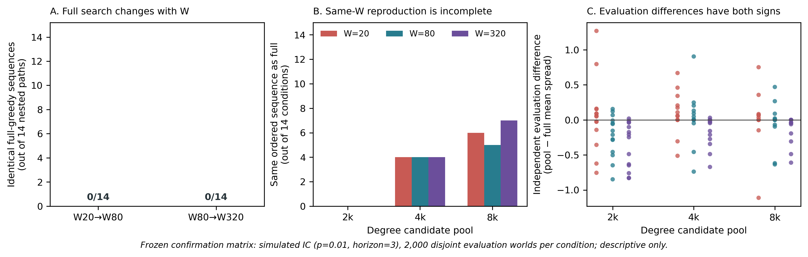

# Selection Resolution Changes Candidate-Truncation Conclusions in Simulated Influence Maximization

**Author names, affiliations, corresponding author and e-mail:** to be supplied by the authors before submission.

## Abstract

Candidate truncation reduces the search cost of simulation-based influence
maximization, but its apparent agreement with full greedy search is conditional
on the Monte Carlo worlds used during selection. We introduce a
selection-resolution profile that reports nested selection-world
re-optimization, round-level ties, same-budget agreement with full greedy,
disjoint evaluation spread and decision cost together. The profile is applied
to a frozen 42-condition matrix on four openly licensed SocioPatterns temporal
contact datasets. We construct bidirectional topologies from the observed
contacts and run independent-cascade simulations with transmission probability
0.01 and horizon three. Across 14 nested dataset/path/seed-budget blocks, the
ordered full-greedy sequence changed in every transition from 20 to 80 worlds
and from 80 to 320 worlds. Exact best-score ties fell from 80/190 greedy rounds
at 20 worlds to 21/190 at 320 worlds. Degree-based pools reduced decision time
but did not uniformly reproduce the same-budget full reference: 2k reproduced
0/42 sequences, 4k 12/42, and 8k 18/42. Independent evaluation differences
had both signs. These findings show why a candidate pool should be evaluated
against a named finite-world reference and why speed, seed agreement, and
out-of-sample spread must be reported jointly. The results are descriptive for
the stated simulator and contact-derived topologies; they do not establish
observed information diffusion, causal influence, universal pool equivalence,
or superiority of a learned or structural ranking.

**Keywords:** influence maximization; Monte Carlo simulation; candidate
truncation; reproducibility; temporal contact networks; social network analysis

## 1 Introduction

Influence maximization selects a limited number of initial nodes to maximize a
diffusion objective. The independent-cascade formulation made this selection
problem a standard reference point for network algorithms [1]. It also creates
a practical evaluation difficulty: a greedy decision is usually based on a
finite collection of simulated diffusion worlds. At the same time, practical
implementations frequently reduce the candidate set before the greedy search in
order to control cost. A paper can consequently appear to show that a candidate
pool preserved full search even when the full-search reference itself changes
as selection simulation is refined.

This paper studies that evaluation problem. It does not offer a new influence
maximization algorithm, a safe-pruning theorem, or a new node-ranking model.
Instead, it asks a narrower question: **when a candidate pool is compared with
full greedy search under a finite Monte Carlo selection budget, how does that
budget alter the reported preservation, cost and failure boundary?**

The question is important because a candidate pool is normally evaluated by
one reported seed set or one reported utility value. That does not reveal
whether the result is stable when the selection estimate is refined. Modern
influence-maximization methods have developed highly efficient sampling and
approximation schemes [2], but a study that evaluates a truncation policy still
needs to distinguish (i) a finite-world reference, (ii) a pool's ability to
reproduce that particular reference, and (iii) performance on disjoint worlds
not used to choose the seeds.

We make three bounded contributions.

1. We define a *selection-resolution profile*: nested selection-world budgets,
   ordered greedy traces and round-level margins; same-budget agreement with a
   full reference; independent evaluation spread; and decision cost.
2. We apply a frozen, complete 42-condition confirmation matrix to four
   independently collected temporal contact datasets with documented licenses,
   field semantics, source hashes and an immutable code snapshot.
3. We report the positive and negative findings together. Increased selection
   resolution changes every full-greedy trace in the matrix. Degree pools offer
   cost savings, but none reproduces full greedy consistently across all stated
   conditions.

This framing prevents a stronger but unsupported conclusion. The study does not
compare a graph neural network with degree screening. It does not claim that
the observed contacts are information cascades. Nor does it treat the four
networks or two random-world paths per network as a random sample from which a
population significance test can be inferred.

## 2 A selection-resolution profile

Let a directed topology be denoted by \(G=(V,E)\), let \(k\) be the seed
budget, and let \(\mathcal{W}_W\) be a fixed collection of \(W\) independent
simulation worlds used only for selection. Full greedy evaluates every
available candidate at each round under \(\mathcal{W}_W\), with a stable node-ID
tie-break. A candidate policy \(q\) restricts each round to a precomputed
candidate pool, while using the identical simulator, selection worlds and
tie-break.

For each `(network, path, k, W, q)` condition, the profile records:

- the ordered seed sequence and, at each greedy round, the winner, runner-up,
  margin and exact best-score tie count;
- whether the candidate sequence exactly equals full greedy under the **same**
  \(W\), and the first divergent round if it does not;
- the mean spread on a disjoint collection of evaluation worlds shared by all
  arms in the condition; and
- measured decision time, including the greedy enumeration and final
  evaluation but excluding data preparation and the inexpensive degree ranking.

The selection worlds are nested: W=20 is a prefix of W=80, which is a prefix
of W=320 on a named world path. Thus a change in a full-greedy sequence is a
direct diagnostic of resolution sensitivity, not a result of drawing unrelated
world sets. Independent evaluation worlds are never used in seed selection.

The profile has a deliberately limited interpretation. Equality with full
greedy at W=80 means equality with the stored finite-world full reference at
W=80. It is not equivalence to an unobserved exact expectation, nor a
guarantee for another graph, another diffusion model or another seed budget.

## 3 Data and frozen protocol

### 3.1 Data scope

The confirmation layer uses four SocioPatterns datasets: a 2013 workplace
deployment, a 2015 workplace deployment, the 2009 SFHH conference, and 2012
Kenyan households. The data pages describe the first three as temporal
face-to-face contacts at 20-second resolution and the fourth as measured
household contacts [3–6]. The source pages provide a Creative Commons Public
Domain Dedication for these datasets and request the corresponding source
citations. The original studies are cited in [3–6].

These datasets do **not** contain observed parent-child information cascades.
Each observed undirected contact was converted to two directed edges at the
same timestamp only to define a simulated propagation topology. The reported
spread is therefore simulated independent-cascade spread on a
contact-derived topology, not a measure of real information diffusion or a
causal intervention effect.

For every dataset, the first 65% of complete timestamp groups form the
historical topology. The dataset-specific raw archive hash, parsed file hash,
transformation and semantic limitation are recorded in a data card. Raw
provider archives are not redistributed by this study.

### 3.2 Confirmation matrix

The primary simulator uses independent cascade with transmission probability
\(p=0.01\) and horizon three. The candidate arms are full greedy and the top
2k, 4k and 8k nodes by historical weighted degree. The selection budgets are
W={20,80,320} on paths 301 and 302. All arms in a condition share 2,000
disjoint evaluation worlds.

All four datasets are evaluated at \(k=5\). The 2013 workplace, 2015
workplace and Kenya datasets are also evaluated at \(k=20\). SFHH \(k=20\)
was excluded before examining outcomes by an outcome-blind resource preflight:
the full-reference cost would violate the frozen four-hour serial ceiling. The
resulting matrix contains 42 conditions and 168 arm executions. The protocol,
data admission ledger and source snapshot were frozen before the confirmation
results were read.

### 3.3 Analysis principle

The study reports condition-level observations and pooled descriptions. It does
not calculate population p-values: the small set of data instances is not a
random sample, and the two world paths are controlled computational
replications rather than additional networks. The primary claims are counts,
recorded seed traces, independently evaluated differences and costs. This
choice makes the inferential boundary explicit instead of using many simulation
worlds to imply many independent social networks.

## 4 Results

### 4.1 Full greedy is resolution-sensitive in every nested block

The immutable confirmation run completed all 42 conditions and passed the
frozen-matrix validator. Across all 14 `(dataset, path, k)` blocks, no ordered
full-greedy sequence remained identical from W=20 to W=80 (0/14), and no
sequence remained identical from W=80 to W=320 (0/14). Exact best-score ties
in the full selection trace declined from 80 out of 190 greedy rounds at W=20
to 46/190 at W=80 and 21/190 at W=320.

The change in an ordered sequence should not be read as evidence that a larger
W returns a universally better seed set. It establishes the narrower,
protocol-level fact that the finite-world reference used to judge candidate
truncation is not stable at the lower budgets. A result that says a pool
"matches full greedy" without naming its selection budget can therefore be
misleading.

### 4.2 Candidate agreement is incomplete and depends on pool size

Table 1 gives exact same-W agreement. Degree 2k never reproduced the ordered
full sequence (0/14 at each W). Degree 4k reproduced 4/14 sequences at each
budget. Degree 8k reproduced 6/14 at W=20, 5/14 at W=80 and 7/14 at W=320.
No fixed degree pool was a uniform same-W surrogate for full greedy.

**Table 1. Same-W candidate agreement and decision-time saving.**

| Pool | W | Exact ordered agreement | Median decision-time saving |
| --- | ---: | ---: | ---: |
| Degree 2k | 20 / 80 / 320 | 0/14 / 0/14 / 0/14 | 67.2% / 83.8% / 87.4% |
| Degree 4k | 20 / 80 / 320 | 4/14 / 4/14 / 4/14 | 55.9% / 66.2% / 72.4% |
| Degree 8k | 20 / 80 / 320 | 6/14 / 5/14 / 7/14 | 32.8% / 41.2% / 45.6% |

The savings are relevant operationally, but they are paired with an explicit
reproduction risk. A low cost does not justify treating a truncation as an
exact approximation when it has omitted seed choices that full greedy makes
under the same simulation budget.

### 4.3 Independent evaluation does not support a superiority claim

The 2,000 held-out worlds give a separate spread estimate for each arm. The
candidate-minus-full mean differences have both positive and negative signs.
At W=320, the mean differences across the 14 conditions are −0.356 for degree
2k, −0.158 for degree 4k and −0.124 for degree 8k. At lower W, some conditions
are positive and some negative. These signs must not be interpreted as an
effect of candidate policy: the arms choose different finite-world seed sets,
and the study is not designed to infer an average population effect. The key
empirical result is that seed agreement, cost and independent evaluation can
move separately.

**Figure 1.** Selection-resolution confirmation. (A) no adjacent nested budget
transition preserves an ordered full-greedy sequence across the 14 paths. (B)
degree-pool reproduction is incomplete at every selection budget. (C) held-out
evaluation differences have both signs. The figure reports simulated IC only.

## 5 Discussion

Candidate truncation is often presented as a computational device, whereas
full greedy search is treated as a stable comparator. The present matrix shows
that this comparator can vary substantially with the number of worlds used to
estimate marginal influence. The consequence is not that full greedy is
invalid. It is that a candidate-pool claim needs a more precise target: the
pool may reproduce a finite, named reference at a stated selection budget.

The profile also exposes the quality-cost trade-off. Degree 2k delivers the
largest median cost reduction but never reproduces the ordered full sequence in
this matrix. The larger degree pools reproduce some full sequences and retain
some decision-time savings, yet still fail in other conditions. Selecting only
the apparently successful cases would turn a conditional cost observation into
an unjustified general rule. The full matrix instead presents both successful
and failed conditions.

The scope is intentionally modest. First, the IC probability and horizon are
fixed. A different diffusion model or probability calibration may produce a
different resolution profile. Second, topology is derived from contact data,
which makes the simulations meaningful as a controlled network-computation
task but not as a validation of information diffusion. Third, the report uses
only degree pools. It does not say whether a learned score, PageRank or another
policy would change the pattern. Fourth, increasing W from 20 to 320 does not
identify the exact-expectation optimum; it simply tests whether conclusions at
smaller W survive a predetermined refinement.

These limits also define a practical reporting recommendation. A candidate
truncation paper should publish (a) its selection-world budget and nested
stability path, (b) per-round margins and ties, (c) exact agreement with a
same-W full comparator, (d) disjoint evaluation results and (e) decision cost.
Where resources preclude full search at higher resolution, that limit should
be reported as a feasibility boundary rather than hidden.

## 6 Conclusion

The complete confirmation matrix supports a publishable computational-methods
direction: **selection resolution is part of the evaluation target for
candidate-truncated simulation-based influence maximization.** On four
contact-derived temporal topologies, full greedy changed on every nested
selection-world transition, while degree pools offered cost savings but did not
uniformly reproduce the named full reference. The contribution is a rigorous,
reproducible protocol and a documented failure boundary. It is not a claim of
universal candidate-pool equivalence, structural-ranking superiority, GNN
superiority, observed information diffusion or causal impact.

## Statements and Declarations

**Funding:** [To be supplied by the authors. Do not state “no funding” unless
confirmed.]

**Competing interests:** [To be supplied by the authors.]

**Author contributions:** [To be supplied by the authors, using the journal's
required contribution taxonomy.]

**Data availability:** The raw contact data remain available from the
SocioPatterns provider pages cited below under their stated CC0 terms. This
study does not redistribute those provider files. The planned reproducibility
archive will contain the data-preparation code, data cards, source hashes,
frozen protocol, immutable source snapshot, condition-level outputs, validator
and analysis scripts.

**Code availability:** [Insert an archival repository DOI or persistent URL
after the authors create and verify a public release.]

**Use of AI tools:** [Authors must provide a truthful statement consistent with
the target journal's current policy and their actual use.]

## References

1. Kempe D, Kleinberg J, Tardos É (2003) Maximizing the spread of influence
   through a social network. In: Proceedings of the ninth ACM SIGKDD
   international conference on knowledge discovery and data mining, pp 137–146.
   https://doi.org/10.1145/956750.956769
2. Tang Y, Shi Y, Xiao X (2015) Influence maximization in near-linear time: a
   martingale approach. In: Proceedings of the 2015 ACM SIGMOD international
   conference on management of data, pp 1539–1554.
   https://doi.org/10.1145/2723372.2723734
3. Génois M, Vestergaard CL, Fournet J, Panisson A, Bonmarin I, Barrat A (2015)
   Data on face-to-face contacts in an office building suggest a low-cost
   vaccination strategy based on community linkers. Network Science 3:326–347.
   https://doi.org/10.1017/nws.2015.10
4. Génois M, Barrat A (2018) Can co-location be used as a proxy for
   face-to-face contacts? EPJ Data Science 7:11.
   https://doi.org/10.1140/epjds/s13688-018-0140-1
5. Cattuto C, Van den Broeck W, Barrat A, Colizza V, Pinton J-F, Vespignani A
   (2010) Dynamics of person-to-person interactions from distributed RFID
   sensor networks. PLoS ONE 5:e11596.
   https://doi.org/10.1371/journal.pone.0011596
6. Kiti MC, Tizzoni M, Kinyanjui TM, et al. (2016) Quantifying social contacts
   in a household setting of rural Kenya using wearable proximity sensors. EPJ
   Data Science 5:21. https://doi.org/10.1140/epjds/s13688-016-0084-2
