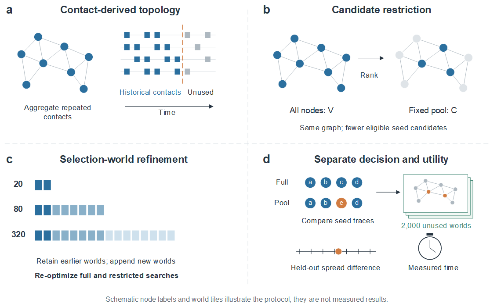
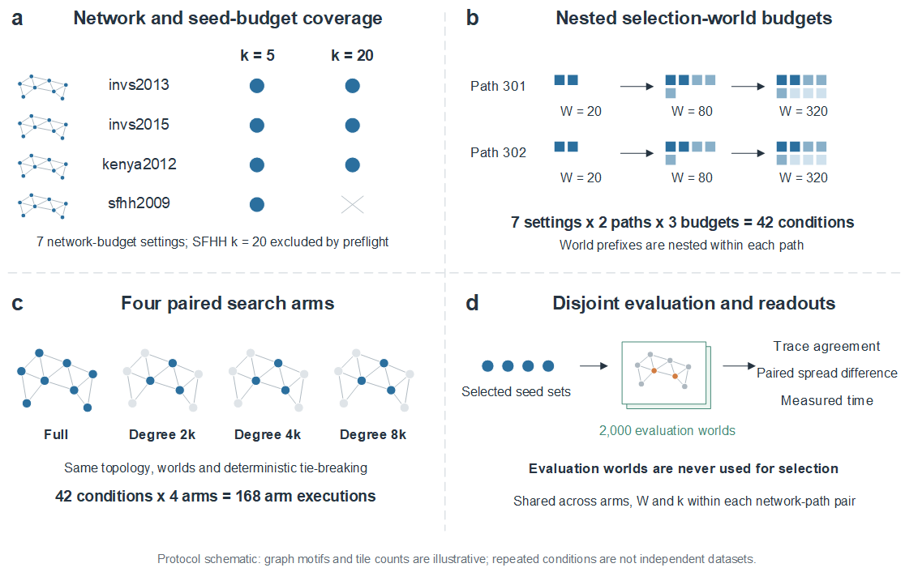
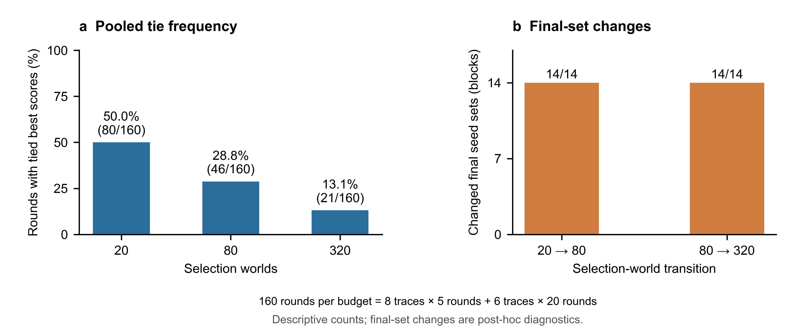
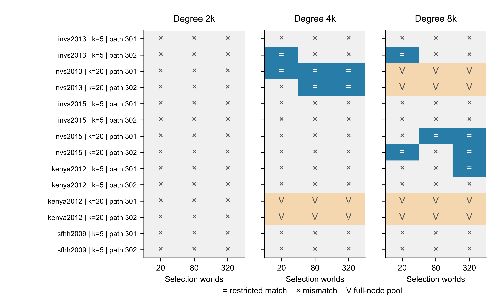
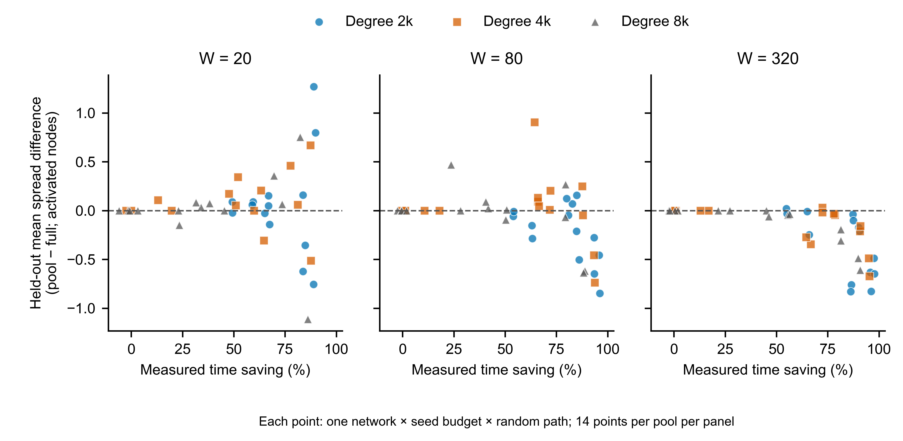
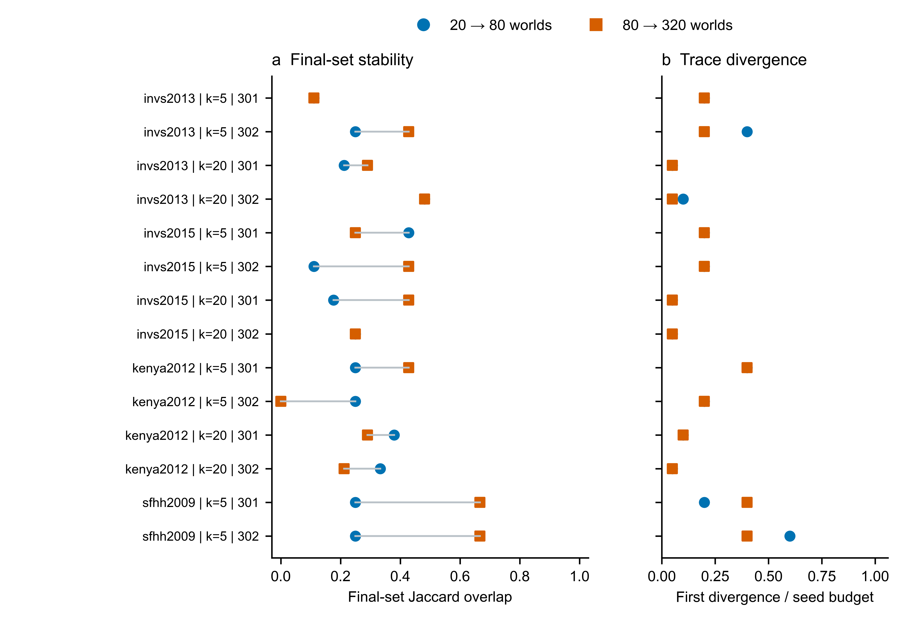
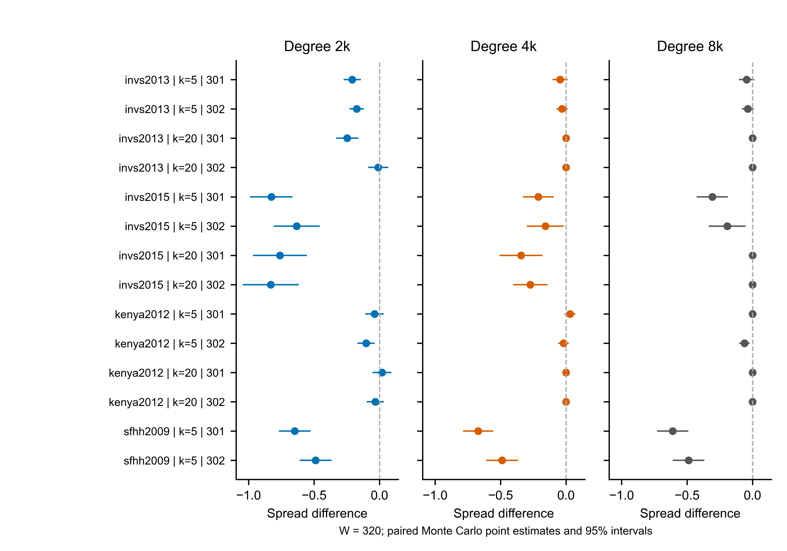

# Selection Resolution Changes Candidate-Truncation Conclusions in Simulated Influence Maximization

**Author names, affiliations, corresponding author and e-mail:** to be supplied by the authors before submission.

## Abstract

Candidate restriction can reduce the cost of greedy influence maximization, but its agreement with a simulated full-search reference depends on the simulation budget used to define that reference. We introduce a selection-resolution profile that jointly reports nested simulation budgets, greedy traces, actual candidate coverage, held-out spread, and computation time. On four contact-derived networks under independent-cascade simulation, every one of 14 full-greedy traces changed when the selection budget increased from 20 to 80 and again from 80 to 320 worlds. Nominally larger pools matched more traces, although some of those arms covered every node; genuinely restricted pools did not match consistently. Restricted searches saved time but yielded held-out spread differences of both signs. The results distinguish reproduction of a finite-simulation decision from preservation of diffusion utility. Candidate-restriction studies should report the named selection budget, stability of the full reference, actual candidate coverage, independent utility, and cost. The findings are limited to the tested simulation setting and do not establish convergence to exact expected influence.

**Keywords:** influence maximization; Monte Carlo simulation; candidate truncation; reproducibility; network optimization

## 1 Introduction

Influence maximization asks which initial nodes should be selected to maximize expected diffusion through a network [1]. In a simulation-based implementation, answering this question involves two computational choices: which nodes to consider and how accurately to estimate their influence. Restricting the candidate pool reduces the number of alternatives evaluated at each greedy step. Increasing the number of simulated diffusion worlds refines the objective estimate. An evaluation of candidate restriction therefore depends on both the search space and the simulation budget.

The difficulty is that the full-search comparator is itself an estimated decision. Consider a restricted search that returns the same ordered seed sequence as full greedy under a small set of simulation worlds. This establishes reproduction of that particular reference. If full greedy selects a different sequence when the world set is enlarged, the original agreement does not establish agreement at the new budget. Conversely, a different sequence need not have worse independently evaluated spread. Decision reproduction and diffusion utility answer different questions.

We study this distinction for degree-based candidate restriction under the independent-cascade model. Our research question is: **how does the number of selection worlds affect reference stability, candidate agreement, and the observed cost–utility trade-off?** We call this number the *selection resolution*. Nested world sets allow us to refine resolution while retaining all earlier worlds. Separate evaluation worlds measure the spread of the resulting seed sets without reusing the worlds that selected them.

The methodological context includes the influence-maximization formulation of Kempe et al. [1] and efficient sampling-based optimization represented by Tang et al. [2]. The present experiment concerns an enumerative, finite-world greedy implementation. Its comparator is the stored greedy trace at a specified simulation budget; it is not an exact expected-influence optimum. This distinction defines the scope of the evaluation.

The paper organizes reference stability, candidate reproduction, held-out spread, and cost into a common selection-resolution profile. It applies this profile to a fixed matrix of four contact-derived networks, three selection budgets, and three degree-based candidate pools. The resulting evidence identifies a concrete limitation of reference-based evaluation: every adjacent budget transition changes the ordered full-greedy trace, while candidate agreement, independent utility, and computation savings exhibit different patterns.

The contribution is a bounded empirical evaluation, not a new seed-selection algorithm. Specifically, this paper: (i) makes the finite-world full-greedy reference explicit and tests its stability under nested budget refinement; (ii) separates nominal candidate-pool size from actual coverage, so full-pool controls are not misreported as successful truncation; and (iii) combines procedural agreement, conditional held-out utility uncertainty, and measured timing in a reusable reporting profile. These claims concern the frozen protocol described below.

### 1.1 Related work and the scope of the present contribution

Influence-maximization research addresses several distinct sources of computational difficulty. The classical formulation connects seed selection to the expected reach of a stochastic diffusion process [1]. The algorithmic survey by Li et al. organizes diffusion models and optimization methods, illustrating why a result for one simulator and implementation need not describe the entire problem family [9]. Efficient optimization may reduce repeated marginal-gain calculations, change how influence is sampled, or restrict the eligible seeds. These interventions affect different parts of the computation and require different evidence of accuracy.

The cost-effective lazy-forward approach developed in outbreak detection exploits previously computed information to avoid unnecessary objective evaluations [7]. StaticGreedy instead emphasizes consistent reuse of sampled diffusion realizations during optimization [8]. The latter is particularly relevant here: a fixed collection of worlds defines a reproducible empirical objective, but reproducibility within that collection is a different question from stability when the collection is enlarged. Our shared, nested worlds expose this second question. We do not claim that fixed-world optimization or simulation reuse is new. Nor do we infer that a change in the finite-world greedy sequence invalidates approximation results that apply under their own assumptions.

Sampling-based methods such as IMM pursue efficient influence maximization with algorithm-specific statistical guarantees [2]. Their sampling procedures and stopping conditions differ from the small, enumerated world prefixes examined here. Consequently, the present results cannot be read as a comparison with IMM or as evidence against its guarantees. Our full-search arm exhausts eligible nodes at each greedy round, rather than exhaustively enumerating all seed sets or calculating an exact expected-influence optimum. Naming this comparator precisely is necessary when interpreting either speed improvements or agreement counts.

Candidate-selection research also includes structural heuristics and population-based optimization. In Computing, Rui et al. study a fixed-neighbour-scale approach [12], while Fan et al. develop discrete Harris hawks optimization for influence maximization [13]. These articles establish relevant algorithmic context for the journal, but their reported performance does not validate our degree pools. We deliberately retain a simple historical weighted-degree ranking so that changing the candidate set does not simultaneously change a learned representation. This isolates an evaluation issue; it does not establish a competitive new solver.

Learning-based combinatorial optimization offers another route, reviewed by Li et al. [10]. A recent example combines lightweight reinforcement learning with prior knowledge for imbalanced heterogeneous networks [14]. Learned selection can introduce additional variability from training, representations, and tuning. None of those sources is tested by the present confirmation matrix. Its findings therefore support neither a GNN advantage nor the broader conclusion that learned selectors are unnecessary. A learning claim would require matched historical-information baselines, controlled training choices, and independent evaluation beyond this study.

Two further distinctions concern realism and benchmarking. Temporal-network influence maximization explicitly considers evolving interactions [11], whereas our timestamp split supplies an aggregated historical topology. Empirically motivated influence models can change seed-selection conclusions [15]; contact observations alone do not identify such a model. Benchmarking itself has an established literature, including the study by Arora et al. [16]. We cite that work as evaluation context, without adopting its broader algorithm rankings. The narrower contribution here is a fully exposed comparison of reference resolution, actual candidate coverage, seed-set changes, conditional utility uncertainty, and measured cost on one frozen matrix. This contribution is descriptive and reproducible, rather than a new approximation theorem or a claim of general algorithmic superiority.

## 2 Resolution-aware evaluation

Figure 1 shows how search-space restriction and selection resolution enter the evaluation. Their effects are inspected through decision reproduction, independently evaluated utility, and measured cost.

**Fig. 1** Computational evaluation mechanism. A fixed contact-derived graph supplies the full and degree-restricted searches. Each search is repeated at nested selection-world budgets under common tie-breaking. Ordered traces are compared across budgets and candidate pools, while selected sets are evaluated on disjoint worlds. The network motifs, world tiles, and seed tokens are schematic, not measured data; tile counts are not proportional to simulation budgets. Muted nodes remain in the propagation graph but are ineligible as seeds. Arrows indicate computational information flow, not an experimentally established causal mechanism for trace instability. An editable native Visio master accompanies the figure.

### 2.1 Finite-world greedy selection

Let \(G=(V,E)\) denote a directed graph and \(k\) the seed budget. For a seed set \(S\), let \(f(S;\omega)\) be its simulated spread in world \(\omega\). Selection uses the finite-world objective

\[
\widehat{\sigma}_{W}(S)=\frac{1}{W}\sum_{\omega\in\mathcal W_W}f(S;\omega).
\]

Starting from the empty set, greedy selection adds the available node that maximizes this objective after addition. Full greedy considers all remaining nodes. Restricted greedy considers only a fixed candidate pool \(C\subseteq V\). Both use the same selection worlds and deterministic node-ID tie-breaking.

Write the resulting ordered sequence as \(T_W(C)\), and its final seed set as \(S_W(C)\). The full reference is \(T_W(V)\). Exact ordered agreement,

\[
A_W(C)=\mathbf{1}\{T_W(C)=T_W(V)\},
\]

measures reproduction of the full greedy trace. It is stricter than equality of the final unordered seed sets: two sequences can differ in order while containing the same nodes. Neither sequence disagreement nor set disagreement alone quantifies a loss of expected spread.

### 2.2 Reference refinement and independent evaluation

We evaluate nested selection worlds, with
\(\mathcal W_{20}\subset\mathcal W_{80}\subset\mathcal W_{320}\).
Each budget entails a fresh greedy optimization over the corresponding prefix. Comparing \(T_{20}(V)\), \(T_{80}(V)\), and \(T_{320}(V)\) tests whether the reference trace survives a specified refinement. Two reproducible random-world paths provide separate realizations of this comparison.

At each greedy round, the profile records the selected node, the best-score tie count, and the gap between the best and runner-up scores. Ties describe ambiguity under the finite objective. Their reduction can accompany changes in selection, but a tie count alone cannot establish why a particular sequence changed.

Utility is measured using a disjoint set \(\mathcal E\) of evaluation worlds. For each pool, we report the paired difference

\[
\Delta_W(C)=\frac{1}{|\mathcal E|}\sum_{\omega\in\mathcal E}
\left[f(S_W(C);\omega)-f(S_W(V);\omega)\right].
\]

Sharing \(\mathcal E\) across arms holds the evaluation realization fixed within a comparison. A positive estimated difference can occur even when a restricted search disagrees with full greedy: selection and evaluation use different finite samples. This estimate remains subject to evaluation uncertainty.

### 2.3 A joint interpretation of agreement, utility, and cost

Table 1 summarizes the quantities needed to interpret a candidate restriction. None substitutes for the others. Exact trace agreement describes a computational decision; independently evaluated spread describes the resulting seed set; time describes the expense of obtaining and evaluating that set.

**Table 1. Quantities in the selection-resolution profile.**

| Quantity | Question answered | Interpretation boundary |
| --- | --- | --- |
| Full-reference agreement across nested budgets | Does refinement preserve the ordered greedy trace? | Does not certify convergence beyond the tested budgets |
| Same-budget candidate agreement | Does restriction reproduce the named full trace? | Disagreement does not necessarily imply a different final set or lower utility |
| Round-level ties and score gaps | How distinct are competing choices under the finite objective? | Does not establish a causal explanation for trace changes |
| Held-out spread difference | How do selected sets compare on unused worlds? | Finite-sample utility estimate, not population evidence across networks |
| Decision time | What computation is saved in the tested implementation? | Depends on timing scope, hardware, and implementation |

For timing, the measured interval includes greedy enumeration and final independent evaluation. Data preparation and degree ranking occur before this interval. The saving is \(1-t_C/t_V\), reported as a percentage. Consequently, these measurements describe the timed implementation rather than end-to-end preprocessing costs.

The distinction between the eligible seed set and the propagation graph is essential. Restriction changes which node can be added at a greedy round; it does not delete ineligible nodes or their incident edges from diffusion. Otherwise, a comparison would confound search-space reduction with a different spread model. Similarly, when the nominal pool size reaches the number of vertices, the pool is the full search space. Such an arm is a useful implementation consistency check but supplies no evidence that truncation preserved a solution.

## 3 Experimental design

The experiment addresses three linked questions. First, does refinement of a fixed selection-world path preserve the full-greedy decision? Second, does a degree-restricted search reproduce the full reference at the same selection budget? Third, how do its independently evaluated spread and measured computation time compare? Figure 2 summarizes the crossed comparison structure. Table 2 describes the graph instances, while Table 3 distinguishes varied factors from shared controls.

**Fig. 2** Experimental design and comparison units. (a) Four contact-derived graphs provide seven admitted combinations of network and seed budget; filled circles indicate inclusion and the cross marks the SFHH setting excluded during resource preflight. (b) Each setting is crossed with two random-world paths and three nested selection budgets, giving 42 conditions. (c) Each condition runs full greedy and three degree-pool arms, giving 168 arm executions. Eligibility alone changes between arms; the diffusion topology is shared. The small networks illustrate this distinction and do not encode measured pool sizes. (d) Selected sets are evaluated on 2,000 worlds disjoint from selection and shared across arms, selection budgets and seed budgets within each pair of network and path. Seed traces and timing come from selection records and the timed execution; spread comes from evaluation. Diagram tiles are schematic. Conditions sharing data or worlds are dependent comparisons, not independent network replicates.

### 3.1 Networks and simulated diffusion

We use four SocioPatterns contact datasets: the 2013 and 2015 workplace deployments, the 2009 SFHH conference, and 2012 Kenyan households [3–6]. These records provide observed contacts from which to construct graph instances. They do not provide observed information cascades.

The first 65% of complete timestamp groups define the historical data. Each undirected contact is represented by two directed edges, and the historical contacts are aggregated into a graph. Degree ranking uses historical weighted degree. Diffusion is then simulated on this contact-derived topology using independent cascade with transmission probability \(p=0.01\) and horizon three. The temporal records determine the historical graph; the reported outcome is simulated spread, rather than a validated model of temporal information transmission.

**Table 2. Historical graph instances used by the frozen confirmation run. Edge counts include both directions of each aggregated contact link. Conditions count world-path and selection-budget combinations, not independent datasets.**

| Dataset | Nodes | Directed edges | Seed budgets | Conditions |
| --- | ---: | ---: | --- | ---: |
| invs2013 | 91 | 1,238 | 5, 20 | 12 |
| invs2015 | 212 | 6,938 | 5, 20 | 12 |
| kenya2012 | 75 | 1,044 | 5, 20 | 12 |
| sfhh2009 | 402 | 11,856 | 5 | 6 |

These are sizes after historical preprocessing, rather than headline sizes of the complete provider datasets. The instances permit exhaustive per-round candidate enumeration at the chosen budgets. They do not constitute a large-scale scalability benchmark. Their different sizes also mean that a fixed multiple of the seed budget represents different fractions of the graph.

### 3.2 Candidate pools and comparison matrix

The restricted pools contain the highest-ranked \(\min(|V|,2k)\), \(\min(|V|,4k)\), or \(\min(|V|,8k)\) nodes by historical weighted degree. Each pool is constructed before greedy selection and remains fixed throughout that selection. All arms within a condition share the graph, simulator, selection worlds, evaluation worlds, and tie-breaking rule.

The design combines selection budgets \(W\in\{20,80,320\}\) with two random-world paths. All four networks use \(k=5\); the two workplace networks and Kenya also use \(k=20\). SFHH at \(k=20\) was excluded by a resource preflight before confirmation outcomes were examined because preflight projections indicated that including it would exceed the four-hour serial ceiling for the confirmation matrix. This yields seven network–seed-budget settings, 14 nested trajectory blocks, and 42 conditions. Each condition contains full greedy and three restricted arms, giving 168 arm executions.

Each arm is evaluated on 2,000 worlds disjoint from selection. The study configuration and execution source snapshot were fixed before reading the confirmation results. Online Resource 1 describes the execution matrix and evidence provenance.

**Table 3. Experimental factors and controls. The matrix was fixed before confirmation results; the final row identifies diagnostics added subsequently.**

| Component | Setting | Role in the comparison |
| --- | --- | --- |
| Network and seed budget | Four networks; k = 5 for all, k = 20 for three | Seven admitted settings (Table 2) |
| Selection resolution | W = 20, 80, 320 | Refines the empirical objective on nested prefixes |
| Random-world path | 301, 302 | Two realizations within each combination of network and seed budget |
| Candidate eligibility | Full V; top min(n, 2k), min(n, 4k), min(n, 8k) by historical weighted degree | Four paired arms; the pool remains fixed during selection |
| Historical graph | First 65% of complete timestamp groups; bidirectional aggregate | Shared input graph and ranking information |
| Diffusion | Independent cascade; p = 0.01; horizon 3 | Fixed simulator across all comparisons |
| Selection controls | Same worlds and deterministic node-ID tie-breaking within a condition | Makes same-budget arm comparisons reproducible |
| Evaluation worlds | 2,000 disjoint from selection; reused within each pair of network and path | Paired utility estimates; shared worlds induce dependence |
| Timing scope | Greedy search plus final evaluation; excludes graph preparation and ranking | Defines the reported time saving |
| Additional diagnostics | Set overlap, first divergence, full-pool classification, conditional Monte Carlo intervals | Post-hoc analysis of frozen outputs |

Three comparison units follow from this design. A trajectory block fixes the network, seed budget and path, and contains the three nested selection budgets; there are 14 such blocks. An arm comparison additionally fixes the selection budget and contrasts one pool against full greedy; there are 126 such comparisons. A paired evaluation difference compares two selected sets on one shared evaluation world. These units answer different questions and must not be treated as interchangeable replications.
### 3.3 Analysis

We report the fraction of matching ordered traces, tie counts, held-out spread differences, and median timing savings. Comparisons across selection budgets use the same nested trajectory block; comparisons across candidate pools use the same condition.

These summaries describe the tested instances. The four networks are not a random sample of a network population, and simulation paths do not increase the number of independently collected datasets. Pooled condition counts are therefore descriptive, not estimates of a population success probability. The analysis also does not equate a small point estimate of spread loss with established utility equivalence.

#### Post-hoc diagnostics

After inspecting the confirmation summaries, we computed additional diagnostics from the stored outputs, without repeating selection or modifying outcomes. Final-set similarity is the Jaccard index \(J(A,B)=|A\cap B|/|A\cup B|\). The first divergence is the one-based greedy round at which adjacent-budget sequences first differ; division by \(k\) expresses its location within a trace. These analyses distinguish changed ordering from changed membership. We also classify each arm by whether its actual candidate count equals the graph's node count, separating full-pool controls from genuine restrictions.

For conditional evaluation uncertainty, let \(d_i\) be candidate-minus-full spread in shared evaluation world \(i\). We estimate the Monte Carlo standard error as \(s_d/\sqrt{2000}\) and display the normal-approximation interval \(\bar d\pm1.96s_d/\sqrt{2000}\). This calculation preserves pairing rather than treating the two arm means as independent. It is conditional on the selected sets and simulator, and assumes the evaluation worlds are independent draws. It does not include selection-path variability, model uncertainty, or sampling of networks. The intervals are unadjusted descriptive intervals, not simultaneous tests or evidence of equivalence. Figure 7 displays the largest tested selection budget; the accompanying CSV retains all 126 comparisons.

## 4 Results

### 4.1 Does increasing selection resolution preserve the reference?

The full-greedy ordered sequence changed in every tested block at both adjacent budget transitions. No block preserved its sequence from 20 to 80 worlds (0/14), or from 80 to 320 worlds (0/14). Thus, none of these comparisons supplied an unchanged ordered reference against which candidate restriction could be assessed across resolutions.

Exact best-score ties became less frequent as the selection budget increased: 80 of 160 greedy rounds at \(W=20\) (50.0%), 46 at \(W=80\) (28.8%), and 21 at \(W=320\) (13.1%). The denominator comprises eight traces of five rounds and six traces of 20 rounds. Larger budgets therefore reduced pooled ties without preserving the ordered traces. The post-hoc analysis also found changed final seed sets in all 14 blocks at each transition (Section 4.4). Neither result establishes that higher-budget sets are uniformly better or that ties cause instability.

Figure 3 pairs pooled tie proportions with final-set change counts. The 14 individual tie trajectories are shown by network and seed budget in Supplementary Fig. S1; individual trajectories need not decrease monotonically.

**Fig. 3** Fewer pooled ties coexist with changes in final seed sets. (a) The proportion of greedy rounds with multiple best-scoring candidates at each selection budget; labels show percentages and counts. Each denominator is 160 rounds from eight traces of length five and six of length 20, so longer traces contribute more weight. (b) Counts of blocks whose final unordered full-greedy seed set changes at each adjacent budget transition, computed post-hoc from frozen outputs. These descriptive counts use dependent rounds and repeated network instances; no inferential intervals or significance tests are shown. The panels do not establish utility loss or a causal relationship between ties and set changes. Individual tie trajectories appear in Supplementary Fig. S1, and final-set overlaps in Fig. 6.

### 4.2 Which pools reproduce the reference, and at what cost?

Larger pools reproduced more same-budget reference traces overall, but no pool did so throughout the matrix (Table 4). The \(2k\) pool matched none of the 42 traces. The \(4k\) pool matched 12, and the \(8k\) pool matched 18. Agreement was not monotonic in selection resolution: the \(8k\) pool matched six blocks at 20 worlds, five at 80, and seven at 320.

**Table 4. Exact ordered agreement and median measured time saving relative to full greedy. Each row summarizes 14 conditions.**

| Pool | Selection worlds | Matching traces | Median time saving |
| --- | ---: | ---: | ---: |
| Degree \(2k\) | 20 | 0/14 | 67.2% |
| Degree \(2k\) | 80 | 0/14 | 83.8% |
| Degree \(2k\) | 320 | 0/14 | 87.4% |
| Degree \(4k\) | 20 | 4/14 | 55.9% |
| Degree \(4k\) | 80 | 4/14 | 66.2% |
| Degree \(4k\) | 320 | 4/14 | 72.4% |
| Degree \(8k\) | 20 | 6/14 | 32.8% |
| Degree \(8k\) | 80 | 5/14 | 41.2% |
| Degree \(8k\) | 320 | 7/14 | 45.6% |

Actual candidate coverage qualifies these nominal-pool totals. At \(k=20\), the \(4k\) pool covers all 75 Kenya nodes, while the \(8k\) pool covers all nodes in Kenya and invs2013. Thus, six of the 12 matches for \(4k\), and 12 of the 18 matches for \(8k\), arise without any restriction. Among genuinely restricted conditions, the match counts are 0/42, 6/36, and 6/30 for \(2k\), \(4k\), and \(8k\). These denominators differ because saturation depends on network size and seed budget; they are not paired estimates of a general success rate. All full-pool arms matched their reference, providing a consistency check on shared-world selection.

The smallest pool delivered the greatest median saving at every resolution, accompanied by no exact trace reproduction. At 320 worlds, enlarging the pool from \(2k\) to \(8k\) increased matches from zero to seven while reducing median savings from 87.4% to 45.6%. The nominal comparison mixes genuinely restricted and saturated pools, so the increased match count cannot be attributed entirely to successful truncation. Whether it is an acceptable utility trade-off requires independent spread evaluation.

Figure 4 resolves the aggregate agreement counts into individual conditions, making the successful and failed comparisons visible for each network, seed budget, and random path.

**Fig. 4** Complete same-budget ordered-agreement matrix. Rows identify all 14 network–seed-budget–path blocks; columns give selection-world budgets within each candidate-pool panel. An equals sign indicates an identical ordered trace with a genuinely restricted pool, a cross indicates a different trace, and V identifies a pool containing every graph node. All V cells match by full-pool consistency; they are not successful truncations. All 126 pool-condition comparisons are shown. These are descriptive computational comparisons with shared worlds, not independent population replicates.

### 4.3 Does independent spread follow trace agreement?

Trace disagreement did not have a uniform sign in held-out utility. At 20 selection worlds, the \(2k\) pool disagreed with every full trace, yet its estimated spread difference was positive in eight conditions and negative in six. At 320 worlds, it remained different in every condition, but the split changed to one positive and 13 negative differences. The same agreement count therefore concealed different utility profiles.

At 320 worlds, mean candidate-minus-full spread differences across the 14 conditions were −0.356, −0.158, and −0.124 activated nodes for \(2k\), \(4k\), and \(8k\), respectively. For \(8k\), seven conditions had zero difference and seven had negative differences; none was positive at this budget. Positive and negative differences occur across the wider matrix, rather than in every pool–budget combination.

These point estimates show why utility must be inspected separately from trace agreement. They do not establish practical equivalence or consistent superiority: no utility-equivalence margin is tested, and the pooled means combine different networks and seed budgets. Figure 5 pairs each held-out difference with its measured time saving, exposing variation concealed by aggregate averages.

**Fig. 5** Condition-level computation–utility trade-off at three selection resolutions. Each panel shows 14 conditions per candidate pool, for 126 observations overall; overlapping points are retained. The horizontal axis gives measured time saving relative to the full arm, including search and final evaluation but excluding graph preparation and degree ranking. The vertical axis gives candidate-minus-full mean activated-node counts on 2,000 disjoint evaluation worlds; the dashed line denotes zero difference. Marker shape and color identify the pools. Values are finite-sample point estimates without inferential intervals. Shared evaluation worlds and repeated network instances make observations dependent.

### 4.4 Do changed traces also change final sets?

The post-hoc set analysis shows that the reference changes are not merely reorderings. All 14 final full-greedy sets changed from 20 to 80 worlds, and all 14 changed again from 80 to 320. Jaccard overlap ranged from 0.111 to 0.481 at the first transition and from 0 to 0.667 at the second. The descriptive means were 0.267 and 0.352, respectively. The higher mean at the second transition does not establish monotonic convergence: individual blocks can become less similar, and no tested block has identical final membership across either adjacent transition.

**Fig. 6** Post-hoc seed-set diagnostics from frozen full-greedy outputs. (a) Final-set Jaccard similarity for both adjacent budget transitions within each of the 14 blocks. Grey segments connect the two transitions of the same block; overlapping symbols are retained. (b) The first differing greedy round divided by the seed budget. Smaller values indicate earlier divergence, not a larger utility penalty. Path identifiers 301 and 302 denote the two random-world realizations. These diagnostics were added after confirmation and are not new independent replications.

Within candidate-versus-full comparisons, unordered-set agreement equals ordered agreement for every stored condition. Thus, the discrepancy between those criteria is conceptually important but does not change the match totals in this matrix. The larger concern for interpreting the totals is pool saturation, identified in Section 4.2. Separating actual coverage from nominal pool labels prevents full-search controls from being mistaken for evidence that a reduced search space is sufficient.

**Fig. 7** Post-hoc conditional evaluation uncertainty at 320 selection worlds. Points show candidate-minus-full spread on 2,000 shared, disjoint evaluation worlds; horizontal segments show paired normal-approximation 95% Monte Carlo intervals. The vertical dashed line marks zero. Identical sets have zero paired differences in every world and therefore zero-width intervals. Such points include full-pool controls but are not limited to them. Intervals quantify evaluation sampling uncertainty conditional on the selected sets and fixed simulator; they do not quantify uncertainty across networks or establish practical equivalence.

The forest display distinguishes identical-set zeros, estimates near zero, and visibly negative differences. It complements the computation–utility scatter rather than replacing it: uncertainty and timing answer different questions. A zero-width interval for an identical set is an algebraic consequence of paired evaluation, not exceptional evidence of precision about a broader population. Conversely, an interval crossing zero is insufficient to declare utility preservation without a prespecified equivalence margin. No such margin was fixed for this study.

## 5 Implications and limits

The results make the evaluation target explicit. An assertion that a candidate pool preserves full greedy should specify whether preservation means the ordered trace, the final seed set, or diffusion utility. For trace reproduction, the reference also requires a named selection budget and random-world realization. For utility preservation, independent evaluation and an explicit tolerance are needed. Reporting only a matching trace or a speed reduction leaves these distinct questions unresolved.

The selection-resolution profile offers a practical way to expose this distinction. A study first refines its full reference on nested worlds, then compares candidate pools at each common budget, and finally evaluates their selected sets on unused worlds. Timing completes the comparison. This procedure makes failed reproduction visible alongside savings and utility estimates. Its role is diagnostic; it supplies neither a new pruning guarantee nor proof that a particular simulation budget is adequate.

Several limits constrain the evidence. The probability and horizon are fixed, the pools use only weighted degree, and the graph instances come from four contact datasets. The experiment does not establish that the same pattern holds for other rankings, diffusion models, parameter regimes, or larger networks. Increasing the world count to 320 does not establish convergence to expected-influence greedy selection. A systematic characterization of how ties, small score gaps, and graph structure drive trace changes would require further analysis.

The post-hoc analysis rules out pure reordering as the explanation of reference changes in this matrix: every adjacent transition also changes final membership. This does not identify the cause of the change or establish a utility penalty. Likewise, separating saturated pools reduces the apparent evidence for successful truncation: many nominal large-pool matches are full-search controls. Both qualifications strengthen interpretation while narrowing the supported claim. Similarly, the timing interval excludes preprocessing and ranking, and the excluded SFHH setting limits the larger-\(k\) comparison. These boundaries are part of the study design and should accompany reuse of its results.

For reuse, a candidate-pool claim should record the actual candidate fraction alongside its nominal multiplier. A match at full coverage verifies consistency, while a match below full coverage establishes reproduction only for the specified empirical objective. If practical utility preservation is the goal, an acceptable spread-loss margin should be chosen before confirmatory evaluation. Additional evaluation worlds can then reduce conditional Monte Carlo uncertainty, whereas additional selection paths address a different source of variation. Simply increasing one of these budgets does not substitute for the other.

This separation also guides future experiments. Testing another transmission probability or diffusion horizon would probe the scope of the observed sensitivity. Testing larger graphs would probe whether comparable actual candidate fractions remain useful. A learned selector would require a separate comparison against simple historical rankings under matched information and tuning budgets. These are distinct extensions, and the current observations do not predict their outcomes. The frozen study remains valuable as a transparent diagnostic case, but its modest network scale and lack of a new algorithmic guarantee should remain explicit in assessing its contribution.

## 6 Conclusion

Selection resolution changes the reference used to evaluate candidate-restricted greedy influence maximization. Across the tested nested budgets, every ordered full-greedy trace changed, while degree-based restrictions saved computation and reproduced only a subset of same-budget reference traces. Held-out spread differences further showed that trace agreement and utility are separate evaluation targets. Candidate-restriction studies should therefore report the selection budget, reference stability, independent utility, and computation cost together. This yields a precise, reproducible account of the observed trade-off within the tested simulation setting.

## Statements and Declarations

**Funding:** [To be supplied by the authors. Do not state “no funding” unless
confirmed.]

**Competing interests:** [To be supplied by the authors.]

**Author contributions:** [To be supplied by the authors, using the journal's
required contribution taxonomy.]

**Data availability:** The raw contact data remain available from the
SocioPatterns provider pages cited below under their stated CC0 terms. This
study does not redistribute those provider files. The planned reproducibility
archive will contain the data-preparation code, data cards, source hashes,
frozen protocol, immutable source snapshot, condition-level outputs, validator
and analysis scripts.

**Code availability:** [Insert an archival repository DOI or persistent URL
after the authors create and verify a public release.]

**Use of AI tools:** [Authors must provide a truthful statement consistent with
the target journal's current policy and their actual use.]

## References

1. Kempe D, Kleinberg J, Tardos É (2003) Maximizing the spread of influence
   through a social network. In: Proceedings of the ninth ACM SIGKDD
   international conference on knowledge discovery and data mining, pp 137–146.
   https://doi.org/10.1145/956750.956769
2. Tang Y, Shi Y, Xiao X (2015) Influence maximization in near-linear time: a
   martingale approach. In: Proceedings of the 2015 ACM SIGMOD international
   conference on management of data, pp 1539–1554.
   https://doi.org/10.1145/2723372.2723734
3. Génois M, Vestergaard CL, Fournet J, Panisson A, Bonmarin I, Barrat A (2015)
   Data on face-to-face contacts in an office building suggest a low-cost
   vaccination strategy based on community linkers. Network Science 3:326–347.
   https://doi.org/10.1017/nws.2015.10
4. Génois M, Barrat A (2018) Can co-location be used as a proxy for
   face-to-face contacts? EPJ Data Science 7:11.
   https://doi.org/10.1140/epjds/s13688-018-0140-1
5. Cattuto C, Van den Broeck W, Barrat A, Colizza V, Pinton J-F, Vespignani A
   (2010) Dynamics of person-to-person interactions from distributed RFID
   sensor networks. PLoS ONE 5:e11596.
   https://doi.org/10.1371/journal.pone.0011596
6. Kiti MC, Tizzoni M, Kinyanjui TM, et al. (2016) Quantifying social contacts
   in a household setting of rural Kenya using wearable proximity sensors. EPJ
   Data Science 5:21. https://doi.org/10.1140/epjds/s13688-016-0084-2

7. Leskovec J, Krause A, Guestrin C, Faloutsos C, VanBriesen J, Glance N (2007) Cost-effective outbreak detection in networks. In: KDD, pp 420–429. https://doi.org/10.1145/1281192.1281239
8. Cheng S, Shen H, Huang J, Zhang G, Cheng X (2013) StaticGreedy: solving the scalability-accuracy dilemma in influence maximization. In: CIKM, pp 509–518. https://doi.org/10.1145/2505515.2505541
9. Li Y, Fan J, Wang Y, Tan K-L (2018) Influence maximization on social graphs: a survey. IEEE Transactions on Knowledge and Data Engineering 30:1852–1872. https://doi.org/10.1109/TKDE.2018.2807843
10. Li Y, Gao H, Gao Y, Guo J, Wu W (2023) A survey on influence maximization: from an ML-based combinatorial optimization. ACM Transactions on Knowledge Discovery from Data 17(9):1–50. https://doi.org/10.1145/3604559
11. Yanchenko E, Murata T, Holme P (2024) Influence maximization on temporal networks: a review. Applied Network Science 9:16. https://doi.org/10.1007/s41109-024-00625-3
12. Rui X, Yang X, Fan J, Wang Z (2020) A neighbour scale fixed approach for influence maximization in social networks. Computing 102:427–449. https://doi.org/10.1007/s00607-019-00778-5
13. Fan C, Wang Z, Zhang J, Zhao J, Rui X (2024) Influence maximization in social networks based on discrete harris hawks optimization algorithm. Computing 106:327–351. https://doi.org/10.1007/s00607-023-01207-4
14. You K, Liu S, Bai Y (2025) Influence maximization under imbalanced heterogeneous networks via lightweight reinforcement learning with prior knowledge. Complex & Intelligent Systems 11:40. https://doi.org/10.1007/s40747-024-01666-y
15. Aral S, Dhillon PS (2018) Social influence maximization under empirical influence models. Nature Human Behaviour 2:375–382. https://doi.org/10.1038/s41562-018-0346-z
16. Arora A, Galhotra S, Ranu S (2017) Debunking the myths of influence maximization: an in-depth benchmarking study. In: SIGMOD, pp 651–666. https://doi.org/10.1145/3035918.3035924
