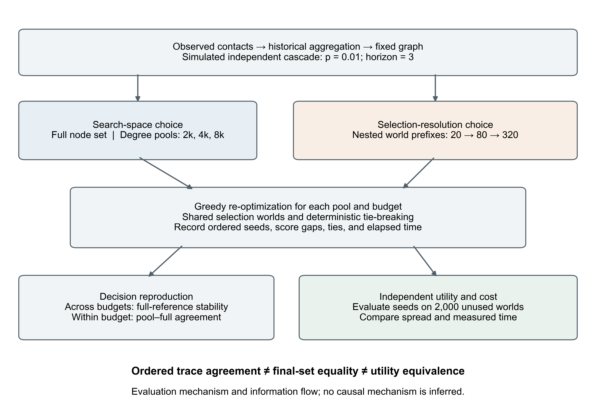
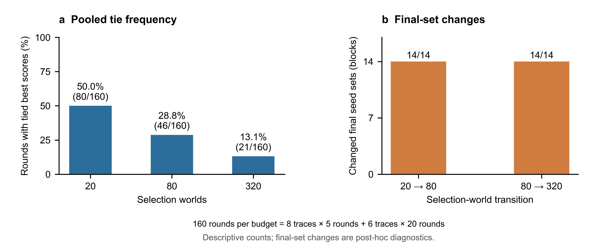
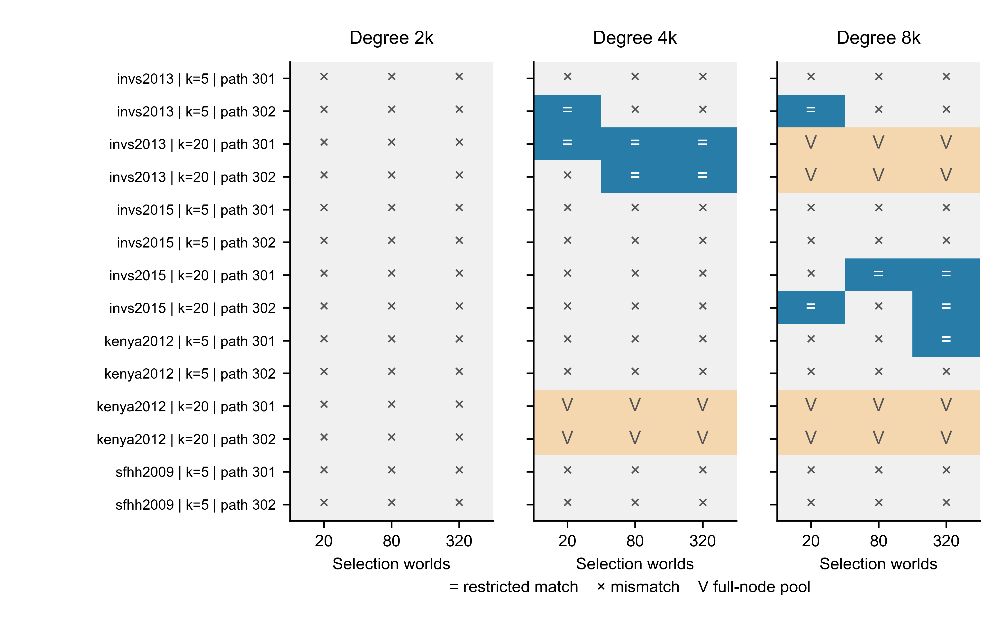
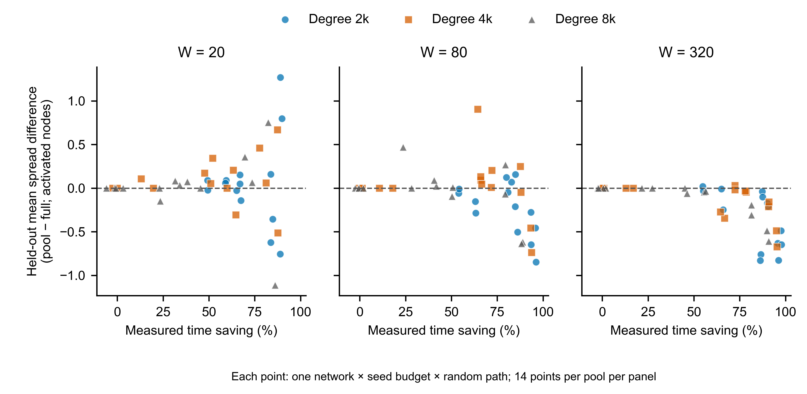

# Selection Resolution Changes Candidate-Truncation Conclusions in Simulated Influence Maximization

**Author names, affiliations, corresponding author and e-mail:** to be supplied by the authors before submission.

## Abstract

Restricting candidate nodes reduces the computational cost of greedy influence maximization, but agreement with a simulated full-search reference depends on how that reference is estimated. We examine this dependence through a selection-resolution profile that combines nested simulation budgets, greedy decision traces, candidate agreement, independent spread evaluation, and computation time. Experiments use four contact-derived networks with independent-cascade simulations and three degree-based candidate pools. Across 14 network, random-path, and seed-budget combinations, the ordered full-greedy sequence changed at both successive increases in the selection budget, from 20 to 80 and from 80 to 320 simulation worlds. Larger candidate pools reproduced more reference sequences overall, but none reproduced them in every condition. Candidate restrictions saved computation while producing both positive and negative held-out spread differences relative to full search. These findings distinguish reproduction of a finite-simulation decision trace from preservation of diffusion utility. They support evaluating candidate restrictions against an explicitly specified selection budget and reporting stability, independent utility, and cost together. The conclusions concern the tested simulation settings and do not establish convergence to an exact-expectation reference.

**Keywords:** influence maximization; Monte Carlo simulation; candidate truncation; reproducibility; network optimization

## 1 Introduction

Influence maximization asks which initial nodes should be selected to maximize expected diffusion through a network [1]. In a simulation-based implementation, answering this question involves two computational choices: which nodes to consider and how accurately to estimate their influence. Restricting the candidate pool reduces the number of alternatives evaluated at each greedy step. Increasing the number of simulated diffusion worlds refines the objective estimate. An evaluation of candidate restriction therefore depends on both the search space and the simulation budget.

The difficulty is that the full-search comparator is itself an estimated decision. Consider a restricted search that returns the same ordered seed sequence as full greedy under a small set of simulation worlds. This establishes reproduction of that particular reference. If full greedy selects a different sequence when the world set is enlarged, the original agreement does not establish agreement at the new budget. Conversely, a different sequence need not have worse independently evaluated spread. Decision reproduction and diffusion utility answer different questions.

We study this distinction for degree-based candidate restriction under the independent-cascade model. Our research question is: **how does the number of selection worlds affect reference stability, candidate agreement, and the observed cost–utility trade-off?** We call this number the *selection resolution*. Nested world sets allow us to refine resolution while retaining all earlier worlds. Separate evaluation worlds measure the spread of the resulting seed sets without reusing the worlds that selected them.

The methodological context includes the influence-maximization formulation of Kempe et al. [1] and efficient sampling-based optimization represented by Tang et al. [2]. The present experiment concerns an enumerative, finite-world greedy implementation. Its comparator is the stored greedy trace at a specified simulation budget; it is not an exact expected-influence optimum. This distinction defines the scope of the evaluation.

The paper organizes reference stability, candidate reproduction, held-out spread, and cost into a common selection-resolution profile. It applies this profile to a fixed matrix of four contact-derived networks, three selection budgets, and three degree-based candidate pools. The resulting evidence identifies a concrete limitation of reference-based evaluation: every adjacent budget transition changes the ordered full-greedy trace, while candidate agreement, independent utility, and computation savings exhibit different patterns. Together, these results provide a reporting procedure for making candidate-restriction claims precise.

## 2 Resolution-aware evaluation

Figure 1 shows how search-space restriction and selection resolution enter the evaluation. Their effects are inspected through decision reproduction, independently evaluated utility, and measured cost.

**Fig. 1** Computational evaluation mechanism. A fixed contact-derived graph supplies the full and degree-restricted searches. Each search is repeated at nested selection-world budgets under common tie-breaking. Ordered traces are compared across budgets and candidate pools, while selected sets are evaluated on disjoint worlds. Arrows indicate computational information flow, not an experimentally established causal mechanism for trace instability.

### 2.1 Finite-world greedy selection

Let \(G=(V,E)\) denote a directed graph and \(k\) the seed budget. For a seed set \(S\), let \(f(S;\omega)\) be its simulated spread in world \(\omega\). Selection uses the finite-world objective

\[
\widehat{\sigma}_{W}(S)=\frac{1}{W}\sum_{\omega\in\mathcal W_W}f(S;\omega).
\]

Starting from the empty set, greedy selection adds the available node that maximizes this objective after addition. Full greedy considers all remaining nodes. Restricted greedy considers only a fixed candidate pool \(C\subseteq V\). Both use the same selection worlds and deterministic node-ID tie-breaking.

Write the resulting ordered sequence as \(T_W(C)\), and its final seed set as \(S_W(C)\). The full reference is \(T_W(V)\). Exact ordered agreement,

\[
A_W(C)=\mathbf{1}\{T_W(C)=T_W(V)\},
\]

measures reproduction of the full greedy trace. It is stricter than equality of the final unordered seed sets: two sequences can differ in order while containing the same nodes. Neither sequence disagreement nor set disagreement alone quantifies a loss of expected spread.

### 2.2 Reference refinement and independent evaluation

We evaluate nested selection worlds, with
\(\mathcal W_{20}\subset\mathcal W_{80}\subset\mathcal W_{320}\).
Each budget entails a fresh greedy optimization over the corresponding prefix. Comparing \(T_{20}(V)\), \(T_{80}(V)\), and \(T_{320}(V)\) tests whether the reference trace survives a specified refinement. Two reproducible random-world paths provide separate realizations of this comparison.

At each greedy round, the profile records the selected node, the best-score tie count, and the gap between the best and runner-up scores. Ties describe ambiguity under the finite objective. Their reduction can accompany changes in selection, but a tie count alone cannot establish why a particular sequence changed.

Utility is measured using a disjoint set \(\mathcal E\) of evaluation worlds. For each pool, we report the paired difference

\[
\Delta_W(C)=\frac{1}{|\mathcal E|}\sum_{\omega\in\mathcal E}
\left[f(S_W(C);\omega)-f(S_W(V);\omega)\right].
\]

Sharing \(\mathcal E\) across arms holds the evaluation realization fixed within a comparison. A positive estimated difference can occur even when a restricted search disagrees with full greedy: selection and evaluation use different finite samples. This estimate remains subject to evaluation uncertainty.

### 2.3 A joint interpretation of agreement, utility, and cost

Table 1 summarizes the quantities needed to interpret a candidate restriction. None substitutes for the others. Exact trace agreement describes a computational decision; independently evaluated spread describes the resulting seed set; time describes the expense of obtaining and evaluating that set.

**Table 1. Quantities in the selection-resolution profile.**

| Quantity | Question answered | Interpretation boundary |
| --- | --- | --- |
| Full-reference agreement across nested budgets | Does refinement preserve the ordered greedy trace? | Does not certify convergence beyond the tested budgets |
| Same-budget candidate agreement | Does restriction reproduce the named full trace? | Disagreement does not necessarily imply a different final set or lower utility |
| Round-level ties and score gaps | How distinct are competing choices under the finite objective? | Does not establish a causal explanation for trace changes |
| Held-out spread difference | How do selected sets compare on unused worlds? | Finite-sample utility estimate, not population evidence across networks |
| Decision time | What computation is saved in the tested implementation? | Depends on timing scope, hardware, and implementation |

For timing, the measured interval includes greedy enumeration and final independent evaluation. Data preparation and degree ranking occur before this interval. The saving is \(1-t_C/t_V\), reported as a percentage. Consequently, these measurements describe the timed implementation rather than end-to-end preprocessing costs.

## 3 Experimental design

### 3.1 Networks and simulated diffusion

We use four SocioPatterns contact datasets: the 2013 and 2015 workplace deployments, the 2009 SFHH conference, and 2012 Kenyan households [3–6]. These records provide observed contacts from which to construct graph instances. They do not provide observed information cascades.

The first 65% of complete timestamp groups define the historical data. Each undirected contact is represented by two directed edges, and the historical contacts are aggregated into a graph. Degree ranking uses historical weighted degree. Diffusion is then simulated on this contact-derived topology using independent cascade with transmission probability \(p=0.01\) and horizon three. The temporal records determine the historical graph; the reported outcome is simulated spread, rather than a validated model of temporal information transmission.

### 3.2 Candidate pools and comparison matrix

The restricted pools contain the highest-ranked \(\min(|V|,2k)\), \(\min(|V|,4k)\), or \(\min(|V|,8k)\) nodes by historical weighted degree. Each pool is constructed before greedy selection and remains fixed throughout that selection. All arms within a condition share the graph, simulator, selection worlds, evaluation worlds, and tie-breaking rule.

The design combines selection budgets \(W\in\{20,80,320\}\) with two random-world paths. All four networks use \(k=5\); the two workplace networks and Kenya also use \(k=20\). SFHH at \(k=20\) was excluded by a resource preflight before confirmation outcomes were examined because its projected full-reference computation exceeded the four-hour serial ceiling. This yields seven network–seed-budget settings, 14 nested trajectory blocks, and 42 conditions. Each condition contains full greedy and three restricted arms, giving 168 arm executions.

Each arm is evaluated on 2,000 worlds disjoint from selection. The study configuration and execution source snapshot were fixed before reading the confirmation results. Online Resource 1 describes the execution matrix and evidence provenance.

### 3.3 Analysis

We report the fraction of matching ordered traces, tie counts, held-out spread differences, and median timing savings. Comparisons across selection budgets use the same nested trajectory block; comparisons across candidate pools use the same condition.

These summaries describe the tested instances. The four networks are not a random sample of a network population, and simulation paths do not increase the number of independently collected datasets. Pooled condition counts are therefore descriptive, not estimates of a population success probability. The analysis also does not equate a small point estimate of spread loss with established utility equivalence.

## 4 Results

### 4.1 Does increasing selection resolution preserve the reference?

The full-greedy ordered sequence changed in every tested block at both adjacent budget transitions. No block preserved its sequence from 20 to 80 worlds (0/14), or from 80 to 320 worlds (0/14). Thus, none of these comparisons supplied an unchanged ordered reference against which candidate restriction could be assessed across resolutions.

Exact best-score ties became less frequent as the selection budget increased: 80 of 190 greedy rounds at \(W=20\), 46 at \(W=80\), and 21 at \(W=320\). Larger budgets therefore reduced observed ties without preserving the ordered traces. These observations establish sensitivity of the reference sequence in this matrix; they do not determine how many final unordered sets changed or whether the higher-budget sequences are uniformly better.

Figure 2 presents the tie-rate trajectories alongside the reference-change counts.

**Fig. 2** Reference sensitivity across selection resolutions. (a) Exact best-score tie rates for all 14 network–seed-budget–path blocks (thin lines) and pooled rounds (thick line). Each block rate divides tied rounds by its seed budget; pooled rates use 190 rounds at each resolution and thus weight longer traces more heavily. Lines connect nested budgets, not independent observations. (b) Counts of changed full-greedy ordered traces at each adjacent transition. Neither panel establishes final-set changes, utility loss, or a causal relationship between ties and instability.

### 4.2 Which pools reproduce the reference, and at what cost?

Larger pools reproduced more same-budget reference traces overall, but no pool did so throughout the matrix (Table 2). The \(2k\) pool matched none of the 42 traces. The \(4k\) pool matched 12, and the \(8k\) pool matched 18. Agreement was not monotonic in selection resolution: the \(8k\) pool matched six blocks at 20 worlds, five at 80, and seven at 320.

**Table 2. Exact ordered agreement and median measured time saving relative to full greedy. Each row summarizes 14 conditions.**

| Pool | Selection worlds | Matching traces | Median time saving |
| --- | ---: | ---: | ---: |
| Degree \(2k\) | 20 | 0/14 | 67.2% |
| Degree \(2k\) | 80 | 0/14 | 83.8% |
| Degree \(2k\) | 320 | 0/14 | 87.4% |
| Degree \(4k\) | 20 | 4/14 | 55.9% |
| Degree \(4k\) | 80 | 4/14 | 66.2% |
| Degree \(4k\) | 320 | 4/14 | 72.4% |
| Degree \(8k\) | 20 | 6/14 | 32.8% |
| Degree \(8k\) | 80 | 5/14 | 41.2% |
| Degree \(8k\) | 320 | 7/14 | 45.6% |

The smallest pool delivered the greatest median saving at every resolution, accompanied by no exact trace reproduction. At 320 worlds, enlarging the pool from \(2k\) to \(8k\) increased matches from zero to seven while reducing median savings from 87.4% to 45.6%. This is a trade-off between computation and reference reproduction. Whether it is an acceptable utility trade-off requires independent spread evaluation.

Figure 3 resolves the aggregate agreement counts into individual conditions, making the successful and failed comparisons visible for each network, seed budget, and random path.

**Fig. 3** Complete same-budget ordered-agreement matrix. Rows identify all 14 network–seed-budget–path blocks; columns give selection-world budgets within each candidate-pool panel. An equals sign indicates an identical ordered trace, and a cross indicates a different trace. All 126 pool-condition comparisons are shown. These are descriptive computational comparisons with shared worlds, not independent population replicates.

### 4.3 Does independent spread follow trace agreement?

Trace disagreement did not have a uniform sign in held-out utility. At 20 selection worlds, the \(2k\) pool disagreed with every full trace, yet its estimated spread difference was positive in eight conditions and negative in six. At 320 worlds, it remained different in every condition, but the split changed to one positive and 13 negative differences. The same agreement count therefore concealed different utility profiles.

At 320 worlds, mean candidate-minus-full spread differences across the 14 conditions were −0.356, −0.158, and −0.124 activated nodes for \(2k\), \(4k\), and \(8k\), respectively. For \(8k\), seven conditions had zero difference and seven had negative differences; none was positive at this budget. Positive and negative differences occur across the wider matrix, rather than in every pool–budget combination.

These point estimates show why utility must be inspected separately from trace agreement. They do not establish practical equivalence or consistent superiority: no utility-equivalence margin is tested, and the pooled means combine different networks and seed budgets. Figure 4 pairs each held-out difference with its measured time saving, exposing variation concealed by aggregate averages.

**Fig. 4** Condition-level computation–utility trade-off at three selection resolutions. Each panel shows 14 conditions per candidate pool, for 126 observations overall; overlapping points are retained. The horizontal axis gives measured time saving relative to the full arm, including search and final evaluation but excluding graph preparation and degree ranking. The vertical axis gives candidate-minus-full mean activated-node counts on 2,000 disjoint evaluation worlds; the dashed line denotes zero difference. Marker shape and color identify the pools. Values are finite-sample point estimates without inferential intervals. Shared evaluation worlds and repeated network instances make observations dependent.

## 5 Implications and limits

The results make the evaluation target explicit. An assertion that a candidate pool preserves full greedy should specify whether preservation means the ordered trace, the final seed set, or diffusion utility. For trace reproduction, the reference also requires a named selection budget and random-world realization. For utility preservation, independent evaluation and an explicit tolerance are needed. Reporting only a matching trace or a speed reduction leaves these distinct questions unresolved.

The selection-resolution profile offers a practical way to expose this distinction. A study first refines its full reference on nested worlds, then compares candidate pools at each common budget, and finally evaluates their selected sets on unused worlds. Timing completes the comparison. This procedure makes failed reproduction visible alongside savings and utility estimates. Its role is diagnostic; it supplies neither a new pruning guarantee nor proof that a particular simulation budget is adequate.

Several limits constrain the evidence. The probability and horizon are fixed, the pools use only weighted degree, and the graph instances come from four contact datasets. The experiment does not establish that the same pattern holds for other rankings, diffusion models, parameter regimes, or larger networks. Increasing the world count to 320 does not establish convergence to expected-influence greedy selection. A systematic characterization of how ties, small score gaps, and graph structure drive trace changes would require further analysis.

The distinction between an ordered trace and a final seed set also limits the primary stability result. A changed order may leave the final set unchanged; different sets may have similar utility. Our ordered-agreement counts describe procedural reproduction and must be interpreted alongside held-out spread. Similarly, the timing interval excludes preprocessing and ranking, and the excluded SFHH setting limits the larger-\(k\) comparison. These boundaries are part of the study design and should accompany reuse of its results.

## 6 Conclusion

Selection resolution changes the reference used to evaluate candidate-restricted greedy influence maximization. Across the tested nested budgets, every ordered full-greedy trace changed, while degree-based restrictions saved computation and reproduced only a subset of same-budget reference traces. Held-out spread differences further showed that trace agreement and utility are separate evaluation targets. Candidate-restriction studies should therefore report the selection budget, reference stability, independent utility, and computation cost together. This yields a precise, reproducible account of the observed trade-off within the tested simulation setting.

## Statements and Declarations

**Funding:** [To be supplied by the authors. Do not state “no funding” unless
confirmed.]

**Competing interests:** [To be supplied by the authors.]

**Author contributions:** [To be supplied by the authors, using the journal's
required contribution taxonomy.]

**Data availability:** The raw contact data remain available from the
SocioPatterns provider pages cited below under their stated CC0 terms. This
study does not redistribute those provider files. The planned reproducibility
archive will contain the data-preparation code, data cards, source hashes,
frozen protocol, immutable source snapshot, condition-level outputs, validator
and analysis scripts.

**Code availability:** [Insert an archival repository DOI or persistent URL
after the authors create and verify a public release.]

**Use of AI tools:** [Authors must provide a truthful statement consistent with
the target journal's current policy and their actual use.]

## References

1. Kempe D, Kleinberg J, Tardos É (2003) Maximizing the spread of influence
   through a social network. In: Proceedings of the ninth ACM SIGKDD
   international conference on knowledge discovery and data mining, pp 137–146.
   https://doi.org/10.1145/956750.956769
2. Tang Y, Shi Y, Xiao X (2015) Influence maximization in near-linear time: a
   martingale approach. In: Proceedings of the 2015 ACM SIGMOD international
   conference on management of data, pp 1539–1554.
   https://doi.org/10.1145/2723372.2723734
3. Génois M, Vestergaard CL, Fournet J, Panisson A, Bonmarin I, Barrat A (2015)
   Data on face-to-face contacts in an office building suggest a low-cost
   vaccination strategy based on community linkers. Network Science 3:326–347.
   https://doi.org/10.1017/nws.2015.10
4. Génois M, Barrat A (2018) Can co-location be used as a proxy for
   face-to-face contacts? EPJ Data Science 7:11.
   https://doi.org/10.1140/epjds/s13688-018-0140-1
5. Cattuto C, Van den Broeck W, Barrat A, Colizza V, Pinton J-F, Vespignani A
   (2010) Dynamics of person-to-person interactions from distributed RFID
   sensor networks. PLoS ONE 5:e11596.
   https://doi.org/10.1371/journal.pone.0011596
6. Kiti MC, Tizzoni M, Kinyanjui TM, et al. (2016) Quantifying social contacts
   in a household setting of rural Kenya using wearable proximity sensors. EPJ
   Data Science 5:21. https://doi.org/10.1140/epjds/s13688-016-0084-2
